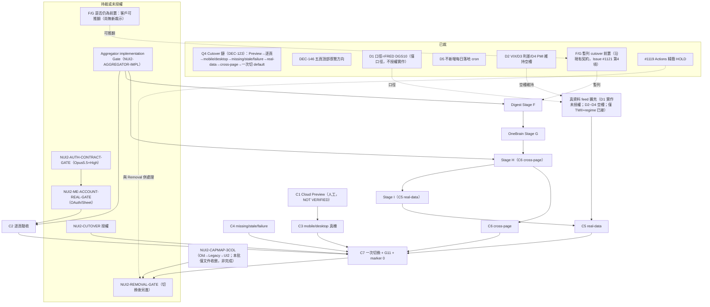

# New UI2 Cutover 缺口矩陣（C1～C7）與前置依賴圖

- **日期**：2026-11-10　**基準**：`origin/main` = `f4d86b4f9b45832cb784895342cecd5f9305c48b`（撰寫時 `git rev-parse origin/main`；cron 會推進 tip，引用前請重查）。
- **性質**：docs-only，**記錄現行規則與缺口**；**不新增、不改變任何前置規則**，不授權任何施工、切換、刪碼。
- **授權來源**：Issue #1121（https://github.com/linchen-20200325/my-stock-dashboard/issues/1121 ，使用者 2026-11-10 對 ChatGPT「四項建議」回覆「同意」之**轉錄**，repo 無原始逐字對話；**轉錄不是 QA PASS**）。
- **上下位**：`CLAUDE.md` > `PROCESS.md` > `PROJECT_RULES.md` > `docs/DECISIONS.md`（DEC-123、DEC-128、DEC-142、DEC-146、DEC-147）> `docs/vnext/NEWUI2_ACTIVE_PRESENTATION_CONTRACT_2026-11-03.md` > `docs/vnext/NEWUI2_MIGRATION_CUTOVER_CONTRACT_2026-11-02.md`（下稱 MC；頂部標 SUPERSEDED 的範圍除外，其餘仍有效）。MC 與 Active Contract 衝突時以 Active Contract／DEC-128 為準。
- **揭露（`CLAUDE.md` §-2 規則 6）**：本檔單組撰寫、**未經第二組獨立複驗**；證據欄的 `path:symbol` 為本機讀碼／grep（量測日 2026-11-10），「NOT FOUND」＝在本機 repo 內搜不到，**不等於不存在於 GitHub 其他分支、Streamlit Cloud 或對話**。未連網、未跑測試、未開 Cloud。

---

## 1. C1～C7 逐條矩陣

狀態字彙：**已滿足／部分／未滿足／無法判斷**。「誰能解」：工程＝專案 AI 依既有授權施工；客戶裁示＝須使用者 Decision Gate；真機人工＝需人在真機／Cloud 操作。

### 1.0 更正對照（現行有效版本 vs 過時措辭；原文一字不改）

| 過時措辭（出處） | 現行有效讀法 | 依據 |
|---|---|---|
| 「四頁逐頁驗收」「四頁」（MC §1 鏈、§1.1 C2，MC:19、MC:37） | 現行 New UI2 為**五頁**：📊 市場、🎯 標的、💼 持股、👤 我的、🗂 資料；頂部兩列導覽 | DEC-142（2026-11-06）、DEC-146（2026-11-07）；Active Contract 頂部 📌 註（`NEWUI2_ACTIVE_PRESENTATION_CONTRACT_2026-11-03.md` 第 3、5 行） |
| C2「L1／L2／L3」口徑（MC:37） | 人類可讀頁（四頁／現五頁）**無完整 L2／L3 expander**；完整診斷集中資料健康度三層（Level 1 摘要／2 來源日期 provenance／3 developer diagnostics） | DEC-128；MC 頂部 SUPERSEDED 註（MC:3）；Active Contract §5。⚠️ DEC-142 又規定「👤 我的內建完整資料健康度」舊布局不再是下一輪施工依據，完整來源健康度改集中 🗂 資料頁——**資料健康度的最終落點（我的 vs 資料）以 DEC-142／146 為較新，細節以 `NEWUI2_TOP_FIVE_APPROVED_VISUAL_AND_SAFETY_GATE_2026-11-07.md` 為準；本檔不裁決** |
| 「放不下依 Freeze §16.5 下沉」之頁內落點（MC:3 所指 S32） | 落點改為精簡卡／圖，或 backend Evidence／資料健康度（MIGRATE） | DEC-128 |
| 手機底部固定四格／抽屜 | 五頁頂部導覽、手機橫向捲動；不做臨時五頁 Drawer | DEC-134 → DEC-142 → DEC-146 |
| 「桌機左側 Navigation Rail＋Account Area」 | 頂部第一列 Active Sheet／帳號、第二列五頁 | DEC-142／DEC-146（細節在 Visual/Safety Gate 文件；工程是否全面完成見 C2／C3，本檔未逐項驗證） |
| 「正式主頁只能四頁」（Active Contract §2 原文） | 頁數上限已被取代；五頁為方向 | DEC-135、DEC-142、DEC-146 |
| Freeze §19「Stage J 六條件」「第 6 條不成立（critical 7 列，量測日 2026-11-02）」 | 條件本身不變；**該量測值已過期，現況未重量**（無三欄 Capability Map，見 C7／§2） | Freeze §19；`NUI2-CAPMAP-3COL` open |

### 1.1 矩陣

| # | 條件原文摘要（MC §1.1／§1.2／§7） | 現行有效版本 | 目前狀態 | 證據 | 阻塞依賴 | 誰能解 |
|---|---|---|---|---|---|---|
| **C1** | 獨立 Streamlit Cloud Preview 可開、正式網站 0 diff；Preview 與 production 讀相同 canonical services／contracts（客戶 Q1）；人工建 App／Secrets／OAuth 須發 🟡 Manual Action Gate | 同左；Preview 控制僅 `?ui2_dev=1` 開發面；cutover 前 FAKE 場景維度與 `ui2_feed` 維度須移除（`NUI2-PREVIEW-CONTROL-AXES`） | **部分** | 本機入口存在：`app_ui2.py`、`src/ui2/shell/app.py`（五頁頂部導覽＋`ui2_dev`／`ui2_feed`）。讀相同 canonical：`src/services/ui2/real_feed.py` 僅呼叫既有 L3（`market_twii_view_service.get_twii_trend_view`、`allocation_service.get_macro_regime`）。Cloud：HANDOFF 稱 #1107 Cloud 驗收 **PARTIAL**（`docs/HANDOFF.md` 2026-11-10 各追記）；`NUI2-PREVIEW-APP-MANUAL` 於 BACKLOG §5.1.19 #1 記為未發 Manual Action Gate（`docs/BACKLOG.md:1279` 起該表第 1 列）。Cloud 線上實況：**NOT VERIFIED** | Cloud App／Secrets／OAuth 網址須人工；Cloud 實況未驗；`NUI2-PREVIEW-CLOUD-STATE-FILES`（MC §10-⑤）未驗 | 真機人工（Cloud）＋工程 |
| **C2** | 每頁：線框一致、第一屏四問、Visual Fidelity、PR 驗收六問；**動作欄 `⬜ 尚未提供` 只允許 Preview 期**，C2 通過前 💼／📊 動作能力必須已改讀 System Action Aggregator（`NUI2-AGGREGATOR-IMPL`、M-A3） | 逐頁驗收對象由四頁改五頁（見 1.0）；L1／L2／L3 改讀 DEC-128；Aggregator 前置不變（MC §1.2、BACKLOG §5.1.19 #3） | **未滿足** | Aggregator **NOT FOUND**：`grep -rn "class .*Aggregat\|def .*aggregat" src shared` 無 System Action Aggregator 實作；僅 `src/services/ui2/vm_common.py:aggregator_pending_field`（輸出 `⬜ 尚未提供（待 System Action Aggregator）`）。BACKLOG #3 狀態「blocked-on-customer（implementation Gate）」（`docs/BACKLOG.md` §5.1.19 第 3 列）。逐批驗收清單幾乎全未勾（`docs/vnext/NEWUI2_AUDIT_ACCEPTANCE_CHECKLIST_2026-11-02.md` 各節 `[ ]`；`grep -c "\[ \]\|⬜"` 得 195 行，僅 1 行含 ✅／[x]） | `NUI2-AGGREGATOR-IMPL`（需客戶 implementation Gate，Opus 5.5＋High，BACKLOG #3）；🎯／💼／👤／🗂 真資料多數未接（見 C5）；Auth（`NUI2-AUTH-CONTRACT-GATE`）、Sheet（`NUI2-ME-ACCOUNT-REAL-GATE`） | 客戶裁示（implementation Gate）→ 工程 |
| **C3** | 390×844 與 1440×900 第一屏「不用滑」項目全部可見；放不下 → Decision Gate，⛔ 自行移出 | 同左；對象為五頁頂部兩列導覽新布局（DEC-146 要求真實 390×844／1440×900、Streamlit 1.56／1.59.2 測試、`p2_nav_margin_160`≥160px） | **部分** | 有 FAKE 量測腳本：`tests/ui2_viewport/measure_viewport.py`（MC §8）；瀏覽器測試檔 `tests/ui2_browser.py`、`tests/test_ui2_drawer_browser.py`；HANDOFF 稱順序 B 的 browser lane 41 passed（`docs/HANDOFF.md` 2026-11-10 #1109 補註）。但第一屏高度量測為 **FAKE 字串量測**（`NUI2-VIEWPORT-FAKE-ONLY`，MC §8）；真機 `NUI2-ACC-REAL-DEVICE`、iOS 安全區 `NUI2-NAV-SAFE-AREA`、Safari 皆 open（BACKLOG:1327、:1357）。正式 `NUI2-ACC-MOBILE`／`NUI2-ACC-DESKTOP` 驗收簽核 **NOT FOUND**（checklist §3 未勾） | 真資料換入後重量；真機；`NUI2-ACC-REAL-DEVICE` 依賴 Cloud Preview | 真機人工＋工程 |
| **C4** | 四態字樣與色正確；missing≠0／HOLD／neutral；unavailable≠safe；部分失敗真錯誤外露；冷啟動灰色 | 同左；Data State 五態與 Capability 兩軸分離（DEC-130 (a)） | **部分** | Real-data shadow 僅對 2 個事實（台股加權指數、市場位階）證明 loaded／missing／stale／unavailable／partial（MC §10 第一點；`src/services/ui2/real_canonical.py`、`tests/test_ui2_real_feed.py`）；其餘欄位為 capability `⬜ 尚未提供`。`NUI2-ACC-MISSING-STALE-FAILURE` 正式驗收簽核 **NOT FOUND**（checklist §4、§9 未勾） | 其餘事實未接線；無獨立驗收簽核 | 工程＋獨立 QA |
| **C5** | 真資料（非夾具）全頁通過；Cold Start、Partial、Stale、API Failure、AI Failure 下仍安全顯示 deterministic output | 同左；對象為五頁 | **未滿足** | MC §10：A3 是 shadow acceptance，**⛔ 不是 C5 通過**。`BACKLOG NUI2-REALFEED-ACCEPTANCE-OPEN`（`docs/BACKLOG.md:1499`）自記 Real-data acceptance 未通過。HANDOFF 2026-11-10 session-end 第 4 列(c)：真實接線僅 TWII＋regime；VIX／US10Y／DXY／利差／PMI／OneBrain／持股／我的 未提供。Issue #1110 研究：UI2 真 feed 不使用任何 Secret（`docs/vnext/ISSUE1110_DATA_AVAILABILITY_MATRIX_2026-11-10.md`） | 見 §3 D1～D5（資料口徑／空槽決定）；`NUI2-PORT-*`；AI Failure 情境需 OneBrain（Stage G）；真機＋Cloud | 客戶裁示（資料）→ 工程；真機人工 |
| **C6** | 同一 market context；Risk Cap blocked／無法判定時任何頁 ⛔ unrestricted Add；術語統一；Aggregator 完成並經 M-A4 後市場 ⚡ 與持股今日需處理**必須同源**（W-10 transitional 不得延續到 cutover） | 同左；`NUI2-ACC-CROSS-PAGE`＝`FUI-STAGE-H`，BACKLOG 記依賴 Stage G（`docs/BACKLOG.md:1203`） | **未滿足** | Aggregator 未實作（見 C2）→ 同源無從達成；`FUI-STAGE-H` 狀態「open（未開始）」（`docs/BACKLOG.md:1203`）；checklist §10 未勾 | `NUI2-AGGREGATOR-IMPL`；Stage G（依 BACKLOG 順序）；多頁真資料 | 客戶裁示＋工程 |
| **C7** | C1～C6 皆有 PR／報告證據＋獨立 QA；一次 PR 切換 `app.py` 預設；切換前 G11 路由毒化測試綠；前置含 `NUI2-AGGREGATOR-IMPL`＋M-A3＋M-A4；production 預設 VM 0 個 capability marker（MC §7） | 同左；rollback：`?ui=1`（Legacy New UI）、`?legacy=1`（Old UI）、一行切回（MC §2）；Cutover≠Removal | **未滿足** | `app.py` 目前無 UI2 路由（`grep -n "ui2" app.py` 無 UI2 入口；僅 NAV-1 的 `?legacy=1` 邏輯，`app.py:82-110`）；`grep -n "ui=\|'ui'" app.py` **NOT FOUND**（MC §2 的 `?ui=1` 機制尚未建，屬 cutover 批工作）。G11 毒化測試 **NOT FOUND**：`tests/test_nav1_app_routing.py` 僅毒化 `shared/ia_nav4.py`（舊 NAV-1 證明 legacy 仍載入），無毒化 UI2 套件測試。capability marker runtime 0 斷言 **NOT FOUND**：現僅原始碼允許清單 `tests/test_ui2_guards.py:CAPABILITY_MARKER_ALLOWLIST`（`NUI2-CAPABILITY-MARKER-CUTOVER-ZERO` open，`docs/BACKLOG.md:1340`）。`NUI2-CUTOVER` 狀態 open（`docs/BACKLOG.md:1294`） | C1～C6 皆未滿足；cutover 批本身尚無授權 | 客戶裁示（切換）＋工程 |

### 1.2 §1.2 前置清單補充（非 C 條，但 MC 列為 cutover 前置或讀法待定）

| 項目 | MC 現行讀法 | 狀態 | 證據／備註 |
|---|---|---|---|
| Aggregator（#3） | 是前置（M2） | 未實作 | 見 C2 |
| Digest Stage F（#6，`FUI-STAGE-F`） | AI 總管讀法：是前置；客戶可推翻；欲提前 cutover 須另送客戶裁示（MC §1.2） | BACKLOG 記「open（未開始）」（`docs/BACKLOG.md:1201`）；但本機已有 `src/services/decision_digest_builder.py`、`decision_digest_summary.py` 與 `tests/test_decision_digest_*.py`。**兩者關係（是否已是 Stage F 所指的 `decision_digest.v2` Headless 實作）無法判斷**，不補推 | Issue #1121 第 4 項：**沿現有契約暫列 cutover 前置，未經新裁示不改** |
| OneBrain Stage G（#7，`FUI-STAGE-G`） | 同上；依賴 Stage F 合格 | 未開始（`docs/BACKLOG.md:1202`）；OneBrain runtime 不得動（Issue #1121） | F→G→H→I 順序見 BACKLOG:1201-1204 |
| 非前置：#4 Risk Cap Numeric、#5 比例 Action、#8 LINE／UI 收斂 | 否（MC §1.2） | 皆 open | 不因本檔改變 |

---

## 2. 前置依賴圖

> 圖中「客戶已裁」只指文件可查的裁示；「待裁」指文件記載尚未取得裁示。**本圖不新增依賴**，僅整理 MC §1／§1.2、BACKLOG §5.1.19、Issue #1121、HANDOFF。

依賴出處：Aggregator→Digest（BACKLOG §5.1.19 #6「Aggregator 契約（M-A5）」）；F→G→H→I（`docs/BACKLOG.md:1201-1204`）；C7 前置含 Aggregator（MC §1.1 C7）；Removal 在切換後另進（MC §4；Freeze §19）；#1119 HOLD（`docs/HANDOFF.md` 2026-11-10 更正）。圖中 `SH --> C6`、`SI --> C5` 為把 BACKLOG 別名（C6＝`FUI-STAGE-H`、C5＝`FUI-STAGE-I`）畫成邊，不是新規則。

---

## 3. D1～D5 記錄表

> **轉錄自 Issue #1121 第 1 項，非逐字、不是 QA PASS。** 「Issue #1121 轉錄」為使用者 2026-11-10 對 ChatGPT 的口頭同意；原始逐字對話不在 repo。D1 另有 HANDOFF 紀錄為「AI 建議」，Issue 轉錄為「同意」。

| 項 | 議題 | 轉錄裁示 | 邊界（不授權什麼） | 對 cutover 的影響 |
|---|---|---|---|---|
| D1 | US10Y 口徑 | 選官方 FRED `DGS10`；應標示 `source`、`as_of` 與 missing／stale 狀態 | **僅資料口徑決定**；不授權新增來源、fetcher、adapter、排程或正式 UI 接線 | US10Y 在 UI2 仍為空槽，C5 仍未滿足；接線須另行授權 |
| D2 | VIX | 保持空槽；先完成「已收盤日」的 PIT Gate | 不接線 | 同上 |
| D3 | 利差 | 保持空槽；定義與來源暫不選 | 不選定義、不新取數 | 同上 |
| D4 | 台灣 PMI | 保持空槽；不將 proxy 當正式訊號 | 不將 proxy／`UNDETERMINED` 升格 | 同上 |
| D5 | 新增每日落地 cron | **不核准** | 不新增 cron／workflow | 資料更新維持現有排程；與 #1119 HOLD 獨立 |

另：D6（舊診斷頁資安最小修補）已由 Issue #1113／PR #1114 處理並合併（`docs/HANDOFF.md` 2026-11-10），不在 D1～D5 範圍；殘留資安項仍待客戶授權（同處）。EPS 預估大盤：Issue #1121 第 3 項僅准唯讀研究，**不在本檔範圍**，不得宣稱任何估值或指數預測可計算。

---

## 4. 文件過期／矛盾清單（僅建議；本檔不修改任何一項）

| # | 位置 | 現況 | 為何過期／矛盾 | 建議處置（僅建議） |
|---|---|---|---|---|
| 1 | `docs/HANDOFF.md:4`（2026-11-09 快照「main `f4d6e6a4…`」「Open PR 0」） | 檔內自標「歷史快照，非即時 SSOT」 | 已被取代：撰寫時 main 為 `f4d86b4f`；同檔後續追記亦已有多個 main SHA（如 session-end 快照寫 `48d7c28f`，同樣已落後） | 保留；新對話一律重做 GitHub Gate；後續追加新快照而非改舊行 |
| 2 | `docs/vnext/NEWUI2_MIGRATION_CUTOVER_CONTRACT_2026-11-02.md:19, 37`（MC §1 鏈與 C2「四頁」；全檔多處） | MC:3 的 SUPERSEDED 註只覆蓋 L1／L2／L3 與「下沉」，**未涵蓋「四頁→五頁」** | DEC-142／146 已改五頁；讀者只看 MC §1 會以為驗收對象是四頁 | 在 MC 頂部 SUPERSEDED 註以追加方式補「頁數見 DEC-142／146」；原文不改 |
| 3 | `docs/PROJECT_STATE.md:1163`（「下一個唯一安全動作見 HANDOFF 最末 Safe Handoff（#1034 治理段落抽取）」）、`:1127`（#1034 仍 open、抽取「尚未做」） | 指向 #1034 | HANDOFF 最末現為 2026-11-10「無已授權施工、等客戶指示」，#1034 不再是唯一下一動作；#1034 目前 open／closed 狀態本機無法判斷（NOT VERIFIED） | 追加更正行指向 HANDOFF 最新接手點；#1034 實況待 GitHub 查驗 |
| 4 | `docs/BACKLOG.md:2158`（`ETF-MGR-DATA-PR-1` 更新，客戶待辦 (a)「由 repo admin 確認『Allow GitHub Actions to create and approve pull requests』已勾選」） | 仍列為客戶待辦 | HANDOFF 2026-11-10 更正已取代：擁有者自述該設定已勾選（截圖不在 repo，非獨立驗證）；(b)(c) 仍 NOT VERIFIED | 追加更正行；(b)(c) 保持 NOT VERIFIED |
| 5 | `docs/vnext/NEWUI2_AUDIT_ACCEPTANCE_CHECKLIST_2026-11-02.md:119-134`（§11 Cutover／Rollback、§12 Removal Gate） | 全部 `[ ]` 未勾，標題與措辭仍為 Q4 九步／舊口徑 | 與現況一致為「未達成」，但 §11 的「Cutover 鏈九步」未反映五頁；勾選者欄位無人更新 | 不由實作組自勾；追加註記「對象改五頁」並待獨立 QA 勾選 |
| 6 | `docs/vnext/NEWUI2_ACTIVE_PRESENTATION_CONTRACT_2026-11-03.md` §2「不得新增第五頁」「正式主頁只有四個」、§2.5 左 rail／Account Area | 頂部已有 DEC-146 註，但正文仍為四頁條文 | 僅「頁數上限／導覽呈現」被取代，其餘仍有效；讀者易誤讀正文 | 已有頂部 📌 註；可再追加一行對照到 §2／§2.5 |
| 7 | `docs/vnext/FINAL_UI_CONTRACT_FREEZE_2026-11-02.md` §19「現況：第 6 條不成立（critical 7 列；量測日 2026-11-02）」 | 量測值過期 | 之後 UI2 多批落地，未重量；且無三欄 Capability Map（`NUI2-CAPMAP-3COL` open，`docs/BACKLOG.md:1270`） | 以三欄 Capability Map 重量後再更新 |
| 8 | `docs/BACKLOG.md:1201-1202`（`FUI-STAGE-F`「open（未開始）」）vs 本機 `src/services/decision_digest_builder.py`、`tests/test_decision_digest_*.py` | 狀態與程式碼存在並列 | 無法判斷這些是舊版 Digest 還是 Stage F 目標；不得據此宣稱 F 已完成或未開始 | 由獨立組比對 `decision_digest.v2` 契約與現有 builder 後再更新 |
| 9 | `docs/HANDOFF.md` 2026-11-10 session-end 快照第 1 列「Open PR 0」 | 已有同檔「更正之二」 | 撰寫當時不含自己的 PR；已更正 | 無需動作，僅註記為已知 |

---

## 5. 結論

### 5.1 目前可否提 cutover？

**否，目前不可提 cutover。** 理由（皆為上表證據，非推論）：

1. C2、C5、C6、C7 為「未滿足」；C1、C3、C4 為「部分」；**無任何一條為「已滿足」**。
2. System Action Aggregator 未實作（NOT FOUND），而 MC §1.2 / §1.1 C7 把它列為 cutover 前置，且 `⬜ 尚未提供` 只允許 Preview 期。其 implementation Gate 為 blocked-on-customer，**目前沒有授權**。
3. 真資料僅接 TWII＋市場位階；D1 僅定口徑未授權實作，D2～D4 維持空槽，D5 不新增 cron——C5 在現行授權下無從達成。
4. `app.py` 無 UI2 路由、無 `?ui=1` rollback 機制、無 G11 UI2 毒化測試、無 production VM「0 capability marker」runtime 斷言。
5. Digest Stage F／OneBrain Stage G 依 Issue #1121 第 4 項「暫列 cutover 前置」，未經新裁示不改；兩者皆未完成（F 的程式碼/狀態關係見 §4-8，無法判斷）。
6. `NUI2-CAPMAP-3COL` 未完成，Removal 條件亦不具備（但 Removal 在切換後另進，非 cutover 前置）。

> 本結論是依現行規則與本機證據對「缺口」的記錄，**不是**提出或否決任何新規則，亦不是客戶裁示。

### 5.2 NOT VERIFIED 清單（不得因本檔轉為 PASS）

- **Streamlit Cloud 上的 New UI2**（含 #1107、#1108 順序 B 線上實況）：NOT VERIFIED；#1107 為 PARTIAL。
- **手機／桌機真機**（iOS Safari、安全區、螢幕閱讀器、Light theme）：NOT VERIFIED。
- **ETF Managers 真實 Actions 發布 PR**（`auto/data-etf-managers`，下次排程 2026-11-16 20:00 UTC）：NOT VERIFIED；GITHUB_TOKEN 建立之 PR 是否觸發 `ui2-browser-gate` 亦未驗；「Allow GitHub Actions to create and approve pull requests」僅為擁有者自述。
- Cloud 上 Secrets 載入、API 認證、資料日：NOT VERIFIED。
- Issue #1121 為使用者裁示之轉錄，**不是 QA PASS**；本檔未經獨立 QA。
- `?ui=1`、OAuth 回呼落地（MC §5 自陳未實機驗）：NOT VERIFIED。
- #1034 目前開關狀態、Digest Stage F 程式與 BACKLOG 狀態之關係：無法判斷。
- EPS 預估大盤、任何估值／指數預測：未研究於本檔，不得宣稱可計算。

### 5.3 本檔未做的事

未改任何程式、測試、資料、workflow、Secrets 或既有文件；未更新 `docs/DECISIONS.md`／`docs/BACKLOG.md`／`docs/HANDOFF.md`（Issue #1121 要求之同步由後續步驟處理）；未建立三欄 Capability Map 本體（僅記錄其缺口）。
