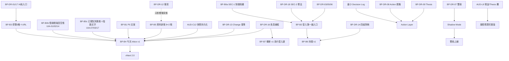

# vNext Product Blueprint：投資決策 OS／Investment Inbox

> **用途**：承載新 UI 的**最終產品方向**。`docs/DECISIONS.md` DEC-056 第 4 點指定由 Blueprint 負責這件事，對應 `docs/BACKLOG.md` **VN-00**。客戶 2026-10-17 指派本批建立這份「可長期維護的 vNext Product Blueprint」。
>
> **位階**：
> - 本檔**不凌駕** `CLAUDE.md`、`PROCESS.md`、`PROJECT_RULES.md`、`docs/DECISIONS.md`。牴觸時以上位文件為準，並登記到 `docs/BACKLOG.md`。
> - 本檔**不是實作授權**（DEC-056 第 2 點、DEC-015、DEC-002）。登記不構成動工授權（`CLAUDE.md` §-1）。
> - 本檔所有線框都是**文字線框草稿**，供客戶拍板（DEC-003 草稿先行、`PROJECT_RULES.md` 第 4 節第 7 項）。**客戶拍板前不得撰寫對應的 UI code。**
> - 涉及公式、門檻、Action transition rule、Position Sizing、Confidence 計算、新資料來源、API／MCP、production switch、舊 UI 刪除、branch 刪除的地方，一律標 **Decision Required**，並寫出對應的 DEC-056 Gate 代號（G1～G11，定義見 `docs/BACKLOG.md` 第 5 節）。本檔**不定任何正式規則**。
>
> **量測基準**：main＝`2647a0fd`（#866，最後一個非 cron 的功能／治理 commit）；本檔分支以 PR #867 head `c9b3be6e`（DEC-056、VN-00～VN-36）為基礎。量測日 2026-10-17。行號會漂移，本檔一律寫 `檔案::符號`，不寫行號（`CLAUDE.md` §8.2.A.0 規則 1）。
>
> **Provenance 揭露**（`CLAUDE.md` §-2 規則 6）：
> - 本檔由單一撰寫組依四組調查結果撰寫：G 治理盤點、C 新 UI 程式碼盤點、O OAuth 盤點、U 實機 UI 稽核。各組的全稱句都是單組結論。
> - 本檔交付前另派兩組獨立 review（UX／Mobile、投資系統／資料語意），結論與修正紀錄見第 29 節。
> - 標〔單組〕者是未經第二組驗證的宣稱，**只能當待驗事項**，不得作為後續動作的前提。
>
> **配套文件**：`docs/vnext/UI_AUDIT_2026-10-17.md`（實機 UI Audit：UIA-01～UIA-27＋工程術語盤點）。

---

## 0. 怎麼讀本檔

### 0.1 ID 規則（本檔暫用 ID；正式登記以 `docs/BACKLOG.md` 為準）

| 前綴 | 意思 | 正式落點 |
|---|---|---|
| `VN-*` | DEC-056 的方向項（PR #867 登記） | `docs/BACKLOG.md` 第 5 節。本檔只引用，不改。 |
| `BP-DR-*` | 本藍圖整理的 Decision Required（第 23 節） | 交付時同步登記於 BACKLOG（ID 照用，永不重用） |
| `BP-RC-*` | 本藍圖整理的 Research Candidate（第 24 節） | 同上 |
| `BP-B*` | 建議施工批（第 26 節）。**只是建議**，DEC-015 禁止預先決定 Batch 1 | 客戶指派後才成為工作項 |
| `UIA-*` | 實機 UI Audit 發現（配套文件） | BACKLOG 登記 |

### 0.2 用語（避免撞名）

- **雙軌選股**：Track A 成長／動能、Track B 價值／錯殺（VN-05）。這個「雙軌」**不是**指 handoff 分支 `S2-PRD.md` §2.2 的「新舊 UI 雙軌並行」。
- **Decision**：系統依正式規則對某件事的結論。Action 是其中一種（DEC-054 七種方向）。
- **Attention**：需要使用者注意的事件，分 P0～P3 語意層級（第 12 節）。層級的**觸發門檻**屬 Decision Required。
- **有效（valid）**：通過 freshness policy（DEC-029、`shared/freshness_policy.py`），而且規則版本相符的結論或快照。
- **示意**：線框裡的股名、數字、Action 全部是**示意，非真實判斷**。

---

## 1. Product North Star（第四十八節第 1 項）

**一句話**（客戶原文）：「每天替使用者過濾市場噪音，只把真正需要做決定的事情送到面前；每個結論都可以一路追溯到正式規則與客觀資料。」

**北極星行為指標（方向，不是 KPI 公式）**：
1. 打開 App 約 **3 秒**內知道「今天要不要處理事情、下一步在哪」。來源：客戶 MSG 1 §26「Mobile 約 3 秒知道現在該做什麼」，轉錄於 `docs/BACKLOG.md` `CV1-RC-07`。
2. 沒事的日子，系統**敢說沒事**（第 8.3 節安靜模式，VN-35）。
3. 任何一個結論都能點到「為什麼」，一路往下追到事實、規則、資料來源與 as-of（VN-16、VN-17）。

**MSG 1 §26 的演進鏈**（`CV1-RC-07` 摘錄，本藍圖的骨架）：
可靠資料 → 最小有效雙軌選股核心 → Context 提升判斷（而不是讓系統癱瘓）→ 技術面找位置 → Portfolio 控制曝險 → Structured Thesis 持續驗證 → 清楚 Action → AI 白話解釋 → Mobile 約 3 秒知道現在該做什麼 → LINE 只提醒真正重要事件 → Decision History 驗證系統是否創造價值。

**反北極星**（MSG 1 §26 原文）：「不要把專案做成：更多資料＋更多指標＋更多卡片＋更多 Gate＋更多 AI 文字」。

---

## 2. UX Principles（第 2 項）

| # | 原則 | 具體意思 | 來源 |
|---|---|---|---|
| U1 | **Decision first** | 每頁首屏先給結論，依序往下是 Attention、Risk、Evidence、Raw data | 客戶本批第一節 |
| U2 | **Mobile：現在怎麼做 → 為什麼 → 下一步** | 手機首屏只放這三件事；其餘收合 | 客戶本批第一節 |
| U3 | **Change over State** | 優先顯示「和上一次有效 Decision 相比改變了什麼」；沒變就明說沒變 | 客戶第五節 |
| U4 | **不製造訊號** | 沒有需要處理的事，就不為了填版面產生 Action 或 Attention | 客戶第四、四十五節；VN-35 |
| U5 | **missing ≠ 0、unavailable ≠ neutral、not evaluated ≠ safe** | 缺資料不得畫成綠燈、中性或已通過 | DEC-026、DEC-040、DEC-041；`PROJECT_RULES.md` D5～D7 |
| U6 | **顏色不是唯一載體** | 每個狀態都要有圖示＋文字；灰＝未載入，紅＝真出錯 | DEC-040、DEC-051；`CLAUDE.md` §1.A 第 4 點 |
| U7 | **使用者語言** | 一般畫面不出現 L1/L2/L3、canonical、session、key、schema、函式名；工程資訊收到「技術資訊」層 | 客戶第三節；VN-03 |
| U8 | **Compact by default** | 正常狀態只給一行摘要，點開才看 Evidence；只有異常、缺資料、需要行動時才顯示「怎麼處理」 | 客戶第七節 |
| U9 | **一頁一個主行動，放在首屏** | 指路句不寫方位詞（「上方」「下方」），改用直接可按的按鈕或錨點 | UIA-03、UIA-04 |
| U10 | **No fake precision** | 不顯示「87.3%」這類 AI 信心度或總分；可信度用高／中／低＋拆解 | DEC-040；客戶第二十六、三十六節 |
| U11 | **Desktop ≠ 放大的 Mobile，Mobile ≠ 縮小的 Desktop** | 兩種密度分開設計（VN-36） | 客戶第六節 |
| U12 | **Evidence 分層標示** | 事實、規則判定、系統結論、AI 解釋四種內容分開標示 | 客戶第二十七節；DEC-027 |
| U13 | **沒有 dead end** | 每個「無法判定」都要回答：為什麼、影響哪個 Decision、哪些功能仍可用、使用者能不能修 | 客戶第八節；UIA-11、UIA-24 |
| U14 | **現金是資產** | UI 不得暗示「沒買股票＝錯失機會」 | 客戶第二十節 |

---

## 3. Data／Rule／Decision／AI 責任邊界（第 3 項）

```
 ┌───────────────┐   ┌────────────────┐   ┌──────────────────┐   ┌────────────────┐
 │ ① Data 資料層 │──▶│ ② Rule 規則層  │──▶│ ③ Decision 決策層│──▶│ ④ AI 解釋層    │
 │ 取得/驗證/標準化│   │ 正式公式與門檻 │   │ 套規則產生結論   │   │ 白話解釋已有結論│
 │ 缺值狀態/as-of │   │ 有版本號       │   │ Action/Attention │   │ 不產生新結論   │
 └───────────────┘   └────────────────┘   └──────────────────┘   └────────────────┘
        ▲                    ▲                     ▲                      │
        └──── AI 不得寫回 ───┴───── AI 不得改 ─────┴──── AI 不得改 ───────┘
```

| 層 | 可以做 | 不可以做 | 現行對應（`檔案::符號`） | 依據 |
|---|---|---|---|---|
| ① Data | 取得、驗證、標準化；標缺值原因、as-of、freshness、provenance；多源依既有優先序取值 | 填 0、自估值、沉默 ffill；跨幣別平均；官方只缺外資時拼 FinMind；把 cache 存活當新鮮 | `src/data/**`；`shared/freshness_policy.py::FreshnessStatus`；`shared/macro_buckets.py::MISSING_*`；`shared/station_specs.py::MISS_*` | DEC-026、DEC-028、DEC-029、DEC-033、DEC-035；`CLAUDE.md` §1、§2 |
| ② Rule | 用正式公式與門檻判定；帶規則版本號 | 未經客戶裁示新增或修改公式、門檻、權重；把 Context 升成 Core 或 hard veto | `shared/*_thresholds.py`；`shared/risk_cap_policy.py::RISK_CAP_RULESET_VERSION`；`src/compute/screener/fundamental_prescreen.py::PRESCREEN_VERSION` | DEC-009、DEC-008；`PROJECT_RULES.md` 第 4 節 1～2 項 |
| ③ Decision | 把規則結果組成 Action／Attention／候選清單；套 Risk Cap；資料不足時給「無法判定」 | 繞過 Risk Cap；資料不足仍硬給方向；沒有正式 sizing 規則卻給比例 | `src/compute/etf/dividend_station.py::suggest_action`；`src/services/risk_cap_apply.py::compute_and_lock_risk_cap`；`src/services/fundamental_screener_service.py::get_ranked_picks` | DEC-054、DEC-048、DEC-053；S1-6 STEP 2-b |
| ④ AI | 讀已驗證資料與已產生的 Decision，白話解釋；回答「這張卡在說什麼」 | 生成客觀資料、猜缺值、自成 primary source、把推論寫回資料、改公式或規則、自己產生正式 Action 或目標價 | `src/services/app_ai_service.py::gemini_call`；`src/services/ai_qa_service.py::run_agent`；`shared/compliance_copy.py::AI_QA_DISCLOSURE` | DEC-027、DEC-054 第 6 點、DEC-055；`PROJECT_RULES.md` D3、D4 |

**跨層硬規則**：
- 強 Action（例如「全部退出」）不得只靠生成式 AI（DEC-054；S1-6 STEP 2-b 第 6 條）。
- AI 輸出一律同屏附免責三件套（S1-6 §3.1、§3.2）。
- Shadow 結果不得影響 ③ 的正式 Decision（第 19 節）。
- `src/config/persona.py::TAIWAN_ADVISOR_PERSONA` 的「請給出明確的動作」與 ④ 的邊界衝突，已登記 `CV1-FU-06`。施工 Action Layer 前要先處理。

---

## 4. Information Architecture（第 4 項）

### 4.1 現行（Current）

- **舊 UI**（凍結，DEC-019）：7 個頂層頁籤（🌍 市場環境／🔬 選股／🏦 ETF／🔧 工具箱／💼 我的持股戰情室／📁 組合管理／🧬 AI 問答）。
- **新 UI（IA v2，DEC-017）**：5 頁（`shared/ia_nav.py::PAGE_LABELS`：🚦 今天／🔍 找標的／🔬 查一檔／💼 我的持股／📖 憑什麼）。入口在側欄 radio（`app.py::_IA_NAV_CHOICE`，DEC-018），預設是「不使用」，而且側欄預設收合（`app.py` 的 `set_page_config(initial_sidebar_state='collapsed')`）。選了哪一頁不寫進 URL，重新整理就回到舊 UI〔C 組，單組〕。

### 4.2 目標（Target，草稿，待 BP-DR-01 拍板）

以「**使用者要做的決定**」切頁，而不是以「資料種類」切頁：

| 目標頁 | 使用者問題 | 吸收現行哪些內容 | VN |
|---|---|---|---|
| 🏠 **今天** | 今天有沒有事要處理？ | 今天頁的結論＋持股重要變化＋新候選＋Risk Cap＋資料健康摘要 | VN-02、VN-19、VN-35 |
| 🔎 **機會** | 哪些標的值得研究？為什麼？ | 找標的（選股網、板塊地圖）＋觀察名單／接近機會 | VN-05、VN-07、VN-08 |
| 💼 **持股** | 我的錢配置得對不對？ | 我的持股（戰情室、組合設定）＋Risk Cap 風險預算 | VN-11、VN-12、VN-24 |
| 🔔 **動態** | 最近發生了什麼和我有關的事？ | Attention 收件匣＋事件傳導（不是新聞牆）＋週報 | VN-19、VN-21、VN-34 |
| ⚙️ **我的** | 帳號、Sheet、設定、資料健康 | Google 登入／Sheet、個人設定、資料體檢（使用者版）、教學 | VN-01、VN-04 |

**頁面以外的共用層**：
- **個股頁（🔬）**：不是主導航項目，而是從任何地方點一檔股票進入的「詳情頁」。現行「查一檔」改成：搜尋框放在「機會」頁頂端，加上全域搜尋圖示。
- **為什麼（Why／Evidence）**：不是主導航項目，而是每個 Decision 上的「為什麼？」入口（drawer 或子頁），見第 14 節。現行「📖 憑什麼」的三個葉分流如下：教學 → 我的 › 說明；資料體檢 → 我的 › 資料健康；AI 問答 → 每個 Evidence drawer 底部的「問 AI 解釋這張卡」，外加我的 › AI 問答。

> ⚠️ 這是對 DEC-017 已核准 IA 的**動線變更**，屬 DEC-003 ①、DEC-009「重大 UI flow」。本節只是草稿，見 **BP-DR-01**。DEC-013 規定已裁示事項不重問，所以 BP-DR-01 問的是「是否以新 IA **取代**」，不是重問 DEC-017 本身。

---

## 5. Mobile navigation（第 5 項）

```
390px ─────────────────────────────────────────
│ 台股戰情室                        🔍   👤     │  ← 站名縮小（UIA-21）；🔍 全域搜股；👤 登入狀態
│─────────────────────────────────────────────│
│                                             │
│              （頁面內容）                    │
│                                             │
│─────────────────────────────────────────────│
│  🏠      🔎      💼      🔔(2)     ⚙️       │  ← 底部固定 tab bar
│ 今天    機會    持股    動態      我的       │     圖示＋文字（不只靠圖示）
───────────────────────────────────────────────
```

- 底部 5 格，每格圖示＋文字。🔔 的數字只算 **P0＋P1** 未讀（第 12 節）；P2／P3 不出紅點，避免製造焦慮（U4）。
- 目前頁要寫進 URL query，重新整理或斷線重連都回到同一頁（解 UIA-05、`AUD-M1`）。
- 個股頁與 Evidence 用「推入式子頁」，左上有「← 返回」。不另開新導覽。
- 側欄**不再**是新 UI 的主要入口（UIA-05）。
- **技術限制**（待施工批驗證）：Streamlit 沒有原生 bottom tab bar。可行做法包括頂部 segmented control、`st.navigation`、自訂 CSS 固定列，各有限制。選哪一種屬內部技術決定，但**最後的視覺**仍要依本草稿給客戶拍板。〔單組判讀〕
- ⛔ 2026-09-07 曾把五頁掛成頂層頁籤（7→12 個），手機擠爆後撤回（DEC-018）。新導覽**取代**舊頁籤列才能成立；新舊並存期間的入口設計見 BP-DR-17。

---

## 6. Desktop navigation（第 6 項）

```
1440px ──────────────────────────────────────────────────────────────────────────
│ 台股戰情室   🏠今天  🔎機會  💼持股  🔔動態(2)  ⚙️我的        [🔍 搜尋代號]  👤 │
│─────────────────────────────────────────────────────────────────────────────────│
│  主欄（8）                                     │  右欄（4）：Context／Evidence   │
│  Decision → Attention → Risk                   │  · 選中卡片的「為什麼」drawer  │
│                                                │  · Risk Cap 風險預算           │
│                                                │  · 資料健康摘要                │
─────────────────────────────────────────────────────────────────────────────────
```

- 頂部水平導覽，項目與 Mobile 相同（心智模型一致），但多一欄右側 Context。
- 研究密度較高：機會頁可以直接顯示比較表；個股頁可以左右並排「支持證據／反方證據」。
- 8:4 加右抽屜的版面和 handoff 分支「UI 目標架構（V3）」的 8:4 grid 構想相近。V3 的效力未調和，見 **BP-DR-02**。本節**沒有**採用 V3 的任何排除條款，也**沒有**推翻它們。

---

## 7. Google 登入／Sheet onboarding（第 7 項）

### 7.1 原則

1. **重用、不重造**。直接沿用既有元件：
   - `infra/oauth.py`：`build_authorize_url`、`exchange_code_for_tokens`、`ensure_fresh_tokens`；
   - `src/data/portfolio/oauth_state.py`：`handle_oauth_callback`、`get_oauth_cfg`、`login_state_with_sheet`（`EX-OAUTH-1`）；
   - `src/data/portfolio/gsheet_portfolio.py`：`list_user_sheets`、`list_user_folders`、`create_new_sheet`；
   - `src/ui/tabs/portfolio_binder.py`：`render_login_cta`、`render_drive_picker`、`render_paste_id_binder`、`render_holdings_binder`、`apply_active_sheet`。
2. **不需要新 scope**：現行 `infra/oauth.py::GOOGLE_OAUTH_SCOPES` 已含 `drive.metadata.readonly`，`list_user_sheets` 能列出使用者的 Sheet；`drive.file` 能建新 Sheet〔O 組讀碼，單組〕。
3. **匿名可用**：Google 登入**不是**觀看公開市場資料的硬 Gate。只有個人持股、個人 Sheet、個人設定才要求登入。
4. **登入入口是第一級入口**：未登入時放在今天頁首屏與「我的」頁頂端，**不再**藏在收合的側欄（UIA-05、UIA-10）。
5. ⚠️ `portfolio_binder.py` 位於 `src/ui/tabs/`，是舊 UI 也在用的元件。新 UI **以 import 方式重用、不改它**，就不違反 DEC-019 舊 UI 凍結。若重用時發現必須修改它，要先依 DEC-019 判定它是否屬舊 UI 檔案〔單組判讀〕。

### 7.2 未登入（Mobile 首屏，今天頁頂端）

```
390px ─────────────────────────────────────────
│ 台股戰情室                        🔍   👤     │
│─────────────────────────────────────────────│
│ ┌─────────────────────────────────────────┐ │
│ │ 👤 還沒連接 Google                       │ │
│ │ 登入後可以：                             │ │
│ │  · 選擇自己的 Google Sheet               │ │
│ │  · 載入持股、看持股提醒                  │ │
│ │  · 儲存個人設定                          │ │
│ │                                         │ │
│ │ [ 使用 Google 登入 ]      稍後設定 ›     │ │
│ └─────────────────────────────────────────┘ │
│                                             │
│ 市場與機會不用登入也能看 ↓                   │
│ （今天的市場摘要卡…）                        │
```

- 按「稍後設定」後，這張卡收成一行：「👤 未連接 Google · 登入看持股 ›」。這個狀態只存在 session，不新增持久化（持久化見 BP-DR-04）。
- 部署端沒設 `[google_oauth]` 時，不顯示登入鈕，改成灰色說明：「這個部署沒有開啟 Google 登入，持股功能暫時無法使用；市場與機會功能不受影響。」不寫 `secrets.toml` 之類的工程字（UIA-10 第 3 步）。

### 7.3 登入後

```
│ ┌─────────────────────────────────────────┐ │
│ │ ✓ Google 已連接  ·  a***@gmail.com       │ │  ← email 遮罩
│ │                                         │ │
│ │ 投資資料                                 │ │
│ │ 目前使用：〈我的持股 2026〉   [更換]     │ │  ← 只顯示 Sheet 名稱，不顯示識別碼（DEC-021）
│ │                                         │ │
│ │ [ 開始今日戰情 ]                         │ │
│ └─────────────────────────────────────────┘ │
```

**還沒選 Sheet 時**：

```
│ │ 投資資料                                 │ │
│ │ [ 選擇 Google Sheet ▾ ]                  │ │  ← render_drive_picker（Drive 列檔）
│ │  或 貼上 Sheet 網址                       │ │  ← render_paste_id_binder
│ │  或 建立新的持股 Sheet                    │ │  ← create_new_sheet（DEC-021「建新 Sheet」）
```

### 7.4 流程圖

```
開 App ─▶ 已登入? ─否─▶ 顯示登入卡（可「稍後設定」）─▶ 公開功能照常可用
            │是
            ▼
       已選 Sheet? ─否─▶ Sheet 選擇（列檔／貼網址／建新）─▶ apply_active_sheet
            │是
            ▼
       今天頁：持股相關卡片可用（讀 holdings_service.get_holdings，唯讀）
```

### 7.5 這一節裡哪些屬 Decision Gate

| 事項 | 要不要裁示 | 理由 |
|---|---|---|
| 把既有登入鈕／綁定元件移到新 UI 首屏與「我的」頁 | **要**（版面，DEC-003 ①）→ BP-DR-03 | 不動 credentials，只動版面 |
| Sheet 選擇放在哪一頁：`page_hold` 目前有唯讀保證（`tests/test_p04_hold_view.py::TestReadOnly`） | **要** → BP-DR-05 | 改唯讀邊界要客戶拍板（`page_hold.py::READONLY_WHERE` 自陳） |
| 重新整理不登出（token 跨 session 持久化） | **要**（credentials，DEC-009）→ BP-DR-04 | 牽涉憑證存放 |
| 增減 scope、GCP OAuth client／redirect URI／同意畫面、Google Picker API key、改用 `st.login` | **要**（credentials）→ 本藍圖**不建議**做 | 現行 scope 已足夠 |
| 匿名訪客是否可經 Service Account 讀寫管理員 Sheet | **要** → BP-DR-06 | 牽涉多使用者部署語意 |
| 個人設定的持久化存放處 | **要**（存到使用者 Sheet 新分頁＝寫入使用者資產；存到 cookie 或後端＝新基礎設施）→ BP-DR-04 | — |

### 7.6 登入流程的已知安全問題（**在擴大登入入口之前必須先修**）

> 以下兩項由 O 組發現、V 組獨立複驗〔單組複驗：兩組各一，沒有第三組；沒有在真 OAuth 部署上端到端實測〕。它們屬 Correctness／Security，**不是**產品裁示題（`PROJECT_RULES.md` 第 4 節反向禁令）。

- **SEC-1｜跨使用者快取外洩持股（CONFIRMED）**
  - 問題：`src/data/portfolio/gsheet_portfolio.py` 有四支讀取函式：`list_portfolios`、`load_portfolio`、`list_stock_watchlists`、`load_stock_watchlist`。它們用 `@st.cache_data(ttl=TTL_15MIN)`，這是程序全域的快取。快取鍵只有 `(name, sheet_id, keep_blank)`，**不含使用者身分**。命中快取時，函式本體（含 Google 權限檢查）不會執行。
  - 重現：V 組 mock 測試中，無權限的 B 讀到 A 的持股。
  - 觸發門檻很低：側欄可以自由輸入 Sheet ID；`?sheet=` 也會從網址還原。只要帶 `?sheet=` 的網址外流，對方用任何 Google 帳號登入，15 分鐘內就讀得到。
  - **處置**：屬 bug，而且修法方向單一（讓快取以使用者身分隔離，或命中前先驗權限）。依 `PROJECT_RULES.md` 第 4 節**內部修復**，見第 26 節 BP-B0。⛔ 在修好之前，不得把登入入口拉到首屏擴大使用（BP-B2 依賴 BP-B0）。
- **SEC-2｜OAuth CSRF state 檢查實際從不生效（CONFIRMED）**
  - 問題：`src/data/portfolio/oauth_state.py::_oauth_state_ok` 在 expected state 為空時一律放行。而 nonce 存在 `st.session_state`；登入鈕 `st.link_button` 開新分頁，任何到 Google 再回來的整頁轉跳也都會重建 session，所以正常流程下 expected 必為空。
  - 風險：login CSRF，可利用性中等（code 只能用一次、redirect_uri 固定）。
  - **處置**：修法要把 nonce 放到能跨轉跳保存的地方（簽章 cookie、伺服器端短期儲存、或 PKCE），等於改變 OAuth 流程的憑證保存機制，**有多種合理方向**，而且碰到 credentials／account access（DEC-009）→ **BP-DR-18**。在裁示前，先登記並揭露。
- **其他**：
  - `docs/OAUTH_SETUP.md` 不存在；兩份 `secrets.toml.example` 都沒有 OAuth／Service Account 的 key（部署文件缺口）。
  - 若 production 設了 Service Account，匿名訪客也可能經 SA 讀寫管理員 Sheet（BP-DR-06）。

---

## 8. 今天／Investment Inbox 線框（第 8 項）

### 8.1 定位

首頁**不是 Dashboard**，而是「今天需要處理的事情」收件匣（VN-02、VN-19）。

資訊順序：**有沒有事** → 事情清單（依 Attention 層級）→ 沒變的部分一句話帶過 → Risk Cap 與資料健康 → 「查看完整市場」。

### 8.2 有事的日子（Mobile 首屏；示意，非真實判斷）

```
390px ─────────────────────────────────────────
│ 台股戰情室                        🔍   👤     │
│─────────────────────────────────────────────│
│ 早安 · 10/17（五）資料至 10/16 收盤           │  ← as-of 一律寫在首屏（AUD-M1：首屏無資料時間）
│                                             │
│ 今天有 2 件事值得注意                         │
│ ┌─────────────────────────────────────────┐ │
│ │ 🔴 需要處理 · 持股                       │ │  ← 圖示＋文字＋顏色（U6）
│ │ 聯發科（示意）                           │ │
│ │ 續抱 → 暫停加碼                          │ │  ← Change 呈現（U3）
│ │ 主因：〈正式規則理由 1 句〉              │ │
│ │                          [為什麼？] [查看]│ │
│ └─────────────────────────────────────────┘ │
│ ┌─────────────────────────────────────────┐ │
│ │ 🟢 機會 · 新進候選                       │ │
│ │ 台積電（示意）  → 進入 成長／動能 候選    │ │
│ │                          [為什麼？] [查看]│ │
│ └─────────────────────────────────────────┘ │
│ ─────────────────────────────────────────── │
│ ✓ 其他持股沒有重要變化（8 檔）                │
│ 建議持股上限：60%（上次 80%）▾                │  ← Risk Cap 的 Change；無有效 Cap 時寫「無法判定」
│ 資料健康：正常 ▾                              │
│                                             │
│ [ 查看完整市場 ]                              │
│─────────────────────────────────────────────│
│  🏠今天   🔎機會   💼持股   🔔動態   ⚙️我的   │
```

- 每張事件卡最多 4 行：類別、標的、變化、一句主因；動作只有「為什麼？」和「查看」兩個。Evidence 收在後面（U8）。
- 「主因」必須是**正式規則**產生的理由碼的白話版，不是 AI 生成（第 3 節 ③④）。
- 卡片排序依 Attention 層級 P0 → P1。P2、P3 不上首頁，只在「動態」頁（第 12 節）。
- 「續抱 → 暫停加碼」這類 Action 變化**要等 Action Layer 有正式規則**才會出現（BP-DR-08）。在那之前，vNext 1.0 的首頁事件只能用**既有正式訊號**：
  - Risk Cap 變化：`risk_cap_state.json` 的快照；
  - 既有 `dividend_station::suggest_action` 分支的變化：要先通過 BP-DR-14 的對映表；
  - 資料異常。
  ⛔ 不得用 AI 自行把訊號翻成七種 Action。

### 8.3 沒事的日子（安靜模式，VN-35）

```
│ 早安 · 10/17（五）資料至 10/16 收盤           │
│                                             │
│ ┌─────────────────────────────────────────┐ │
│ │ ✓ 今天沒有需要處理的事情                  │ │
│ │                                         │ │
│ │ · 市場狀態與上次相近                      │ │
│ │ · 持股沒有新的風險訊號                    │ │
│ │ · 沒有新的候選                            │ │
│ └─────────────────────────────────────────┘ │
│ 建議持股上限：60%（沒有變化）▾                │
│ 資料健康：正常 ▾                              │
│ [ 查看完整戰情 ]                              │
```

- 只有同時滿足下列條件，才可以說「今天沒有需要處理的事情」：
  - Risk Cap 沒變；
  - 持股 Action 或訊號沒變；
  - 沒有新候選；
  - **資料健康正常**；
  - 比較基準有效（BP-DR-13）。
- ⛔ **資料不足時不得進入安靜模式**。「沒資料」和「沒事」是兩回事（U5）。資料不足時改顯示 8.4 的畫面。

### 8.4 資料不足的日子

```
│ ┌─────────────────────────────────────────┐ │
│ │ ⚠ 今天無法完整判斷                        │ │
│ │ 市場資料只更新到 3/16 項，                │ │
│ │ 「建議持股上限」與「持股提醒」暫時無法判定。│ │
│ │                                         │ │
│ │ 仍可使用：機會清單（資料至 10/15）、持股明細│ │
│ │ [ 重新更新 ]   [ 看缺了哪些 ▾ ]           │ │
│ └─────────────────────────────────────────┘ │
```

- 回答第 15 節的四個問題：為什麼不能判定、影響哪個 Decision、哪些功能仍可用、使用者能不能修。
- 對照現況 UIA-01：15/16 個指標沒資料，卡片卻顯示「🟢 五桶全綠」。這必須先修（第 26 節 BP-B0），否則 Inbox 的「沒事」會建立在假綠燈上。

### 8.5 Change（第五節）

| 比較項目 | 顯示 | 需要的基礎 | 現況 |
|---|---|---|---|
| 建議持股上限 | 80% → 60% | 上一次**有效**快照要能保存並讀回 | `risk_cap_state.json` 存在 ephemeral 磁碟，容器重啟就消失（`AUD-C12`，blocked-on-customer）〔單組〕 |
| 持股 Action | 續抱 → 暫停加碼 | Action Layer＋Decision Log | 無（VN-09、VN-27） |
| 候選進出 | → 新進候選／移出 | 上一次候選快照 | 前進式驗證有月度凍結 `data_cache/forward_test/picks.parquet`，但不是每日快照 |
| 沒變 | 「沒有重要變化」 | 同上 | — |

- 「上一次有效 Decision」怎麼定義，屬 **BP-DR-13**。
- 依賴關係：Change 需要能保存歷史快照（AUD-C12、VN-27）。所以 vNext 1.0 的 Change **只能做到 Risk Cap 一項**，而且前提是 AUD-C12 先解決；其餘延到 vNext 2.0（第 20 節調整理由 R2）。

### 8.6 Desktop 擴展

- 主欄放事件卡列表（可一次展開多張）；右欄放 Risk Cap 風險預算（第 11.3 節）與資料健康明細。
- 「查看完整市場」在 Desktop 直接展開成五桶摘要（現行 `page_today.py::build_bucket_tiles` 的內容），Mobile 則是跳轉。

---

## 9. 機會線框（第 9 項，含第九～十二節）

### 9.1 雙軌選股的產品架構（VN-05、VN-06）

**現況**〔C 組讀碼；只描述，不評價公式正確性〕：
- `src/compute/screener/fundamental_prescreen.py::run_fundamental_prescreen` 有四項布林：負債比、三率三升 YoY、淨流動值、EPS > 0。門檻在 `shared/fundamental_prescreen_thresholds.py`。
- `survivor = pass_count == PRESCREEN_REQUIRED_PASSES`，也就是**四項全過才入選**。NaN 視為不通過。
- 排名在 `src/services/fundamental_screener_service.py::get_ranked_picks`：對存活池計算勾選因子（`pe_low`／`eps_high`／`shortage`／`rs_leader`／`trend`）的百分位，再取**有資料因子**的平均。總經為 bear／caution 且有 RS 資料時，剔除未贏過大盤者（`_apply_bear_market_filter`）。
- 已知相關問題：`AUD-L1`（四項 AND 一票否決，可能誤殺 Track B 類標的）、`AUD-C14`（評分缺資料回 50 的假中性）、`AUD-C4-3UP`／`PQ-C4-2`（三率三升累計 vs 單季，待裁示）、`AUD-L2`（`eps_high` 用絕對 EPS）。

**目標架構**（只到架構層，不定條件與門檻）：

```
            ┌──────────── Core Decision（每軌各自一組最小核心條件）────────────┐
 全市場 ──▶ │ Track A 成長／動能：基本面改善 ＋ 估值合理 ＋ 價格／動能確認     │──▶ 候選
            │ Track B 價值／錯殺：品質良好 ＋ 估值近自身低位 ＋ Thesis 未破壞 │
            └──────────────────────────────────────────────────────────────────┘
                                   │
                                   ▼
            ┌──────────── Context Overlay（加減 confidence／risk，不是 Gate）──┐
            │ 產業趨勢 · 全球 regime · 法人／籌碼 · 公司事件                   │
            │ 只有在「有正式風險理由」時才可以 hard veto（須另行裁示）          │
            └──────────────────────────────────────────────────────────────────┘
```

- **不再**設計長長一串 hard gate chain。Core 每軌只放回答該軌問題所必需的最少條件。
- Context Overlay 不得重複計票：例如 Nasdaq、SOX、NVDA、AI ETF 可能屬同一個 global-tech factor，只能算一次（VN-22，第 14.4 節）。
- 每一個條件、門檻、Context 的加減方式、hard veto 的條件都屬 **G1 → BP-DR-07**。Context 升成 Core 或 hard veto 要另走 DEC-009。
- 現行 prescreen 與 vNext 雙軌的關係（取代、並存或 Shadow 比較）也在 BP-DR-07。總管推薦先以 Shadow Mode 並存比較（第 19 節）。

### 9.2 機會頁 Mobile（預設：不需要先調篩選器；示意，非真實判斷）

```
390px ─────────────────────────────────────────
│ 機會                         [🔍 查代號]     │
│ 資料至 10/16 收盤 · 規則版本 〈vX〉 ▾         │
│─────────────────────────────────────────────│
│ 🚀 成長／動能  6 檔                    全部 ›│
│ ┌─────────────────────────────────────────┐ │
│ │ 台積電（示意）            🆕 今天新進     │ │
│ │ 基本面 ↑ · 估值 合理 · 趨勢 確認           │ │  ← 每項都有文字，不只符號
│ │                          [為什麼入選？]   │ │
│ └─────────────────────────────────────────┘ │
│ （…最多 3 張，其餘「全部 ›」）               │
│                                             │
│ 💎 價值／錯殺  4 檔                    全部 ›│
│ ┌─────────────────────────────────────────┐ │
│ │ XXX（示意）                              │ │
│ │ 品質 良好 · 估值 近自身低位 · Thesis 未破壞 │ │
│ │                          [為什麼入選？]   │ │
│ └─────────────────────────────────────────┘ │
│                                             │
│ 👀 接近機會  3 檔                      全部 ›│  ← 第 9.4 節
│                                             │
│ 今天移出 1 檔 ›                               │  ← 「為什麼被移出」
│ [ 進階篩選 ]                                  │  ← 進階使用者才用
```

- 候選依「研究優先順序」排列，不顯示總分（U10，第三十六節）。排序依據本身屬 BP-DR-07。
- 0 檔時要明講：「這一軌今天沒有符合條件的標的（資料至 …）」。這屬於「算過了、結果就是沒有」（S1-6 §2.8），不是失敗。
- 某一軌的資料不足時，該軌顯示「⚠ 無法完整篩選：缺〈項目〉」，**不得**改用另一軌的結果填版面。

### 9.3 為什麼入選／沒入選／移出（第十一節，VN-07）

```
│ ← 台積電（示意） · 為什麼入選                  │
│─────────────────────────────────────────────│
│ 結論：列入「成長／動能」候選                   │
│                                             │
│ 核心條件                                     │
│  ✓ 基本面改善   〈事實：…〉 資料至 2026Q2      │
│  ✓ 估值合理     〈事實：…〉 資料至 10/16       │
│  ✓ 價格確認     〈事實：…〉 資料至 10/16       │
│ 情境加減（不影響入選與否）                     │
│  ▲ 產業趨勢偏多   ▼ 法人近 5 日偏賣             │
│ 已知未知：〈例：下季展望尚未公布〉              │
│ 規則版本 〈vX〉 · [技術資訊 ▾]                 │
```

沒入選的例子（客戶第十一節）：

```
│ 結論：暫列觀察，不列入今日機會                 │
│  ✓ 基本面   ✓ 估值   ✕ 價格確認（〈未達條件的事實〉）│
```

- ⛔ 不得只顯示「3/4」「82 分」「pass=False」「survivor=False」。
- 每個 ✓／✕／△ 都要附**事實＋資料時點**；「△ 部分」與「? 無法評估」要分開。缺資料不能畫成 ✕，也不能畫成 ✓（U5）。
- 「移出」要說明是**哪個條件變了**、什麼時候變的，並連到 Change（第 8.5 節）。

### 9.4 觀察名單／接近機會（第十二節，VN-08）

```
│ 廣達（示意） · 接近機會                        │
│ 目前缺一個條件：價格尚未確認                    │
│  ✓ 基本面   ✓ 估值   △ 趨勢   ✓ Thesis         │
│ 若正式條件成立 → 重新評估是否建立部位           │
│ [為什麼？]   [加入觀察清單]                     │  ← 寫入功能依 DEC-021 已核准線框（尚未實作）
```

- 「接近」的定義（例如缺幾個條件才算接近）屬 **G1 → BP-DR-15**。repo 目前**沒有**正式 trigger，所以線框只寫「若正式條件成立」，**不自創**具體觸發價或條件。
- 觀察清單的新增與刪除沿用 DEC-021（逐筆、預覽、刪除二次確認、重複阻擋）。觀察清單與持股**分流**（DEC-045）。

### 9.5 Desktop 擴展

- 兩軌並排成兩欄，各自一張比較表。欄位：基本面、估值、趨勢、Thesis、Context、和持股重疊度。**不給總分欄**（第三十六節，VN-25）。
- 進階篩選放右欄；現行「勾條件」multiselect（`page_find.py::_render_screen_form`）移到這裡。
- 板塊地圖（熱力圖＋資金泡泡）從主流程移到「機會 › 產業脈絡」子頁，屬 Context，不是篩選結果。

---

## 10. 個股頁線框（第 10 項，含第十三、二十三～二十六節）

### 10.1 核心問題

「這家公司現在值得怎麼做？」—— 而且答案要隨使用者的持股狀況變化（第 11.4 節）。

### 10.2 Mobile 首屏（示意，非真實判斷）

```
390px ─────────────────────────────────────────
│ ← 聯發科 2454（示意）                    ☆  │
│─────────────────────────────────────────────│
│ 系統判斷：暫停加碼                            │  ← Action（DEC-054 七種之一；須有正式規則）
│ 判斷可信度：中  ▾                             │  ← 高／中／低，點開看拆解（第 10.5 節）
│ 資料完整度：4/5 項 · 資料至 10/16 收盤          │
│ 你目前持有：占組合 12%                         │  ← Portfolio Context（只在已登入且已綁定時顯示）
│                                             │
│ 主要理由                                     │
│  1. 〈正式規則理由碼 → 白話〉                  │
│  2. 〈…〉                                     │
│  3. 〈…〉                                     │  ← 最多 3 個
│ 主要風險／反方證據                             │
│  · 〈什麼可能證明我們錯了〉                     │
│ 這個判斷什麼時候失效：〈失效條件〉 · 下次重評：〈日期或事件〉│
│                                             │
│ [ 為什麼？ ]                                 │
│ ── 免責：這是依正式規則產生的方向性判斷，不是投資建議；│
│    你的資金、持有期與風險承受度系統看不到。     │  ← 同屏免責（S1-6 §3.2）
```

**再往下**（每段預設收成一行，點開才展開）：基本面 → 估值 → 價格／技術 → 法人／籌碼 → Context → Thesis → Evidence → 原始資料。⛔ 不可以反過來讓原始資料先淹沒 Decision（現況 UIA-15：首屏最醒目的是綠色「判型結果」卡）。

- Action 卡依 S1-6 STEP 2-b 必須畫出：
  - **理由**；
  - **as-of／freshness**；
  - **關鍵風險**；
  - **資料不足 →「無法判定」**。
  缺任何一項就不顯示方向，改顯示「無法判定」並說明缺什麼。
- Action 規則尚未裁示（BP-DR-08）前，首屏的「系統判斷」位置只能顯示既有正式結論（例如健康度、357 估值、籌碼的既有燈號，**附門檻同屏**，S1-6 §2.5），或顯示「Action 尚未開放」。

### 10.3 Thesis 與價格分離（第二十三節）

```
│ 今天股價 −6.2%（示意）                         │
│ Thesis 狀態：✓ 仍成立（3/3 條件）              │  ← 和價格分開兩行，不用同一個紅綠色
│ 基本面：沒有變化 · 重大事件：沒有               │
```

- 價格紅綠只代表價格。Thesis 狀態用自己的圖示＋文字（第 17 節）。⛔ 不得把漲跌顏色當成 Thesis 狀態。

### 10.4 反方證據與已知未知（第二十四、二十五節，VN-15）

```
│ 支持目前判斷           │ 什麼可能證明我們錯了    │  ← Desktop 並排；Mobile 上下堆疊
│ · 〈事實＋來源＋時點〉 │ · 〈事實＋來源＋時點〉  │
│─────────────────────────────────────────────│
│ 目前不知道什麼（已知未知）                      │
│ · 下季營收尚未公布（預計 〈日期〉）              │
│ · 某指標未取得：〈原因〉                        │
│ → 已知未知會降低判斷可信度（第 10.5 節）          │
```

- 反方證據**固定有一格**。真的找不到時要寫「目前沒有找到反方證據（已檢查：…）」，不能整格消失。

### 10.5 判斷可信度（第二十六節）

- 只呈現**高／中／低**三級，加上**拆解維度**：資料完整度、基本面證據、價格確認、Context、資料新鮮度。
- ⛔ 不顯示百分比或小數。三級的判定方式與各維度怎麼組合屬 **G4 → BP-DR-10**。本藍圖不給計算式。
- 已知未知與資料不新鮮**一定會壓低**可信度；方向已確定，幅度屬 BP-DR-10。

### 10.6 Desktop 擴展

左欄放 Decision、理由、風險、Thesis；右欄放 Evidence drawer（第 14 節）與價格圖。原始資料表格放在最底部的分頁。

---

## 11. 持股線框（第 11 項，含第十八～二十二、三十四節）

### 11.1 核心問題

「我的錢現在配置得對不對？」首屏先給**分組**，不先給完整持股表（現況 UIA-09：首屏是約 20 張「尚未執行」卡，Mobile 高 11,385px）。

### 11.2 Mobile 首屏（示意，非真實判斷）

```
390px ─────────────────────────────────────────
│ 持股 · 〈我的持股 2026〉 · 資料至 10/16 收盤   │
│─────────────────────────────────────────────│
│ 風險預算                                     │
│  允許股票曝險 60% · 目前 52% · 剩餘 8%         │  ← 第 11.3 節
│  現金 48%（現金也是資產）                      │
│─────────────────────────────────────────────│
│ 🔴 需要處理  1 檔   聯發科（示意）           › │
│ 🟡 需要注意  2 檔   …                        › │
│ ✓  正常持有  7 檔                            › │
│ ?  無法判定  1 檔   缺〈資料〉                › │  ← 「無法判定」單獨一組，不併進「正常」
│─────────────────────────────────────────────│
│ 集中度提醒：5 檔都依賴「全球 AI CapEx」（示意）› │  ← 第 11.5 節（vNext 2.0+）
│ [ 完整持股表 ]  [ 成本與損益 ]  [ 產業曝險 ]   │
```

- 四組怎麼分屬 **BP-DR-14**：要用既有 `suggest_action`／`swap_level` 分支建立對映表，或等 Action Layer。
- 未登入或未綁定 Sheet 時，首屏只有一張卡：登入／選 Sheet（第 7 節）。不顯示 20 張空卡。
- 現行「只讀市場端」的預設跑法，跑完對持股什麼都沒回答（UIA-10 第 1 步）。持股頁的預設路徑應該就是讀持股；具體做法屬版面＋流程，併入 BP-DR-05。

### 11.3 Risk Cap 變成風險預算（第二十一節，VN-12）

```
│ 允許股票曝險 ██████████████████░░░░░░  60%   │
│ 目前股票曝險 ███████████████░░░░░░░░░  52%   │
│ 剩餘風險空間 8%                                │
│ 依據：系統風險上限（資料至 10/16 · 規則 risk_cap.v2）▾│
│ ⚠ 未評估：PCR、BIAS240；部分訊號未納入，本次上限資訊不完整 │  ← DEC-051 原文
```

- 沒有有效 Cap 時：「建議持股比例：無法判定」（DEC-040、DEC-044、DEC-048）。剩餘空間也**不顯示**，不得用另一個百分比冒充（D10）。
- 即使有新候選，也不得繞過 Risk Cap（D13）。「剩餘 8%」只是對照數字，⛔ 不得變成「可以買 8%」的建議（DEC-022 再平衡三項限制；`CV1-FU-02`）。
- 「目前股票曝險」需要持股市值與現金：`AUD-L9` 指出持股帳本沒有現金欄 → 屬 Data Gap，並牽涉使用者資產 schema 變更，要裁示。
- 「風險預算」若要改變 Risk Cap 的**計算**，屬 G1／G3；本節只改**呈現**，不改公式（DEC-042：搬遷不是重設計）。

### 11.4 同一檔股票要看 Portfolio Context（第十九節）

| 使用者狀態 | 可能的結論（示意） |
|---|---|
| 未持有 | 建立第一筆部位／等待 |
| 已持有、比重適中 | 續抱 |
| 已持有、比重已高 | 即使股票本身很好，也可能暫停加碼 |

- 概念：**Decision ＝ f(Stock, Portfolio, Risk Cap)**。只到架構層，函數內容屬 G1／G2／G3 → BP-DR-08。
- 同一檔股票在「機會」頁（未持有視角）和「持股」頁（已持有視角）可以有不同結論，但畫面要**說明是哪個視角**，避免看起來互相矛盾。

### 11.5 真正曝險與 Thesis 集中度（第三十四節，VN-24）

維度方向：產業、國家、幣別、客戶、供應鏈、macro factor、Thesis concentration。vNext 2.0 以後才做；資料來源與分類屬 G1／G5。既有 `src/compute/risk/concentration.py` 是否能對應，尚未查證〔#867 已標〕。

### 11.6 Position Sizing 分離（第十七節，VN-10）

- Action Engine 決定**方向**，Position Sizing Engine 決定**幅度**，AI 只**解釋**。
- 沒有正式 sizing 規則時，畫面**只顯示方向**，⛔ 不顯示「減碼 37%」這類數字（DEC-053）。
- 有正式 sizing 以後才顯示「目前 12% → 目標 8%」，再換算約需調整多少股。句型依 S1-6 §2.3：「回到目標需調整 X 股」。

### 11.7 Desktop 擴展

左欄放四組清單＋完整持股表；右欄放風險預算、集中度、80/20 偏離（現行 `page_hold.py::build_allocation_split_card`）。現行 ⑥ 組合深度分析（壓力測試、VaR、配息現金流）放「持股 › 深度分析」子頁。

---

## 12. 動態（Attention）線框（第 12 項，含第三十～三十三節）

### 12.1 Attention 模型（VN-19、VN-20）

| 層級 | 語意 | 出現在哪 | 通知 |
|---|---|---|---|
| **P0 需要處理** | 和你的持股或決策直接相關，而且有正式規則觸發 | 今天首頁、動態、🔔 紅點 | 未來 LINE 可推（VN-20，需裁示） |
| **P1 值得注意** | 有變化，但還不到要動作 | 今天首頁、動態、🔔 紅點 | 預設不推 |
| **P2 觀察** | 接近條件、觀察名單變化 | 動態 | 不推 |
| **P3 資訊** | 背景資訊、週報內容 | 動態（收合） | 不推 |

- 各層級的**觸發門檻**屬 G1 → **BP-DR-11**。本藍圖只定語意層級。
- Web、Mobile、LINE 共用同一套事件語意與同一個事件 ID，避免 Dashboard、LINE、AI 各說各話。現況 `AUD-L8` 指出推播與新頁「建議持股」是兩套邏輯；`AUD-L7` 指出推播沒有 dedup、cooldown 或狀態。
- 觀察清單與持股事件分流（DEC-045）。

### 12.2 動態頁 Mobile（示意，非真實判斷）

```
390px ─────────────────────────────────────────
│ 動態                         只看：全部 ▾     │
│─────────────────────────────────────────────│
│ 今天                                         │
│ 🔴 P0 · 聯發科 · 續抱 → 暫停加碼          ›  │
│ 🟡 P1 · 建議持股上限 80% → 60%            ›  │
│ 本週                                         │
│ 👀 P2 · 廣達 接近機會（缺：價格確認）      ›  │
│ ℹ P3 · 本週回顧已產生                     ›  │
│─────────────────────────────────────────────│
│ 重大產業事件（示意）                       ›  │
│  影響：AI 伺服器供應鏈                         │
│  你的曝險：A / B / C                           │
│  是否觸發 Thesis：否                           │
│  目前 Action：不變                             │
```

### 12.3 事件不是新聞牆（第三十一節，VN-21）

- 傳導鏈：**事件 → 公司 → Thesis → Portfolio → Action**。每一層都要回答「影響誰、有沒有觸發什麼、目前結論變不變」。
- ⛔ 不新增一般新聞 feed。事件只有在能連到使用者的持股、Thesis 或候選時才出現。
- 事件來源分級（`CV1-RC-01`：Event 來源 Level 1～4＋Unverified Lead）是 Research Candidate；新事件資料來源屬 G5。

### 12.4 Evidence 去重（第三十二節，VN-22）

- 多篇媒體報導同一件事，只算**一個 Evidence cluster**（Primary evidence＋Secondary reports）。
- 同一個 factor（例如 global-tech：Nasdaq、SOX、NVDA、AI ETF）在 Context Overlay 只計一次。
- 分群與去重規則屬 G1 → BP-RC-03。

### 12.5 Desktop 擴展

左欄放事件時間軸；右欄放選中事件的傳導鏈圖（事件 → 公司 → Thesis → Portfolio → Action）。

---

## 13. 我的／設定線框（第 13 項）

```
390px ─────────────────────────────────────────
│ 我的                                         │
│─────────────────────────────────────────────│
│ 帳號                                         │
│  ✓ Google 已連接 · a***@gmail.com   [登出]    │  ← 未登入時顯示第 7.2 節的登入卡
│  投資資料：〈我的持股 2026〉        [更換]    │
│─────────────────────────────────────────────│
│ 個人設定                                     │
│  首頁要顯示的層級：P0＋P1 ▾                    │  ← 範例；設定項目本身要拍板
│  （設定目前只保存在這次使用期間）ⓘ             │  ← 誠實揭露（持久化見 BP-DR-04）
│─────────────────────────────────────────────│
│ 資料健康                                  ›  │  ← 現行「憑什麼 › 資料體檢」使用者版
│ 說明與門檻                                ›  │  ← 現行「憑什麼 › 教學」
│ AI 問答                                   ›  │  ← 現行「憑什麼 › AI 問答」
│ 技術資訊（進階）                          ›  │  ← 現行工程師版（expander＋checkbox）
│─────────────────────────────────────────────│
│ 免責聲明（完整版）                         ›  │
```

- 資料健康頁的卡片標題要用**資料名稱**（例如「景氣燈號」），不用函式名（UIA-02、UIA-06：現況卡片標題是 `fetch_business_indicator_series`）。函式名收進「技術資訊」。
- AI 不可用時（沒有金鑰），進頁前就標示「AI 問答目前未開啟」，不要等使用者送出才報錯（UIA-16）。
- 頁尾免責的對比度要提高（UIA-26）。這屬文案或樣式修正，不屬版面變更〔單組判讀〕。

---

## 14. Evidence／為什麼 互動（第 14 項，含第二十七～二十九節）

### 14.1 入口

每個 Decision（Action、候選、Risk Cap、Attention 事件、安靜模式的「沒事」）都有「為什麼？」。Mobile 用推入式子頁，Desktop 用右欄 drawer。

### 14.2 四層分開標示（第二十七節）

```
│ ← 為什麼：聯發科 暫停加碼（示意）              │
│─────────────────────────────────────────────│
│ 【事實】  客觀資料                             │
│  · 月營收 YoY −8%（示意） · 2026-09 · 來源：官方公開資訊 · 新鮮 ✓ │
│  · 外資 5 日淨賣 …                             │
│ 【規則判定】 正式規則怎麼看這些事實              │
│  · 規則 〈名稱 vX〉：條件 A 成立、條件 B 未成立   │
│ 【系統結論】                                   │
│  · 暫停加碼（不是 AI 產生）                     │
│ 【AI 解釋】 🧬                                 │
│  · 〈白話說明〉                                 │
│  ⚠ 這是 AI 生成，不是投資建議；數字以上面為準…  │  ← 免責三件套同屏（S1-6 §3.1）
│ [ 資料來源／技術資訊 ▾ ]                        │
```

- 四層的視覺樣式要能一眼區分（標籤＋底色＋圖示，不只靠顏色）。
- 【AI 解釋】永遠排在最後，而且可以收合；不能和【系統結論】混在一起。

### 14.3 資料血緣（第二十八節，VN-16、VN-17）

「資料來源／技術資訊 ▾」展開後的欄位：

| 欄位 | 現況 |
|---|---|
| 指標 | 有 |
| 值 | 有 |
| 期間 | 部分有 |
| 來源 | `macro_core.fetch_fred` 已有 `source` 欄（S-PROV-1）；其他 fetcher 尚未統一（`CLAUDE.md` §2.2） |
| as-of | 部分有；今天頁明講不顯示資料時間（`page_today.py::AS_OF_NOT_IN_CONTRACT`） |
| freshness | `shared/freshness_policy.py::FreshnessStatus` |
| 計算方式 | 規則版本常數有，畫面上不顯示（`RISK_CAP_RULESET_VERSION` 等） |
| 驗證狀態 | `shared/schemas.py`（pandera opt-in） |

一般 UI 不顯示這些欄位；只在技術資訊層顯示。

### 14.4 資料衝突（第二十九節，VN-18）

```
│ ⚠ 資料來源不一致                               │
│  官方：A（資料至 …）                            │
│  第三方：B（資料至 …）                          │
│  相關判斷：〈依正式規則：暫停使用／無法判定〉     │
```

- 現行規則是「多源依序取第一個命中、**禁止平均**」（`CLAUDE.md` §2.1），衝突**不呈現**〔C 組：code 沒有衝突態〕。
- 客戶要求「禁止 silent choose」。現行規則與這項要求要調和：差多少算衝突（容差＝門檻）、衝突時用哪一邊、相關 Decision 是否暫停，都屬 **BP-DR-12**。

---

## 15. 資料狀態 UX 矩陣（第 15 項，第八節）

> 「現有 code」欄依 C 組盤點〔單組〕。L0 現有 10 態：`shared/ui_state.py::UI_STATES`。「缺」＝需要新增 UI 態，屬施工批工作。新增態的**判定依據**若涉及新門檻或新語意，要裁示。

| # | 狀態 | 顯示文字（範例） | 圖示＋顏色＋非顏色載體 | 為什麼不能判定 | 影響哪個 Decision | 仍可用的功能 | 使用者修復動作 | 現有 code ／缺口 |
|---|---|---|---|---|---|---|---|---|
| 1 | **尚未更新** | 「今天的資料還沒更新」 | ⬜ 灰＋「尚未更新」字樣 | 這次使用期間還沒抓取 | 所有依賴該資料的 Decision 暫不顯示 | 上一次有效結論（標示時點）、說明頁 | [更新] 按鈕（同卡內，不寫方位） | `UI_IDLE`、`MISSING_NOT_LOADED` ✅ |
| 2 | **資料尚未公布** | 「9 月資料預計 10/25 公布，目前沿用 8 月」 | 🗓 灰藍＋「尚未公布」＋預計日期 | 來源還沒發布這一期 | 用上一期仍有效的 Decision 照常；超過 freshness 才降級 | 全部 | 無需動作（顯示預計日） | ❌ 缺。`shared/staleness.py::MACRO_PUBLICATION_LAG_DAYS` 已有發布落後天數，但沒有 UI 態 |
| 3 | **資料來源異常** | 「景氣燈號：來源沒有回應（10:21）」 | 🔴 紅＋「取得失敗」＋來源名 | 抓取失敗或格式錯誤 | 依賴它的 Decision →「無法判定」 | 不依賴它的功能 | [重試]；重試無效時說明「這是來源端問題，稍後再試」 | `UI_FAILED`、`MISS_FETCH_FAILED`、`MISSING_NO_VALUE` ✅（細分多種） |
| 4 | **資料過期（stale）** | 「法人資料停在 10/10，已過期」 | 🟠 橘＋「已過期」＋最後日期 | 超過 freshness policy | Required Core 過期 → Risk Cap 走 7 天沿用規則（DEC-048）；其他 →「無法判定」 | 標示時點的舊值（不參與新判斷） | [重新更新] | ⚠ 部分：`FreshnessStatus.STALE` 只在 Risk Cap 揭露；板塊資金 `is_stale` 借用 `UI_DEGRADED`，語意是「門檻已失準」，不同 → 需要拆開 |
| 5 | **尚未評估** | 「薩姆規則：目前沒有資料來源，未評估（不代表已通過）」 | ◌ 灰＋「未評估」 | 規則存在，但這一輪沒有評估 | 不得宣稱已通過（D7）；揭露在相關卡上 | 全部（加上揭露） | 無（系統端缺口）或 [更新] | ⚠ 部分：文字有，沒有專屬 UI 態，混在 `UI_EMPTY` |
| 6 | **正式規則尚不存在** | 「這一項還沒有判斷規則，只顯示數值」 | ⊘ 灰＋「無判斷規則」 | 沒有正式門檻或規則 | 不產生燈號或 Action | 數值本身（L0 純事實） | 無 | ⚠ 部分：`StationSpec.no_level`、`UI_UNWIRED`、`MISSING_NOT_WIRED`，沒有統一的 UI 態 |
| 7 | **資料來源互相衝突** | 「官方與第三方數字不一致」 | ⚠ 黃＋「來源不一致」＋兩邊值 | 兩個以上來源數值差異超過容差 | 依正式規則暫停或無法判定（BP-DR-12） | 不依賴它的功能 | 無（等待來源校正）；可看兩邊來源 | ❌ 缺。現行取第一個命中、不呈現衝突 |
| 8 | **正常** | （一行摘要，不特別標示） | 🟢 綠＋「正常」 | — | — | 全部 | — | `UI_LIVE` ✅ |
| （補） | **部分可用** | 「選股完成，但名稱與本益比本輪沒拿到」 | ◧ 半格＋「部分可用：缺 名稱、本益比」 | 部分維度失敗 | 依賴缺漏維度的部分降級 | 其他維度 | [重試] | `UI_PARTIAL` 已有，但選股結果卡沒用到（UIA-14） |
| （補） | **已嘗試但算不出** | 「剛剛更新過，但健康分算不出來：缺〈項目〉」 | 🔴／🟠＋原因 | 本輪試過但失敗 | 同狀態 3 | 同狀態 3 | 依原因 | ❌ 現況被畫成「尚未載入」（UIA-07） |

**共通規則**：
- 彙總燈（五桶、危險度、整頁可信度）**受分母約束**：只要組成項有缺，就不得給全綠，卡面必須寫「只根據 N/M 項」（UIA-01）。這是 bug 修正方向，見第 26 節 BP-B0。
- 「可重跑」只用在重跑真的可能改變結果的情況（UIA-17）。
- 「上一輪的值」只在真的有上一輪時才說（UIA-08）。

---

## 16. Action 生命週期概念（第 16 項，含第十四～十六節）

> ⛔ 本節只寫**概念與欄位方向**。Action 規則、狀態轉移規則、有效期門檻屬 **G2／G1 → BP-DR-08**。DEC-054 只核准方向、不是實作授權；七種 Action 是否為封閉清單尚未定（`CV1-FU-03`）。

### 16.1 Action 必須能回答的六個問題（第十四節）

| 問題 | 欄位方向 |
|---|---|
| Action 是什麼？ | `action`（DEC-054 七種之一，含「無法判定」） |
| 為什麼？ | `reason_codes[]`（正式規則產生）→ 白話對照表 |
| 哪些資料支持？ | `evidence_refs[]`（指向 Evidence cluster，含 as-of） |
| 有哪些風險？ | `key_risks[]`（S1-6 STEP 2-b 第 2 條） |
| 什麼情況會使 Action 失效？ | `invalidation_conditions[]`（由正式規則產生，不由 AI 編） |
| 何時需要重新評估？ | `reevaluate_at`（日期或事件） |

### 16.2 有效期與重新評估（第十五節）

Action 不是永久有效。下列任一情況要轉成「**需要重新評估**」，而不是繼續顯示舊 Action：
1. 決策時間超過有效期；
2. 用到的資料超過 freshness；
3. 規則版本已更新；
4. 發生重大事件；
5. 財報更新；
6. 價格條件改變；
7. Risk Cap 改變。

有效期多長、哪些事件算「重大」，屬 BP-DR-08。

```
         ┌───────────────┐
         │ 無法判定      │◀──── 資料不足／Required Core 缺
         └──────┬────────┘
                │ 資料齊、規則可評估
                ▼
 ┌─────────┐  正式規則  ┌─────────┐  失效條件／過期  ┌──────────────┐
 │（無）   │──────────▶│ 有效 Action│─────────────────▶│ 需要重新評估 │
 └─────────┘            └─────────┘                  └──────┬───────┘
                            ▲                               │ 重新評估
                            └───────────────────────────────┘
```

### 16.3 狀態轉移（第十六節）

- 重大跳轉（例如「續抱 → 全部退出」）在 UI 上要求**更高證據可見性**：首屏直接展開理由、風險、失效條件，並強制顯示反方證據。
- 哪些跳轉算「重大」、轉移需要什麼條件，屬 G2 → BP-DR-08。本藍圖**不定義**轉移公式。
- 「全部退出」等強 Action 必須有正式條件、Thesis break 或風險規則，不能只靠生成式 AI（DEC-054；S1-6 STEP 2-b 第 6 條）。

### 16.4 和現有 code 的關係

- 既有 `src/compute/etf/dividend_station.py::suggest_action` 有 7 個分支：汰弱、強制停利、分批停利、暫停加碼、加碼、高溢價、巡航。它和 DEC-054 七種 Action **不是同一組**。對映關係屬 `CV1-FU-03`，⛔ 不得自行對映後上線。
- 個股另有 `swap_level`（🔴換出／🟡留意／🟢續抱／⚪資料不足）。

---

## 17. Thesis 概念（第 17 項，第二十二、二十三節）

> ⛔ repo 沒有正式 Thesis 規格（`CV1-FU-04`、`AUD-L9`；code 裡 grep `thesis` 0 命中〔C 組，單組〕）。DEC-056 第 7 點裁示「不要現在自行創作 Thesis 正式規格」。本節只是產品藍圖與規格缺口，所有欄位的**判定方式**屬 G1 → **BP-DR-09**。

### 17.1 「我為什麼持有？」—— 概念欄位方向

| 欄位 | 意思 | 範例（示意） |
|---|---|---|
| `thesis_id`／`version` | 每次修改都保留舊版（VN-30） | — |
| `why_hold` | 一句話持有理由（使用者寫或從範本選） | 「AI 伺服器出貨成長」 |
| `conditions[]` | 可以用機器評估的關鍵條件 | — |
| └ `condition_id` | 條件識別碼 | — |
| └ `metric` | 看哪個指標 | 月營收 YoY |
| └ `expected_state`／`threshold` | 期待狀態或門檻（**屬 G1**） | 〈待裁示〉 |
| └ `source`／`as_of` | 資料來源與時點 | — |
| └ `evaluator` | 由哪個正式規則評估 | — |
| └ `status` | `valid`／`weakening`／`broken`／`not_evaluable` | — |
| `overall_status` | 由各條件組合而成（組合規則屬 G1） | — |

- `CV1-RC-01` 的 Structured Thesis（condition_id…status 四態）是同一方向的 Research Candidate。
- 存放處：可能寫到使用者 Sheet 新分頁，或另建儲存。前者屬寫入使用者資產＝ schema 變更；後者屬新基礎設施（AUD-L9），兩者都要裁示。

### 17.2 狀態呈現

| 狀態 | 圖示＋文字 | 和價格顏色的區分 |
|---|---|---|
| valid | ✓ 仍成立 | 不用紅綠，改用中性色＋符號 |
| weakening | ◐ 轉弱（N/M 條件） | 同上 |
| broken | ✕ 已破壞 | 同上；連到 Action 重新評估 |
| not_evaluable | ? 無法評估：缺〈資料〉 | 不得畫成 valid（D7） |

---

## 18. Decision Log 概念（第 18 項，含第三十七～四十節）

> ⛔ 儲存格式、儲存位置與併發都屬 Decision Required。`CV1-RC-01` 寫「Storage 不預設」；#867 對 VN-27 標 G8?。本節只寫欄位方向。

### 18.1 每次 Action 改變時保存（第三十七節，VN-27）

| 欄位 | 方向 |
|---|---|
| `timestamp` | UTC＋台灣時間顯示 |
| `symbol` | — |
| `price` | 決策當下價格與它的 as-of |
| `data_snapshot`／`feature_vector` | 決策用到的輸入值（不是重新抓的值） |
| `data_schema_version` | — |
| `rule_version`／`model_version` | 例如 `risk_cap.v2`、`fundamental_prescreen_v1` |
| `portfolio_summary` | 決策當下的持股摘要（去識別化程度屬 BP-DR） |
| `risk_cap` | 當下 Cap、版本與完整性 |
| `action`／`confidence` | — |
| `reason_codes`／`evidence_refs` | — |

**append-only**：歷史 Decision **不得**被新版 AI 或新規則改寫，只能追加新的 Decision（D15、DEC-050、DEC-052）。

### 18.2 使用者覆寫（第三十八節，VN-28）

```
│ 系統判斷：暫停加碼                             │
│ [ 接受 ]   [ 我不同意 ]                        │
│  └ 我不同意 → 你的選擇：〈下拉〉 理由（選填）：〈…〉│
```

- 保存：系統原判斷、使用者最終選擇、理由（選填）、時間戳。
- ⛔ 使用者覆寫**不會**修改正式規則；也不會讓系統「學習」後偷偷調權重。

### 18.3 決策回顧（第三十九節，VN-29）

- 分開看 **Outcome error**（結果不好）和 **Process error**（當時的資料、規則或流程有錯）。
- 回顧只能用**當時可得的資料**（DEC-039 No Look-ahead）。既有前進式驗證（`src/compute/screener/forward_test.py`）是這個方向的雛形。

### 18.4 規則版本化（第四十節，VN-30）

- 每個 Decision 都可追溯：Data version、Rule version、Risk Cap version、Thesis version。
- 現況：已有 `RISK_CAP_RULESET_VERSION`、`PRESCREEN_VERSION` 等常數，但畫面不顯示，Decision 也沒有落盤。
- ⛔ 不得用今天的新規則回頭解釋過去的 Decision。

---

## 19. Shadow Mode 概念（第 19 項，第四十一節，VN-31）

```
Research ─▶ Shadow Mode ─▶ 比較（vs 正式） ─▶ 稽核 ─▶ 客戶核准 ─▶ Production
              │
              └─ 畫面只在「技術資訊」或研究頁顯示 🧪 實驗訊號，⛔ 不影響正式 Action、Attention、推播
```

- 適用對象：雙軌選股（BP-DR-07 推薦先走 Shadow）、Action 規則、Confidence、Position Sizing（DEC-053 明定要經回測或 Shadow）。
- Shadow 結果要和正式結果一起落盤（同一個 Decision Log 結構，但 `mode=shadow`），才能事後比較。
- Shadow 的比較指標與上線門檻屬 G1／G9。

---

## 20. vNext 1／2／3 Roadmap（第 20 項，第四十六節）

> 以客戶草案為底，依 repo 現況調整。調整處標 **R#**，理由寫在 20.5。Roadmap **不是**施工授權；各階段每一批都要客戶指派（DEC-015、DEC-006）。

### 20.1 vNext 0.9「地基修復」（新增階段，R1）

不改版面、不改公式，只修已確認的 bug，讓後面的 Inbox 不會建立在假綠燈或資料外洩上：
- SEC-1 跨使用者快取；
- UIA-01／UIA-02／UIA-14 把缺資料或部分資料畫成運作中；
- UIA-07 已嘗試失敗被當成未載入；
- UIA-03／UIA-17 指路文字錯誤；
- 工程術語 P0 文案改寫（只改字，收進既有「▸ 詳細」）。

### 20.2 vNext 1.0「看得懂、登入方便、手機好操作」

| 項目 | VN | 依賴 | 調整 |
|---|---|---|---|
| Google 登入第一級入口＋Sheet 選擇（重用既有元件） | VN-01 | SEC-1 修好；BP-DR-03、05、06 | — |
| 使用者面中文化、診斷資訊下沉 | VN-03 | 0.9 的 P0 文案 | 拆兩段：0.9 改字、1.0 新增「技術資訊」層 |
| 今天／Investment Inbox（有限事件版） | VN-02、VN-35 | BP-DR-01、13、16；AUD-C12 | **R2**：Change 只做 Risk Cap 一項 |
| Compact cards | VN-02 | BP-DR-16 | — |
| Mobile 導覽（5 格）＋URL 記住目前頁 | VN-02、VN-36 | BP-DR-01、17 | — |
| 資料狀態 UX（8＋2 態） | VN-04 | BP-DR-12（只有衝突態需要） | 衝突態可延到 2.0 |
| 機會頁：現行選股結果改成「為什麼入選」呈現 | VN-07 | BP-DR-16 | **R6**：1.0 先套現行四項條件，雙軌延到 2.0 |
| 持股頁：分組首屏＋風險預算（只呈現允許上限） | VN-11、VN-12 | BP-DR-05、14 | **R3**：「目前曝險／剩餘空間」需要現金欄（AUD-L9），延到 2.0 |

### 20.3 vNext 2.0「會判斷」

| 項目 | VN | Gate |
|---|---|---|
| **最小 Decision Log**（append-only 快照） | VN-27、VN-30 | G8? → **R4 提前到 2.0 開頭** |
| 雙軌選股（先 Shadow，再上線） | VN-05、VN-06、VN-31 | G1、G9 |
| Action Layer＋生命週期 | VN-09 | G2、G1 |
| Thesis（machine-evaluable）＋狀態 | VN-13、VN-14 | G1 |
| Attention 模型＋動態頁 | VN-19、VN-20 | G1；LINE 為 G6? |
| Evidence 四層＋反方證據＋已知未知 | VN-15、VN-16 | — |
| Risk Cap × Portfolio（含現金） | VN-11、VN-12 | G1、G3；AUD-L9 |
| 觀察名單／接近機會 | VN-08 | G1 |
| 完整 Change（持股 Action、候選進出） | — | 依賴 Decision Log |
| 資料衝突呈現 | VN-18 | BP-DR-12 |
| 判斷可信度 | — | G4 |

### 20.4 vNext 3.0「會管理投資決策」

Position Sizing（VN-10，G3，DEC-053 程序）、替代標的／機會成本（VN-26）、候選相對比較（VN-25）、使用者覆寫（VN-28）、決策回顧（VN-29）、Scenario Analysis（VN-32）、真實曝險／Thesis 集中度（VN-24）、事件傳導鏈（VN-21）、Evidence 去重與 factor clustering（VN-22）、市場 Regime as Context（VN-23）、產業／典範轉移雷達（VN-33）、週報／晨報（VN-34）、Shadow Mode 常態化（VN-31）。

### 20.5 調整理由

- **R1 新增 0.9**：V 組確認 UIA-01（15/16 缺資料仍「五桶全綠」）與 SEC-1（持股跨使用者外洩）。Inbox 的核心承諾是「沒事就說沒事」，假綠燈會讓這句話變成錯誤保證；登入入口一旦擴大，SEC-1 的曝險也跟著擴大。
- **R2 Change 收窄**：Change 需要保存「上一次有效」快照。現行只有 Risk Cap 快照，而且存在 ephemeral 磁碟（AUD-C12）；持股 Action、候選每日快照都還沒有。
- **R3 風險預算分段**：「目前股票曝險」要有現金與市值，持股帳本沒有現金欄（AUD-L9），而這屬使用者資產 schema 變更。
- **R4 Decision Log 提前**：Action 生命週期、Change、Review、Shadow 比較都依賴它；放在 3.0 會讓 2.0 的 Action 無法驗證。
- **R6 雙軌延後**：條件與門檻全屬 G1，而且客戶自陳 MSG 1 只是候選策略（`CV1-RC-01`）。1.0 先用現行規則把「為什麼入選」講清楚，2.0 再以 Shadow 比較雙軌。

---

## 21. Current → Target 差距分析（第 21 項）

> 現況證據來自 C／O／U／V 組〔單組；UIA-01／02／07 與 SEC-1／2 另經 V 組複驗〕。

| # | 面向 | Current（證據） | Target | 差距等級 | UIA／ID |
|---|---|---|---|---|---|
| G1 | 缺資料呈現 | 部分有值就「五桶全綠・運作中」（`src/ui/tabs/tab_macro_v2.py::overall_verdict`、`src/ui/views/page_today.py::_danger_tile`） | 彙總受分母約束；資料不足態 | **P0** | UIA-01 |
| G2 | 資料體檢 | 回 0 列記成成功（`shared/fetch_monitor.py::monitored`、`page_why.py::build_source_card`） | 回空與有值分兩態；兩頁共用判準 | **P0** | UIA-02 |
| G3 | 隱私 | 持股讀取快取不分使用者（`gsheet_portfolio.py` 四支 `@st.cache_data`） | 以身分隔離 | **P0（安全）** | SEC-1 |
| G4 | 主行動位置 | 指路寫「按上方」，但按鈕在下方；葉 2 沒有按鈕（`page_today.py::V2_EXIT_PHRASES`、`EXIT_RETRY_HERE`） | 一頁一個首屏主行動；不寫方位 | **P0** | UIA-03、AUD-M1 |
| G5 | 首頁定位 | Dashboard：16 盞燈、五桶、兩套報告（`page_today.py::render_page_today`） | Inbox：有沒有事 → 事件 → 沒變一句話 | 結構性 | UIA-04、UIA-08、UIA-13 |
| G6 | 入口與導覽 | 側欄 radio，預設「不使用」、側欄收合、不寫 URL（`app.py::_IA_NAV_CHOICE`） | 主畫面 5 格導覽＋URL 記住頁 | 結構性 | UIA-05、UIA-11 |
| G7 | 登入 | 新 UI 五頁沒有登入鈕；唯一入口在收合側欄（`app.py` 側欄「🔐 Google 帳號」） | 首屏第一級入口，匿名可用 | 結構性 | UIA-10 |
| G8 | 語言 | 大量 L3、canonical、session key、函式名、「線框：」「葉N」（C 組 AST 掃描） | 使用者語言；技術資訊下沉 | P1（P0 字串先修） | UIA-06 |
| G9 | 卡片密度 | 每卡都有現在／為什麼／去哪補；空卡約 520px；持股頁 Mobile 11,385px | 正常一行；異常才展開 | P1 | UIA-09、UIA-13、UIA-24 |
| G10 | 狀態語意 | 10 態，但沒有「尚未公布」「來源衝突」；stale 借用 degraded；未評估混在 empty（`shared/ui_state.py::UI_STATES`） | 8＋2 態，各有語意與出口 | P1 | UIA-07、UIA-14、UIA-17 |
| G11 | 選股 | 四項全過才入選；排名是百分位平均；只有一條路徑（`fundamental_prescreen.py::run_fundamental_prescreen`） | 雙軌＋Core／Context；為什麼入選、沒入選、移出 | 結構性（G1） | AUD-L1、AUD-C14 |
| G12 | Action | `suggest_action` 7 分支只在換股卡露出；沒有 DEC-054 七種 Action | 有正式規則的 Action＋生命週期 | 結構性（G2） | CV1-FU-03 |
| G13 | Thesis | 無（grep 0 命中） | machine-evaluable Thesis | 結構性（G1） | CV1-FU-04、AUD-L9 |
| G14 | Decision Log／版本 | 沒有日誌；版本常數不顯示 | append-only Decision Log＋版本追溯 | 結構性 | VN-27、VN-30 |
| G15 | Risk Cap | 卡片（range_text＋完整性列）；快照在 ephemeral 磁碟 | 風險預算；保存有效快照 | P1 | AUD-C12、AUD-L9 |
| G16 | 個股頁 | 判型綠卡最醒目；判決全紅在下方；明細指回舊分頁 | Decision first；理由、風險、反方、Thesis | P1 | UIA-15、UIA-11 |
| G17 | AI | 兩個呼叫點；無金鑰時送出後才報錯；免責內含「L3 `build_summary_prompt()`」 | 每個 Evidence drawer 底部可問；不可用時預先標示 | P2 | UIA-16 |
| G18 | 手機表格 | 門檻欄被切；空欄沒有「—」 | 手機卡片式 | P1 | UIA-12 |
| G19 | 事件與推播 | 推播沒有 dedup／cooldown；推播與新頁兩套邏輯 | 共用 Attention 語意 | P1 | AUD-L7、AUD-L8 |
| G20 | OAuth CSRF | expected state 為空時放行（`oauth_state.py::_oauth_state_ok`） | nonce 能跨轉跳驗證 | 安全（需裁示） | SEC-2 |

---

## 22. Keep／Redesign／Remove／Add 矩陣（第 22 項）

> ⛔ 「Remove」只指**從使用者面首屏移除或下沉**。不刪 code，不刪舊 UI，也不刪資料（不可逆，DEC-019、DEC-020、DEC-009）。

| 類別 | 項目 |
|---|---|
| **Keep**（保留語意與實作，最多換呈現） | Risk Cap 規則引擎與「無法判定」閘門（`risk_cap_apply`、`risk_cap_gate::has_system_risk_cap`）；DEC-051 完整性文案；單卡炸掉轉紅卡、不連坐（各頁 `_render_one*`）；Form／按鈕 gate 防重繪；`ui_state` 10 態作為底層；`freshness_policy`；版本常數；AI 免責三件套與同屏規則；既有 OAuth／Sheet 元件；`suggest_action` 既有優先序（DEC-045）；`▸ 詳細` 純 CSS 開關 |
| **Redesign** | 今天頁 → Inbox；彙總燈（受分母約束）；資料體檢（使用者語言、回空態）；卡片 → compact；持股首屏 → 四組分類；個股首屏 → Decision first；找標的結果 → 為什麼入選；Risk Cap 卡 → 風險預算；導覽 → 5 格；「現在／為什麼／去哪補」→ 只在異常時展開 |
| **Remove（從首屏下沉）** | 工程術語、函式名、「線框：」「葉N」註記、`§` 條號 → 技術資訊；兩個重複的「下一步」段落 → 一次；逐源失敗清單 → 一行加展開；未接線卡 → 一行「尚未開放：A、B、C」；判型卡 → 一行標籤；站名大標 → 縮小 |
| **Add** | 登入首屏卡與「我的」頁；Change 呈現；安靜模式；資料狀態「尚未公布」「來源衝突」「部分可用」「已嘗試但算不出」；Evidence 四層 drawer；反方證據固定格；已知未知；判斷可信度三級（待 G4）；Attention 層級；動態頁；Decision Log（2.0）；Thesis（2.0）；觀察名單／接近機會（2.0）；URL 記住目前頁 |

---

## 23. Decision Required 清單（第 23 項）

> 依 `PROJECT_RULES.md` 第 4 節：已確認、而且只有一個安全修法的 bug（UIA-01、UIA-02、UIA-03 文字、UIA-07、UIA-14、SEC-1）**不列在這裡**，由內部修。DEC-013：已裁示的不重問；既有未送題只引用、不重複開題。
> 每題格式：問題（商業語言）／為何需要客戶／**總管推薦**與理由／影響的施工批。

| ID | 問題 | 為何需要客戶 | 總管推薦與理由 | 影響 |
|---|---|---|---|---|
| **BP-DR-01** | 新 UI 是否改用「今天／機會／持股／動態／我的」5 個主頁，取代現行已核准的五頁（今天／找標的／查一檔／我的持股／憑什麼）？ | 改變已核准 IA 的動線（DEC-017、DEC-003 ①） | **推薦核准方向**：以使用者要做的決定切頁；「查一檔」變成任何地方可進的詳情頁，「憑什麼」變成每個結論上的「為什麼？」。線框見第 4～6 節。 | BP-B3、BP-B4 |
| **BP-DR-02** | 2026-10-05 登記在 handoff 分支的「UI 目標架構（V3）」含永久排除條款，例如「Buy/Sell/Switching 不落地」「買賣建議一律不落地」。在 DEC-054／DEC-056 之後還有效嗎？ | 客戶規格與後來的裁示字面衝突；main 的四份治理檔沒有登記 V3 | **推薦**：方向性 Action 以 DEC-054 為準（V3 中與之衝突的「買賣建議不落地」視為已被取代）；**保留** V3 中「AI 自生目標價不落地」與 DEC-022 再平衡三項限制；V3 版面規格（8:4 grid、Drawer）只作 Desktop 參考，不另立為必做。 | 第 6 節；Action Layer |
| **BP-DR-03** | 「使用 Google 登入」要不要放在 App 首屏，並在「我的」頁常駐（公開功能仍可匿名使用）？ | 版面與動線變更（DEC-003 ①） | **推薦核准**：重用既有元件，不改 scope，不改 credentials。線框見第 7.2～7.3 節。前提是 SEC-1 先修。 | BP-B2 |
| **BP-DR-04** | 要不要讓使用者重新整理後仍保持登入，並保存個人設定？ | 牽涉憑證保存（DEC-009 credentials）與新增存放處 | **推薦 vNext 1.0 暫不做**：維持只存在這次使用期間，畫面誠實揭露；1.0 上線後依實際使用頻率再評估。理由：SEC-2 尚未解，先擴大憑證保存面風險較高。 | BP-B2 |
| **BP-DR-05** | 選擇 Sheet 的功能放在哪？持股頁一打開是否預設就讀持股？ | 現行持股頁有「唯讀」保證，改邊界要客戶拍板；持股頁預設路徑屬流程變更 | **推薦**：Sheet 選擇放在「我的」頁與首屏登入卡（app 層），持股頁維持唯讀；已綁定時持股頁預設就讀持股。 | BP-B2、BP-B6 |
| **BP-DR-06** | 這個 App 是給你一人用，還是會給多人登入？匿名訪客要不要能透過系統帳號（Service Account）讀到你的 Sheet？ | 部署語意與資料安全 | **推薦以多人安全為準**：匿名訪客不走 Service Account 讀寫個人 Sheet；Service Account 只給排程任務（cron）。 | BP-B2 |
| **BP-DR-07** | 雙軌選股（成長／動能、價值／錯殺）的核心條件、門檻、排序方式，以及和現行「四項全過」的關係？ | 投資公式與門檻（G1） | **推薦**：先開研究批定義兩軌最小條件 → Shadow Mode 和現行並存比較 → 送裁示後才上線；1.0 期間沿用現行規則，只改呈現。 | 2.0 |
| **BP-DR-08** | 七種 Action 的正式規則、狀態轉移、有效期與「重大跳轉」的條件？七種是否為封閉清單（併 `CV1-FU-03`）？ | G2、G1 | **推薦**：先做「Action 規格批」（只寫規格與既有訊號對映，不寫 code），送裁示；規格未定前，畫面不顯示七種 Action。 | 2.0 |
| **BP-DR-09** | Thesis 要記哪些條件、怎麼判定 valid／weakening／broken、存在哪？（併 `CV1-FU-04`、`AUD-L9`） | G1；寫入使用者資產 | **推薦**：2.0 再開規格批；DEC-056 第 7 點已指示不要現在自行創作。 | 2.0 |
| **BP-DR-10** | 判斷可信度「高／中／低」怎麼判定？ | G4 | **推薦**：只用三級加拆解維度，不顯示數字；規則待 Action 規格批一起定。 | 2.0 |
| **BP-DR-11** | P0～P3 各層級什麼情況下觸發？哪些層級要推播？ | G1；推播屬 G6? | **推薦**：首頁只放 P0＋P1；推播只推 P0；門檻在 Attention 規格批定。 | 1.0（有限事件）、2.0 |
| **BP-DR-12** | 官方與第三方數字不一致時，差多少算衝突？衝突時相關判斷要暫停嗎？ | 現行規則是「依序取第一個命中、禁止平均」，客戶要求「禁止 silent choose」，兩者要調和（G1／G7） | **推薦**：值仍依既有優先序取用；差異超過容差時在卡上揭露「來源不一致」，Required Core 衝突時相關判斷顯示「無法判定」。容差待定。 | BP-B5 |
| **BP-DR-13** | 首頁「和上次比」的「上次」是指什麼？ | 影響首頁「沒事」的判定 | **推薦**：上一次**通過新鮮度檢查且規則版本相同**的快照；前提是解 `AUD-C12`（快照持久化，既有未送題）。 | BP-B4 |
| **BP-DR-14** | 持股首屏「需要處理／需要注意／正常／無法判定」四組，要怎麼從現有訊號（汰弱、停利、暫停加碼、加碼、巡航、換出／留意／續抱）分？ | 新的分組語意 | **推薦**：先以既有訊號建一張對映表送裁示（不新增公式）；Action Layer 上線後改用正式 Action。 | BP-B6 |
| **BP-DR-15** | 「接近機會」怎麼定義（例如只差一個條件）？ | G1 | **推薦**：2.0 和雙軌條件一起定；線框不寫具體 trigger。 | 2.0 |
| **BP-DR-16** | 第 8～13 節的各頁線框草稿（Inbox、機會、個股、持股、動態、我的）是否核准作為 vNext 1.0 的 UI 依據？ | 版面（DEC-003 ①） | **推薦分頁核准**：先核准今天頁（第 8 節）與我的頁（第 13 節），其他頁隨施工批送細部線框。 | BP-B3～B7 |
| **BP-DR-17** | 新舊 UI 並存期間，新 UI 入口要不要從收合的側欄移到主畫面？什麼時候讓新 UI 成為預設？ | 新 UI 成為預設＝production switch（G9、DEC-020） | **推薦**：1.0 期間在主畫面加明顯入口（不切換預設）；切換預設依 DEC-020 路線另送。 | BP-B3 |
| **BP-DR-18** | OAuth 登入防偽造（SEC-2）的修法：把驗證碼存在簽章 cookie、伺服器端短期儲存，或改用 PKCE？ | 改變憑證保存機制（DEC-009 credentials），有多種合理方向 | **推薦**：伺服器端短期儲存（以 state 本身查表、數分鐘失效），不在瀏覽器留新憑證；施工前做一次安全稽核。 | BP-B2 前置 |

**既有、未送題的相關項目（只引用，不重開）**：`AUD-C12`（Risk Cap 快照持久化）、`PQ-C4-2`（三率三升累計 vs 單季）、`CV1-FU-02`（再平衡射程）、`AUD-C10`（同頁 10% vs 50% 無仲裁）、`CV1-FU-06`（persona「給出明確的動作」）、`CV1-DR-07`（S1-6 待確認 11 議題）。

---

## 24. Research Candidate 清單（第 24 項）

| ID | 研究題 | 為什麼是研究 | VN |
|---|---|---|---|
| **BP-RC-01** | 雙軌最小 metrics（Track A：基本面改善＋估值＋價格確認；Track B：品質＋相對估值低位＋Thesis 未破壞） | 客戶自陳候選策略；需要資料驗證與 Shadow | VN-05 |
| **BP-RC-02** | Context Overlay 的 factor 分群（global-tech、匯率、利率…）與計票方式 | 避免重複計票；需要相關性研究 | VN-06、VN-22 |
| **BP-RC-03** | Evidence cluster 去重（Primary／Secondary） | 需要事件來源分級（`CV1-RC-01` Level 1～4） | VN-22 |
| **BP-RC-04** | 市場 Regime 維度（Growth／Inflation／Liquidity／Volatility／Tech momentum）作為 Context | ⛔ 不得變成「熊市禁止買」；需要校準 | VN-23 |
| **BP-RC-05** | Portfolio 真實曝險維度（國家、幣別、客戶、供應鏈、macro factor、Thesis concentration） | 需要新資料來源（G5） | VN-24 |
| **BP-RC-06** | 替代標的與機會成本（「A 是否比持股 X 更值得配置」） | 後期；牽涉 DEC-022 再平衡限制 | VN-26 |
| **BP-RC-07** | Scenario Analysis（Nasdaq −10%、台幣快速升值、AI CapEx 下修） | 情境試算屬 DEC-022 允許項；不是預測 | VN-32 |
| **BP-RC-08** | 產業／典範轉移雷達（政策、CapEx、訂單、營收、產能、商業化） | 不得假精確分數；屬 Context／Research | VN-33 |
| **BP-RC-09** | 週報／晨報內容結構（本週變化、Action 變化、Risk Cap、Thesis、新候選、下週檢查點） | 依賴 Attention 與 Decision Log | VN-34 |
| **BP-RC-10** | Streamlit 上實作 Mobile 底部導覽與推入式子頁的技術可行性 | 原生不支援；需要 PoC | VN-02、VN-36 |
| **BP-RC-11** | Decision Log 儲存方案（Sheet 分頁、repo parquet、外部 DB）與併發 | `CV1-RC-01`「Storage 不預設」 | VN-27 |

---

## 25. 實作依賴圖（第 25 項）



**關鍵路徑**：BP-B0（a／b／c）→ BP-B3 → BP-B4。登入（BP-B2）走平行路徑，但被 SEC-1 與 BP-DR-18 擋住。

---

## 26. 建議施工批（第 26 項）

> ⛔ 只是建議；DEC-015 禁止預先決定 Batch 1，客戶指派後才動工。每批不超過約 3 個高度相關項目（DEC-006）。
> 「可先行」＝已確認 bug、單一安全修法，屬內部自決（仍要派工、獨立稽核、CI）；「草稿後」＝線框經客戶拍板後才能寫 UI code；「被擋」＝等 Decision Required。

| 批 | 內容 | 性質 | 依賴 | 驗收重點 |
|---|---|---|---|---|
| **BP-B0a** | SEC-1：持股讀取快取以使用者身分隔離 | **可先行**（安全 bug） | — | 重現測試：無權限帳號讀不到他人持股；舊 UI 讀取路徑一併受惠（L1 共用層，不改舊 UI 檔案） |
| **BP-B0b** | UIA-01 彙總燈受分母約束；UIA-02 回 0 列不記成運作中；UIA-14 部分失敗用「部分可用」 | **可先行**（unavailable ≠ neutral 的 bug） | — | 「部分有值」輸入不得出綠；兩頁判空同源。⚠️ UIA-01 的根因在 `src/ui/tabs/tab_macro_v2.py::overall_verdict`，舊 UI 也呼叫它：修 L5 共用函式是否算動舊 UI，施工前先依 DEC-019 判定（可能需改成新 UI 專用路徑） |
| **BP-B0c** | UIA-07 分清「已嘗試失敗」與「未載入」；UIA-03／UIA-17 指路文字去方位、「可重跑」只用在有效情況 | **可先行**（文字與狀態語意修正，不搬版面） | — | 更新失敗後卡片不再寫「還沒有人叫過」；葉 2 不再寫「按上方」 |
| **BP-B1** | 工程術語 P0 字串改寫成使用者語言（技術內容移進既有「▸ 詳細」）；資料體檢卡標題改用資料名稱 | **可先行**（只改字，不新增元件） | B0 | S1-6 文案規則；`tests` 中鎖定字串的測試同步 |
| **BP-B2** | 登入第一級入口＋Sheet 選擇（重用 `portfolio_binder`）＋未設定 OAuth 時的灰色說明 | 草稿後＋被擋 | B0a、BP-DR-03、05、06、18 | 匿名可用；不改 scope |
| **BP-B3** | Mobile 5 格導覽／Desktop 頂部導覽＋URL 記住頁＋主畫面入口 | 草稿後＋被擋 | BP-DR-01、17；BP-RC-10 PoC | 重新整理不跳回舊 UI |
| **BP-B4** | 今天 Inbox v1：有沒有事、有限事件（Risk Cap 變化、資料異常）、安靜模式、資料不足態 | 草稿後＋被擋 | B0、B1、B3、BP-DR-13、16、AUD-C12 | 資料不足時不得進安靜模式 |
| **BP-B5** | 資料狀態 8＋2 態（L0 `ui_state` 擴充，含「尚未公布」） | 部分可先行（拆開 stale 與 degraded 屬語意修正）；衝突態被擋 | BP-DR-12（衝突態） | 每態都有圖示＋文字＋出口 |
| **BP-B6** | 持股 v1：分組首屏、只呈現允許上限的風險預算、已綁定預設讀持股 | 草稿後＋被擋 | B2、BP-DR-05、14 | 不出現「可以買 X%」 |
| **BP-B7** | 機會 v1：現行選股結果改成「為什麼入選／沒入選」呈現（不改公式） | 草稿後 | BP-DR-16 | 不顯示 3/4、82 分、pass=False |

**總管推薦第一批**：**BP-B0a＋BP-B0b**。理由：兩者都是已確認的資料語意或安全 bug，修法方向單一，不需要客戶拍版面，而且是 Inbox「沒事就說沒事」與登入擴大的前置條件。BP-B0c 可以緊接著做。

---

## 27. Not Now／未經裁示不做（第四十七節）

| # | 不做的事 | 依據 |
|---|---|---|
| 1 | AI 自行生成客觀資料 | DEC-027；D4 |
| 2 | AI 自行修改正式投資規則 | DEC-027；DEC-009 |
| 3 | 沒有資料仍硬產生 Action | DEC-054；S1-6 STEP 2-b 第 3 條 |
| 4 | 假精確 confidence（例如 87.3%） | DEC-040；BP-DR-10 |
| 5 | 假精確 sizing（例如「減碼 37%」） | DEC-053 |
| 6 | 把新聞數量當成證據強度 | 第 12.4 節 |
| 7 | 同一事件或同一 factor 重複計票 | 第 9.1、12.4 節 |
| 8 | 強迫每天產生交易動作 | U4；VN-35 |
| 9 | Desktop 直接縮成 Mobile | U11；VN-36 |
| 10 | 把所有原始資料塞進首屏 | U1 |
| 11 | 未經裁示接新 production API／MCP | DEC-009；G6 |
| 12 | 未經裁示刪舊 UI | DEC-019、DEC-020；G10 |
| 13 | 未經裁示 production switch（含新 UI 成為預設） | DEC-020；G9；BP-DR-17 |
| 14 | 未經裁示刪 branch | DEC-012；G11 |
| 15 | 為了擴大登入而增減 OAuth scope、改 GCP 設定、加 Picker API key、改用 `st.login` | DEC-009 credentials |
| 16 | 在 SEC-1 修好之前把登入入口拉到首屏 | 第 7.6 節 |
| 17 | 「一鍵再平衡」或「系統預設最佳配置推薦」；把「剩餘風險空間」寫成可買金額 | DEC-022；`CV1-FU-02` |
| 18 | 自行把 `suggest_action` 7 分支對映成 DEC-054 七種 Action 後上線 | `CV1-FU-03` |
| 19 | 自行創作 Thesis、Core Decision、Context Overlay 正式規格 | DEC-056 第 7 點；`CV1-FU-04` |
| 20 | 把 Regime 設計成「熊市 → 全部禁止買」 | 第三十三節；DEC-009（Context → hard veto） |
| 21 | 把產業雷達直接變成買進訊號 | 第四十三節 |
| 22 | 新增一般新聞 feed | 第三十一節 |
| 23 | 為了讓首頁有內容而製造 Attention | U4 |
| 24 | 修改舊 UI（含 bug、文案、顏色） | DEC-019 |
| 25 | 默默套用或推翻 handoff 分支 V3 的排除條款 | BP-DR-02 |

---

## 28. 本檔未驗證事項（`CLAUDE.md` §-2 規則 6）

1. **全稱句都是單組結論**，包括：「新 UI 五頁都沒有登入鈕」、「Thesis／Decision Log 0 命中」、「現行 scope 已足夠列 Sheet」、「`suggest_action` 7 分支只在換股卡露出」、「AUD-M* 只有 M1」、「main 四檔查無 V3 登記」。
2. **UI Audit 只在沙箱的大量失敗環境下實測**：沒有 FinMind token、Gemini 金鑰、OAuth，外網大多被拒。「資料正常」時的畫面幾乎沒看到；登入後流程、AI 實際回答、真 iOS Safari 都沒有測。
3. **SEC-1、SEC-2 是讀碼加本機 mock 重現**，沒有在真 OAuth 部署上端到端實測。
4. **Streamlit 底部導覽、推入式子頁的可行性未驗證**（BP-RC-10）。
5. 本檔的 VN 對照與 Gate 欄沿用 PR #867 撰寫組的單組判讀。
6. 第 20 節 Roadmap 的調整理由是撰寫組判斷，不是客戶裁示。
7. `portfolio_binder.py` 是否算舊 UI 檔案（影響能否修改它），沒有判定。
8. `src/compute/risk/concentration.py` 能否對應真實曝險（VN-24），沒有查證。
9. handoff 分支 `S2-PRD.md`、`UI_PAGE_*.md`、`S1-7_PERMISSIONS_PII.md` 只做了關鍵字抽讀，沒有逐條比對。

---

## 29. 獨立 Review 紀錄

（交付前由兩組獨立 reviewer 填入：A. UX／Mobile、B. 投資系統／資料語意。結論與修正見本節更新。）
