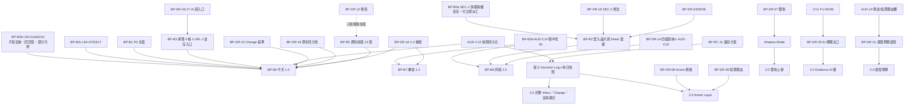

# vNext Product Blueprint：投資決策 OS／Investment Inbox

> **用途**：承載新 UI 的**最終產品方向**。`docs/DECISIONS.md` DEC-056 第 4 點指定由 Blueprint 負責這件事，對應 `docs/BACKLOG.md` **VN-00**。客戶 2026-10-17 指派本批建立這份「可長期維護的 vNext Product Blueprint」。
>
> **位階**：
> - 本檔**不凌駕** `CLAUDE.md`、`PROCESS.md`、`PROJECT_RULES.md`、`docs/DECISIONS.md`。牴觸時以上位文件為準，並登記到 `docs/BACKLOG.md`。
> - 本檔**不是實作授權**（DEC-056 第 2 點、DEC-015、DEC-002）。登記不構成動工授權（`CLAUDE.md` §-1）。
> - 本檔所有線框都是**文字線框草稿**，供客戶拍板（DEC-003 草稿先行、`PROJECT_RULES.md` 第 4 節第 7 項）。**客戶拍板前不得撰寫對應的 UI code。**
> - 涉及公式、門檻、Action transition rule、Position Sizing、Confidence 計算、新資料語意、新資料來源、API／MCP、substantive AI behavior、production switch、舊 UI 刪除、branch 刪除的地方，一律標 **Decision Required**，並寫出對應的 DEC-056 Gate 代號（G1～G11，定義見 `docs/BACKLOG.md` 第 5 節）。本檔**不定任何正式規則**。
>
> **量測基準**：main＝`2647a0fd`（#866）；本檔撰寫時以 PR #867（DEC-056、VN-00～VN-36）為基礎，#867 已 squash 合併為 `312c7fee`。量測日 2026-10-17。行號會漂移，本檔一律寫 `檔案::符號`，不寫行號（`CLAUDE.md` §8.2.A.0 規則 1）。
>
> **Provenance 揭露**（`CLAUDE.md` §-2 規則 6）：
> - 本檔由單一撰寫組依四組調查結果撰寫：G 治理盤點、C 新 UI 程式碼盤點、O OAuth 盤點、U 實機 UI 稽核。另有 V 組獨立複驗 UIA-01／02／03／07 與 SEC-1／SEC-2。
> - 交付前另經兩組獨立 review：A 組看 UX／Mobile，B 組看投資系統／資料語意。兩組結論都是 PASS-WITH-FIXES，逐條處置見第 29 節。
> - 標〔單組〕者是未經第二組驗證的宣稱，**只能當待驗事項**，不得作為後續動作的前提。
> - 2026-10-17 第 4 輪（`BP-ERR-01`，客戶授權，DEC-058）：只更正 §8.9 各桶數字與 §29.3 一句自查宣稱，處置見第 29.4 節；量測基準為 main `f7c60cae`（#868）。
>
> **配套文件**：`docs/vnext/UI_AUDIT_2026-10-17.md`（實機 UI Audit：UIA-01～UIA-29、SEC-1／SEC-2、工程術語盤點）。

---

## 0. 怎麼讀本檔

### 0.1 版本標籤（每張線框都有）

| 標籤 | 意思 |
|---|---|
| **【1.0】** | 只用**現有資料能力與現有正式規則**就能做到的畫面。客戶拍板後即可進施工批（BP-DR-16）。 |
| **【2.0】** | 依賴尚未存在的能力，例如 Action 規格、Thesis、每日快照、Decision Log、現金欄。保留給客戶看方向，**不是** 1.0 的施工依據。每張都會寫出依賴什麼。 |
| **【3.0】** | 後期方向，只示意。 |

### 0.2 ID 規則（本檔暫用 ID；正式登記以 `docs/BACKLOG.md` 為準）

| 前綴 | 意思 | 正式落點 |
|---|---|---|
| `VN-*` | DEC-056 的方向項 | `docs/BACKLOG.md` 第 5 節。本檔只引用，不改。 |
| `BP-DR-*` | 本藍圖整理的 Decision Required（第 23 節）。編號穩定、永不重用；新增的往後接續編號 | BACKLOG 登記 |
| `BP-RC-*` | 本藍圖整理的 Research Candidate（第 24 節） | 同上 |
| `BP-B*` | 建議施工批（第 26 節）。**只是建議**：DEC-015 禁止預先決定 Batch 1。例外是 BP-B0a，它是安全修復，見第 26 節 | 客戶指派後才成為工作項 |
| `UIA-*`／`SEC-*` | 實機 UI Audit 與安全發現（配套文件） | BACKLOG 登記 |

### 0.3 用語（避免撞名）

- **雙軌選股**：Track A 成長／動能、Track B 價值／錯殺（VN-05）。這裡的「雙軌」**不是**指 handoff 分支 `S2-PRD.md` §2.2 說的「新舊 UI 雙軌並行」。
- **Decision**：系統依正式規則對某件事的結論。Action 是其中一種（DEC-054 七種方向）。
- **Attention**：需要使用者注意的事件。內部分 P0～P3；**畫面上一律寫中文**：需要處理／值得注意／觀察／資訊（第 12 節）。
- **有效（valid）**：通過 freshness policy（DEC-029、`shared/freshness_policy.py`），而且規則版本相符的結論或快照。
- **示意**：線框裡的股名、數字、Action 全部是**示意，非真實判斷**。
- **免責文案**：線框中標 `〈免責：常數名〉` 的位置，一律引用既有常數，**不新寫免責文案**（DEC-055 第 4 點）。既有常數有：`shared/compliance_copy.py::AI_QA_DISCLOSURE`、頁尾 `app.py::_render_footer`；`src/ui/views/page_hold.py::AI_DISCLOSURE` 的合規語意可重用，但它的現行文字含工程術語「L3 `build_summary_prompt()`」（UI_AUDIT §4 列為 P0），使用者面要先去除工程術語。去除術語只改措辭、不改免責的三件事（S1-6 §3.1）；若改動超出去術語範圍，依 DEC-055 程序另送。Action 卡**目前沒有**專用的免責常數，待 Action 規格批依 S1-6 §3.1 樣板決定（BP-DR-08）。

---

## 1. Product North Star（第四十八節第 1 項）

**一句話**（客戶原文）：「每天替使用者過濾市場噪音，只把真正需要做決定的事情送到面前；每個結論都可以一路追溯到正式規則與客觀資料。」

**北極星行為指標**（方向，不是 KPI 公式）：
1. 打開 App 約 **3 秒**內知道「今天要不要處理事情、下一步在哪」。來源：客戶 MSG 1 §26「Mobile 約 3 秒知道現在該做什麼」，轉錄於 `docs/BACKLOG.md` `CV1-RC-07`。
2. 沒事的日子，系統**敢說沒事**。但只說**實際檢查過的部分**沒事（第 8.3 節，VN-35）。
3. 任何一個結論都能點到「為什麼」，一路往下追到事實、規則、資料來源與 as-of（VN-16、VN-17）。

**MSG 1 §26 的演進鏈**（`CV1-RC-07` 摘錄，本藍圖的骨架）：可靠資料 → 最小有效雙軌選股核心 → Context 提升判斷（而不是讓系統癱瘓）→ 技術面找位置 → Portfolio 控制曝險 → Structured Thesis 持續驗證 → 清楚 Action → AI 白話解釋 → Mobile 約 3 秒知道現在該做什麼 → LINE 只提醒真正重要事件 → Decision History 驗證系統是否創造價值。

**反北極星**（MSG 1 §26 原文）：「不要把專案做成：更多資料＋更多指標＋更多卡片＋更多 Gate＋更多 AI 文字」。

---

## 2. UX Principles（第 2 項）

| # | 原則 | 具體意思 | 來源 |
|---|---|---|---|
| U1 | **Decision first** | 每頁首屏先給結論，依序往下是 Attention、Risk、Evidence、Raw data；Evidence 頁內也是結論先 | 客戶本批第一節 |
| U2 | **Mobile：現在怎麼做 → 為什麼 → 下一步** | 手機首屏只放這三件事，其餘收合 | 客戶本批第一節 |
| U3 | **Change over State** | 優先顯示「和上一次有效 Decision 相比改變了什麼」；沒變就明說沒變；沒有可比較的上一次時也要明說 | 客戶第五節 |
| U4 | **不製造訊號** | 沒事就不為了填版面產生 Action 或 Attention；紅點不重複騷擾 | 客戶第四、四十五節；VN-35 |
| U5 | **missing ≠ 0、unavailable ≠ neutral、not evaluated ≠ safe** | 缺資料不得畫成綠燈、中性或已通過；**沒檢查的東西不得說「沒事」** | DEC-026、DEC-040、DEC-041；`PROJECT_RULES.md` D5～D7 |
| U6 | **顏色不是唯一載體，而且顏色語意不得混用** | 每個狀態都要有圖示＋文字；色彩語意見 2.1 | DEC-040、DEC-051；`CLAUDE.md` §1.A 第 4 點 |
| U7 | **使用者語言** | 畫面上不出現 L1/L2/L3、canonical、session、key、schema、函式名、P0～P3、規則識別碼、英文縮寫；工程資訊收進「技術資訊」 | 客戶第三節；VN-03 |
| U8 | **Compact by default** | 正常狀態只給一行摘要，點開才看 Evidence；只有異常、缺資料、需要行動時才顯示「怎麼處理」。⚠ 帶 Action 字樣的卡片例外：最少要有 S1-6 規定的欄位（第 10.4 節） | 客戶第七節；S1-6 STEP 2-b |
| U9 | **一頁一個主行動，放在首屏** | 指路句不寫方位詞（「上方」「下方」），改用直接可按的按鈕；CTA 文字寫出目的地 | UIA-03、UIA-04 |
| U10 | **No fake precision** | 不顯示 AI 信心百分比或總分；可信度用高／中／低＋拆解 | DEC-040；客戶第二十六、三十六節 |
| U11 | **Desktop ≠ 放大的 Mobile** | 兩種密度分開設計（VN-36） | 客戶第六節 |
| U12 | **Evidence 分層標示** | 系統結論、規則判定、事實、AI 解釋分開標示 | 客戶第二十七節；DEC-027 |
| U13 | **沒有 dead end** | 每個「無法判定」都要回答：為什麼、影響哪個 Decision、哪些功能仍可用、使用者能不能修；指向舊版功能時附「切回原功能」 | 客戶第八節；UIA-11、UIA-24 |
| U14 | **現金是資產** | UI 不得暗示「沒買股票＝錯失機會」 | 客戶第二十節 |
| U15 | **首屏預算** | Mobile 390×844 扣掉 Streamlit 頂列與留白約 120px（UIA-28）、底部導覽與瀏覽器列，實際可用內容約 560px〔估算，施工批實測後更新〕。每張 390 線框畫一條 `── 首屏線 ──` | UIA-28；R-A-07 |

### 2.1 色彩語意表（R-A-04／R-B-16）

> 台股慣例是**紅漲綠跌**。所以狀態色**不得**借用價格的紅綠，而且永遠搭配圖示和文字。

| 用途 | 顏色 | 圖示＋文字 | 只能用在 | 不得用在 |
|---|---|---|---|---|
| 價格上漲 | 紅 | ▲＋數字 | 價格、漲跌幅數字 | 狀態、Attention、Thesis |
| 價格下跌 | 綠 | ▼＋數字 | 同上 | 同上 |
| 系統錯誤（真的出錯） | 深紅底框 | ✕＋「取得失敗／資料異常」 | 資料狀態 | 價格；Attention |
| 需要處理 | 橘 | ❗＋「需要處理」 | Attention 最高層 | 價格；資料狀態 |
| 值得注意 | 琥珀 | ◆＋「值得注意」 | Attention 第二層 | 同上 |
| 觀察／資訊 | 中性灰藍 | 👀「觀察」／ℹ「資訊」 | Attention 第三、四層 | — |
| 機會 | 品牌藍 | 🆕／🚀＋文字 | 候選 | 不得用綠色 |
| 正常 | 中性 | ✓＋「正常」 | 資料狀態、Thesis | 不得用綠色（綠色＝下跌） |
| 尚未更新、未評估、無資料來源 | 灰 | ⬜／◌／⊘＋文字 | 資料狀態 | — |
| 過期、沿用快照 | 琥珀細框 | 🕘＋「已過期／沿用 〈日期〉」 | 資料狀態 | — |
| Thesis 狀態 | 中性 | ✓ 仍成立／◐ 轉弱／✕ 已破壞／? 無法評估 | Thesis | 不得用價格色 |

- 現行新 UI 的 🟢 運作中／🔴 取得失敗（`shared/ui_state.py::UI_STATE_META`）要依此表重新對映。這是呈現層的 token 變更，屬版面與視覺，要隨 BP-DR-16 線框一起拍板。
- 線框裡的 emoji 只是示意，實際 token 依此表。

---

## 3. Data／Rule／Decision／AI 責任邊界（第 3 項）

```
 ┌───────────────┐   ┌────────────────┐   ┌──────────────────┐   ┌────────────────┐
 │ ① Data 資料層 │──▶│ ② Rule 規則層  │──▶│ ③ Decision 決策層│──▶│ ④ AI 解釋層    │
 │ 取得/驗證/標準化│   │ 正式公式與門檻 │   │ 套規則產生結論   │   │ 白話解釋已有結論│
 │ 缺值狀態/as-of │   │ 有版本號       │   │ Action/Attention │   │ 不產生新結論   │
 └───────────────┘   └────────────────┘   └──────────────────┘   └────────────────┘
        ▲                    ▲                     ▲                      │
        └──── AI 不得寫回 ───┴───── AI 不得改 ─────┴──── AI 不得改 ───────┘
```

| 層 | 可以做 | 不可以做 | 現行對應（`檔案::符號`） | 依據 |
|---|---|---|---|---|
| ① Data | 取得、驗證、標準化；標缺值原因、as-of、freshness、provenance；多源依既有優先序取值 | 填 0、自估值、沉默 ffill；用其他欄位倒推缺的欄位（例如用 1 − 股票曝險推現金）；跨幣別平均；官方只缺外資時拼 FinMind；把 cache 存活當新鮮 | `src/data/**`；`shared/freshness_policy.py::FreshnessStatus`；`shared/macro_buckets.py::MISSING_*`；`shared/station_specs.py::MISS_*` | DEC-026、DEC-028、DEC-029、DEC-033、DEC-035；`CLAUDE.md` §1、§2 |
| ② Rule | 用正式公式與門檻判定；帶規則版本號 | 未經客戶裁示新增或修改公式、門檻、權重、資料充分性門檻（例如「至少 N/M 項」，DEC-046）；把 Context 升成 Core 或 hard veto | `shared/*_thresholds.py`；`shared/risk_cap_policy.py::RISK_CAP_RULESET_VERSION`；`shared/fundamental_prescreen_thresholds.py::PRESCREEN_VERSION` | DEC-009、DEC-008、DEC-046；`PROJECT_RULES.md` 第 4 節 1～2 項 |
| ③ Decision | 把規則結果組成 Action／Attention／候選清單；套 Risk Cap；Required Core 不足時給「無法判定」；Optional／Context 缺時揭露後照常 | 繞過 Risk Cap；Required Core 不足仍硬給方向；Optional 缺就讓整個 Decision 停擺；沒有正式 sizing 規則卻給比例 | `src/compute/etf/dividend_station.py::suggest_action`；`src/services/risk_cap_apply.py::compute_and_lock_risk_cap`；`src/services/fundamental_screener_service.py::get_ranked_picks` | DEC-054、DEC-046、DEC-048、DEC-051、DEC-053；S1-6 STEP 2-b |
| ④ AI | 讀已驗證資料與已產生的 Decision，白話解釋；回答「這張卡在說什麼」 | 生成客觀資料、猜缺值、自成 primary source、把推論寫回資料、改公式或規則、自己產生正式 Action 或目標價；**未經裁示擴大 AI 出口**（BP-DR-20） | `src/services/app_ai_service.py::gemini_call`；`src/services/ai_qa_service.py::run_agent`；`shared/compliance_copy.py::AI_QA_DISCLOSURE` | DEC-027、DEC-054 第 6 點、DEC-055；`PROJECT_RULES.md` D3、D4、第 4 節第 6 項 |

**跨層硬規則**：
- 強 Action（例如「全部退出」）不得只靠生成式 AI（DEC-054；S1-6 STEP 2-b 第 6 條）。
- AI 輸出一律同屏附免責三件套（S1-6 §3.1、§3.2）。
- Shadow 結果不得影響 ③ 的正式 Decision（第 19 節）。
- 下列兩項要在 Action Layer 與 AI 解釋擴大**之前**處理：
  - `src/config/persona.py::TAIWAN_ADVISOR_PERSONA` 寫著「請給出明確的動作」（`CV1-FU-06`）；
  - AI 文案尚未區分「模型自己說的方向」與「轉述正式 Action」（`CV1-FU-05`）。

---
## 4. Information Architecture（第 4 項）

### 4.1 現行（Current）

- **舊 UI**（凍結，DEC-019）：7 個頂層頁籤，即 🌍 市場環境／🔬 選股／🏦 ETF／🔧 工具箱／💼 我的持股戰情室／📁 組合管理／🧬 AI 問答。
- **新 UI（IA v2，DEC-017）**：5 頁，即 🚦 今天／🔍 找標的／🔬 查一檔／💼 我的持股／📖 憑什麼（`shared/ia_nav.py::PAGE_LABELS`）。
  - 入口在側欄 radio（`app.py::_IA_NAV_CHOICE`，DEC-018），預設選項是「不使用」。
  - 側欄預設收合（`set_page_config(initial_sidebar_state='collapsed')`）。
  - 選了哪一頁不會寫進 URL，重新整理就回到舊 UI〔C 組，單組〕。

### 4.2 目標（Target，草稿，待 BP-DR-01 拍板）

以「**使用者要做的決定**」切頁，不以「資料種類」切頁：

| 目標頁 | 使用者問題 | 吸收現行哪些內容 | 版本 | VN |
|---|---|---|---|---|
| 🏠 **今天** | 今天有沒有事要處理？ | 今天頁的結論、Risk Cap 變化、資料健康摘要；2.0 起加持股重要變化與新候選 | 1.0 起 | VN-02、VN-35 |
| 🔎 **機會** | 哪些標的值得研究？為什麼？ | 找標的（選股網、板塊地圖）、查一檔搜尋；2.0 起加雙軌與接近機會 | 1.0 起 | VN-05、VN-07、VN-08 |
| 💼 **持股** | 我的錢配置得對不對？ | 我的持股（戰情室、組合設定） | 1.0 起 | VN-11、VN-12、VN-24 |
| 🔔 **動態** | 最近發生了什麼和我有關的事？ | Attention 收件匣、事件、週報 | **2.0**（1.0 不放這一格，見第 5 節） | VN-19、VN-21、VN-34 |
| ⚙️ **我的** | 帳號、Sheet、設定、資料健康 | Google 登入／Sheet、資料體檢（使用者版）、教學、AI 問答 | 1.0 起 | VN-01、VN-04 |

**頁面以外的共用層**：

- **個股頁（🔬）**：不是主導航項目。從任何地方點一檔股票都進得去，也可以從「機會」頁頂端的搜尋進入。
- **為什麼（Why／Evidence）**：不是主導航項目，而是每個 Decision 上的「為什麼？」入口（第 14 節）。現行「📖 憑什麼」三個葉的去處：
  - 教學 → 我的 › 說明與門檻
  - 資料體檢 → 我的 › 資料健康
  - AI 問答 → 我的 › AI 問答。要不要再放進各 Evidence drawer，屬 **BP-DR-20**。

> ⚠️ 這是對 DEC-017 已核准 IA 的**動線變更**，屬 DEC-003 ① 與 DEC-009「重大 UI flow」，見 **BP-DR-01**。DEC-013 規定已裁示事項不重問，所以 BP-DR-01 問的是「是否以新 IA **取代**」，不是重問 DEC-017 本身。

### 4.3 舊 7 頁籤 → vNext 功能對映（R-A-06；**只對映，不刪任何東西**）

| 舊頁籤 | 子功能 | vNext 去處 | 狀態 |
|---|---|---|---|
| 🌍 市場環境 | 🌍 總經／🚦 總經 v2 | 今天（結論）＋今天 › 查看完整市場 | 已併入新 UI（IA v2 今天頁） |
| | 🗺️ 產業熱力圖／🌊 板塊資金潮汐 | 機會 › 產業脈絡 | 已併入（IA v2 找標的 › 板塊地圖） |
| 🔬 選股 | 🔬 個股 | 個股頁 | 部分併入：查一檔有判決卡，個股明細仍指回舊頁 |
| | 📊 多檔個股比較 | 機會 › 比較（Desktop） | 部分併入：查一檔 › 多檔比較 |
| | 🔭 選股網 | 機會 | 已併入 |
| 🏦 ETF | 單檔診斷／多檔比較等 | 個股頁的 ETF 版（第 10.3 節） | **只在原功能**：ETF 明細仍指回舊頁 |
| 🔧 工具箱 | 🔎 資料診斷 | 我的 › 資料健康（使用者版）＋技術資訊 | 部分併入 |
| | 📚 教學 | 我的 › 說明與門檻 | 部分併入 |
| 💼 我的持股戰情室 | — | 持股 | 已併入（IA v2 我的持股） |
| 📁 組合管理 | 新增／刪除持股、觀察清單 | 持股 › 組合設定 | **只在原功能**（舊 UI 的 `portfolio_manager` 可用）；新 UI 的寫入功能依 DEC-021 已核准線框，新 UI 端尚未實作 |
| 🧬 AI 問答 | — | 我的 › AI 問答 | 已併入（IA v2 憑什麼 › AI 問答） |

「只在原功能」的項目，在 vNext 頁面上一律附「切回原功能」出口（第 5.3 節），不寫「到某分頁」這種在新 UI 下看不到的指路（UIA-11）。

---

## 5. Mobile navigation（第 5 項）

### 5.1 【1.0】底部導覽（4 格）

```
390px ─────────────────────────────────────────
│ ░ Streamlit 頂列（約 120px，不可控，UIA-28）░ │
│ 台股戰情室                        🔍   👤     │  ← 站名縮小（UIA-21）；🔍 搜股；👤 → 我的 › 帳號
│─────────────────────────────────────────────│
│              （頁面內容，約 560px）           │
│─────────────────────────────────────────────│
│    🏠          🔎          💼          ⚙️      │
│   今天        機會        持股        我的     │  ← 圖示＋文字
───────────────────────────────────────────────
```

- 1.0 **只有 4 格**，沒有「動態」（R-A-05）。原因：動態頁的 Attention 模型要到 2.0 才有（第 12 節）；放一個空格等於把 dead end 做成主導航項目。
- 1.0 的「今天」格**不加未讀紅點**。紅點需要記住「已讀」，而 1.0 不做持久化（BP-DR-04）；每次重新整理都重新亮紅點，會製造焦慮（U4）。今天頁本身會寫「今天 N 件事」。
- 目前頁要寫進 URL：`?page=today|find|hold|me`，個股頁加 `&symbol=`；2.0 起事件加 `&event=`，供未來 LINE 深連結使用（R-A-23）。重新整理或斷線重連後回到同一頁（UIA-05、`AUD-M1`）。
- 個股頁與 Evidence 是**推入式子頁**：左上「← 返回」，**隱藏**底部導覽，避免佔首屏。
- 🔍 與機會頁的搜尋框是同一個元件（R-A-22）。
- **技術限制**〔單組判讀，BP-RC-10 PoC〕：Streamlit 沒有原生 bottom tab bar。用哪一種實作屬內部技術決定，但**最後的視覺**仍要依本草稿給客戶拍板。
- 背景（只是背景說明，不是 DEC-018 的條文）：2026-09-07 曾把五頁掛成頂層頁籤，手機上擠爆後撤回。新導覽必須**取代**舊頁籤列才能成立；並存期的入口見 5.3。

### 5.2 【2.0】加入「🔔 動態」第 5 格

- 2.0 起加入。數字顯示「**今天新增 N 件**」，只算「需要處理＋值得注意」。這種計數不需要記已讀（R-A-05）。
- 若 BP-DR-04 核准持久化，才改成未讀數。

### 5.3 【1.0】新舊 UI 並存期的入口（R-A-06；附 BP-DR-17）

**舊 UI 主畫面頂端**（不改舊 UI 檔案，由 `app.py` 層插入一行；是否屬修改舊 UI，施工前依 DEC-019 判定）：

```
│ 🆕 新版戰情室試用中：手機更好用、先看今天有沒有事   [ 試用新版 › ] │
```

**新 UI 內指向只在原版的功能**：

```
│ ┌─────────────────────────────────────────┐ │
│ │ ETF 詳細分析目前只在原版                   │ │
│ │ [ 切回原功能（ETF）› ]                      │ │  ← 一鍵切換，並帶到對應頁籤
│ └─────────────────────────────────────────┘ │
```

- 「我的」頁底部固定放一行「回到原版介面 ›」。
- ⛔ 把新 UI 改成**預設**＝production switch（G9、DEC-020），不在本線框範圍內，見 BP-DR-17。

---

## 6. Desktop navigation（第 6 項）

```
1440px ──────────────────────────────────────────────────────────────────────────
│ 台股戰情室   🏠今天  🔎機會  💼持股  ⚙️我的   （2.0 起加 🔔動態）   [🔍 搜尋代號] 👤 │
│─────────────────────────────────────────────────────────────────────────────────│
│  主欄（8）                                     │  右欄（4）：情境／證據           │
│  Decision → Attention → Risk                   │  · 預設：系統風險上限＋資料健康  │
│                                                │  · 點選某張卡 → 換成該卡的「為什麼」│
─────────────────────────────────────────────────────────────────────────────────
```

- 頂部水平導覽，項目和 Mobile 相同，心智模型一致。
- **右欄切換規則**（R-A-13）：預設顯示系統風險上限與資料健康；點某張卡就換成那張卡的「為什麼」；按 ✕ 回到預設。機會頁的進階篩選**不放右欄**，改成主欄頂端的展開列。
- 研究密度較高：機會頁可直接顯示比較表；個股頁可並排「支持證據／反方證據」。Today 與個股的 1440 線框見第 8.9、10.6 節。
- 8:4 加右抽屜的構想和 handoff 分支「UI 目標架構（V3）」相近。V3 的效力尚未調和，見 **BP-DR-02**。本節**沒有**採用 V3 的排除條款，也**沒有**推翻它們。

---

## 7. Google 登入／Sheet onboarding（第 7 項）

### 7.1 原則

1. **重用、不重造**。直接沿用既有元件：
   - `infra/oauth.py`：`build_authorize_url`、`exchange_code_for_tokens`、`ensure_fresh_tokens`
   - `src/data/portfolio/oauth_state.py`：`handle_oauth_callback`、`get_oauth_cfg`、`login_state_with_sheet`（`EX-OAUTH-1`）
   - `src/data/portfolio/gsheet_portfolio.py`：`list_user_sheets`、`list_user_folders`、`create_new_sheet`
   - `src/ui/tabs/portfolio_binder.py`：`render_login_cta`、`render_drive_picker`、`render_paste_id_binder`、`render_holdings_binder`、`apply_active_sheet`
   - **一行狀態列**：`src/ui/tabs/portfolio_status_bar.py::render_portfolio_status_bar`。主畫面一行晶片，popover 內可就地登入與綁定。舊 UI 已在使用；新 UI 模式下因為 `st.stop()` 不渲染（R-A-08）。
   - 三態判定：`src/services/portfolio_binding_service.py::get_binding_state`。
2. **不需要新 scope**：現行 `infra/oauth.py::GOOGLE_OAUTH_SCOPES` 已含 `drive.metadata.readonly`，`list_user_sheets` 能列出使用者的 Sheet；`drive.file` 能建新 Sheet〔O 組讀碼，單組〕。
3. **匿名可用**：Google 登入**不是**看公開市場資料的硬 Gate。只有個人持股、個人 Sheet、個人設定才要求登入。
4. **第一級入口，但不擋住「今天有沒有事」**：首屏只放**一行**登入晶片；完整登入卡只出現在第一次造訪與「我的」頁。
5. ⚠️ `portfolio_binder.py` 與 `portfolio_status_bar.py` 都在 `src/ui/tabs/`，舊 UI 也在用。新 UI **以 import 方式重用、不改它們**，就不違反 DEC-019 舊 UI 凍結。若重用時發現必須修改，要先依 DEC-019 判定它們算不算舊 UI 檔案〔單組判讀〕。

### 7.2 【1.0】未登入：首屏一行晶片

```
390px ─────────────────────────────────────────
│ ░ Streamlit 頂列 ░                            │
│ 台股戰情室                        🔍   👤     │
│ 10/17（五）· 資料至 10/16 收盤                 │
│ （今天有沒有事 —— 見第 8 節）                   │
│ 👤 登入 Google 看你的持股 ›                    │  ← render_portfolio_status_bar 的一行晶片
│ ── 首屏線 ──                                   │
```

### 7.3 【1.0】完整登入卡（第一次造訪、或點晶片、或在「我的」頁）

```
│ ┌─────────────────────────────────────────┐ │
│ │ 👤 連接 Google                            │ │
│ │ 登入後可以：                               │ │
│ │  · 選擇自己的 Google Sheet                │ │
│ │  · 載入持股、看持股提醒                    │ │
│ │  · 儲存個人設定（目前只保存在這次使用期間）  │ │
│ │ 只會列出檔名讓你選，只讀你選的那一份。       │ │  ← R-A-24
│ │ [ 使用 Google 登入 ]       稍後設定 ›      │ │
│ └─────────────────────────────────────────┘ │
```

- 「稍後設定」之後只剩 7.2 的晶片。這個狀態只存在 session（持久化見 BP-DR-04）。
- 部署端沒設 `[google_oauth]` 時：不顯示登入鈕，改成灰色說明「這個部署沒有開啟 Google 登入，持股功能暫時無法使用；市場與機會功能不受影響。」不寫 `secrets.toml` 這類工程字（UIA-10 第 3 步）。

### 7.4 【1.0】登入後、選 Sheet

```
│ ✓ Google 已連接 · a***@gmail.com            ›  │  ← 晶片；點開 popover
│   投資資料：〈我的持股 2026〉       [更換]      │  ← 只顯示 Sheet 名稱，不顯示識別碼（DEC-021）
```

尚未選 Sheet 時，popover 內容如下：

```
│ 投資資料                                     │
│ [ 選擇 Google Sheet ▾ ]                      │  ← render_drive_picker
│  或 貼上 Sheet 網址                           │  ← render_paste_id_binder
│  或 建立新的持股 Sheet                        │  ← create_new_sheet（DEC-021）
```

- 登入、綁定完成後**留在今天頁**，直接出現持股相關內容。不另放「開始今日戰情」按鈕（R-A-09）。

### 7.5 【1.0】登入與 Sheet 的錯誤／例外狀態（R-A-09）

| 狀態 | 顯示（範例） | 出口 |
|---|---|---|
| 使用者取消或拒絕授權 | 「你取消了 Google 登入，持股功能沒有開啟。」 | [再試一次]／稍後設定 |
| callback 失敗 | 「Google 登入沒有完成（連線中斷）。」 | [再試一次] |
| 登入已過期 | 「Google 登入已過期，請重新登入。」 | [重新登入] |
| Sheet 權限被撤或檔案被刪 | 「讀不到〈我的持股 2026〉：你可能已沒有權限，或檔案已刪除。」 | [重新選 Sheet] |
| Sheet 格式不符 | 「這份 Sheet 不是持股格式（找不到持股分頁）。」 | [重新選 Sheet]／[建立新的持股 Sheet] |
| Sheet 是空的（0 筆） | 「這份 Sheet 目前沒有持股。」（這是有效結果，不是錯誤） | [到組合設定新增]（DEC-021，尚未實作時寫「新增功能尚未開放」） |
| 建立新 Sheet 完成 | 「已建立〈台股持股〉並設為目前使用。」 | — |
| 回到原分頁仍未登入（登入鈕開新分頁，`st.link_button`） | 原分頁顯示「如果你已在另一個分頁登入，請關閉這頁、改用那一頁」 | 〔待 PoC：BP-RC-10 一併驗證返回路徑〕 |

### 7.6 流程圖

```
開 App ─▶ 已登入? ─否─▶ 一行晶片（第一次造訪展開完整卡）─▶ 公開功能照常可用
            │是
            ▼
       已選 Sheet? ─否─▶ popover：列檔／貼網址／建新 ─▶ apply_active_sheet
            │是
            ▼
       今天、持股頁的持股內容可用（holdings_service.get_holdings，唯讀）
```

### 7.7 這一節裡哪些屬 Decision Gate

| 事項 | 要不要裁示 | 理由 |
|---|---|---|
| 把既有登入晶片與綁定元件放進新 UI 首屏與「我的」頁 | **要**（版面，DEC-003 ①）→ BP-DR-03 | 不動 credentials，只動版面 |
| Sheet 選擇掛在哪；`page_hold` 的唯讀保證（`tests/test_p04_hold_view.py::TestReadOnly`） | **要** → BP-DR-05 | 改唯讀邊界要客戶拍板（`page_hold.py::READONLY_WHERE` 自陳） |
| 重新整理後不登出（token 跨 session 持久化） | **要**（credentials，DEC-009）→ BP-DR-04 | 牽涉憑證存放 |
| 增減 scope；改 GCP OAuth client、redirect URI、同意畫面；加 Google Picker API key；改用 `st.login` | **要**（credentials）；本藍圖**不建議**做 | 現行 scope 已足夠 |
| 匿名訪客能否經 Service Account 讀寫管理員的 Sheet | **要** → BP-DR-06 | 牽涉多使用者部署語意 |
| 個人設定存在哪 | **要** → BP-DR-04 | 存在使用者 Sheet 新分頁＝寫入使用者資產；存在 cookie 或後端＝新基礎設施 |
| SEC-2 修法 | **要** → BP-DR-18 | 見 7.8 |

### 7.8 登入流程的已知安全問題（**在擴大登入入口之前必須先修**）

> O 組發現、V 組獨立複驗〔單組複驗：兩組各一，沒有第三組；沒有在真 OAuth 部署上端到端實測〕。兩項都屬 Correctness／Security，**不是**產品裁示題（`PROJECT_RULES.md` 第 4 節反向禁令）。

**SEC-1｜跨使用者快取外洩持股（CONFIRMED，目前正在發生）**
- 問題：`src/data/portfolio/gsheet_portfolio.py` 有四支讀取函式：`list_portfolios`、`load_portfolio`、`list_stock_watchlists`、`load_stock_watchlist`。它們都用程序全域的 `@st.cache_data(ttl=TTL_15MIN)`，快取鍵只有 `(name, sheet_id, keep_blank)`，**不含使用者身分**。
- 後果：命中快取時，函式本體（含 Google 權限檢查）不會執行。V 組 mock 重現：無權限的 B 讀到 A 的持股。
- 觸發門檻很低：舊 UI 是預設入口，側欄可以自由輸入 Sheet ID，`?sheet=` 也會從網址還原。
- **處置**：屬已確認 bug；修法為技術實作（快取鍵帶使用者身分，或改 per-session 快取，二者皆安全，由施工批內部決定），不需客戶裁示。它是 `CLAUDE.md` §-1 允許動工的 security 觸發，所以**不必排在藍圖後面，本批結束後即可派工**（BP-B0a，第 26 節）。本批依指示**不施工**。修好之前，不得把登入入口拉到首屏擴大使用。

**SEC-2｜OAuth CSRF state 檢查實際上從不生效（CONFIRMED）**
- 問題：`src/data/portfolio/oauth_state.py::_oauth_state_ok` 在 expected state 為空時一律放行。nonce 存在 `st.session_state`；登入鈕開新分頁、任何整頁轉跳都會重建 session，所以正常流程下 expected 必為空。
- 風險：login CSRF，可利用性中等。
- **處置**：修法要改變憑證保存機制（簽章 cookie、伺服器端短期儲存、或 PKCE），有多種合理方向，而且牽涉 credentials（DEC-009）→ **BP-DR-18**。

**其他**：
- `docs/OAUTH_SETUP.md` 不存在；兩份 `secrets.toml.example` 都沒有 OAuth／Service Account 的 key（部署文件缺口）。
- 若 production 設了 Service Account，匿名訪客也可能經 SA 讀寫管理員的 Sheet（BP-DR-06）。

---
## 8. 今天／Investment Inbox 線框（第 8 項）

### 8.1 定位與 1.0 的能力邊界

首頁**不是 Dashboard**，而是「今天需要處理的事情」收件匣（VN-02、VN-19）。順序是：有沒有事 → 事情清單 → 沒變的部分一句話帶過 → 系統風險上限與資料健康 → 查看完整市場。

**1.0 只能產生的事件**（現有資料能力）：
1. **系統風險上限變化**：比較兩份**有效**的 `risk_cap_state.json` 快照（`AllocationDecision.cap_pct`）。需要先解決 `AUD-C12`（快照目前存在 ephemeral 磁碟）。
2. **資料異常**：某個 Decision 的 Required Core 缺失或過期。

**1.0 做不到的事件**（→【2.0】）：
- 持股 Action 變化：需要 Action 規格（BP-DR-08）。
- 新進／移出候選：需要每日候選快照。
- 「其他持股沒有重要變化」：需要持股訊號快照。

**名稱對映**（R-B-13）：
- 1.0 沿用現行正式名稱「**系統風險上限**」，對應 `AllocationDecision.cap_pct`（`cap_text`）。
- 「建議持股區間」對應 `AllocationDecision.range_text`，是另一個數字，**兩者不得在同一張卡上混稱**（`AUD-C10` 的教訓）。
- 全域「建議持股 X%」的呈現本身，還在 S1-6 §6 議題 4（`CV1-DR-07`）等客戶確認。
- 改名為「風險預算」屬 BP-DR-21。

### 8.2 【1.0】有事的日子（示意，非真實判斷）

> 依 DEC-048：Required Core（VIX、台灣 PMI 當期、PMI 前月、外資期貨＋MA5）**全部到齊**才產生新的系統風險上限。所以「上限變化」與「Required Core 失敗」**不會同時出現**在同一天的畫面上（第 3 輪 N-1 修正）。下面畫兩種互斥情境。

**情境 A：Required Core 全部到齊，產生新上限；只有 Optional 項失敗**

```
390px ─────────────────────────────────────────
│ ░ Streamlit 頂列 ░                            │
│ 台股戰情室                        🔍   👤     │
│ 10/17（五）· 資料至 10/16 收盤                 │  ← as-of 一律在首屏（AUD-M1）
│                                             │
│ 今天 1 件事值得注意                             │  ← 標題用實際層級名（R-A-11）；層級對應待 BP-DR-11
│ ┌─────────────────────────────────────────┐ │
│ │ ◆ 值得注意 · 市場                          │ │
│ │ 系統風險上限 80% → 60%                      │ │  ← Change（1.0 只有這一種）
│ │ 資料至 10/16                               │ │
│ │ 部分訊號未納入，本次上限資訊不完整 ▾         │ │  ← DEC-051 原句；展開列出 Optional 項
│ │                       [為什麼？] [看市場]  │ │  ← CTA 寫目的地
│ └─────────────────────────────────────────┘ │
│ ── 首屏線 ──                                   │
│ 👤 登入 Google 看你的持股 ›                    │  ← 未登入時；已登入改顯示「持股：本版尚未比較變化 ›」
│ 資料健康：1 項取得失敗 ▾                        │  ← 只報各狀態的數量，不判「正常與否」（BP-DR-19）
│ [ 查看完整市場 ]                                │
│─────────────────────────────────────────────│
│   🏠今天     🔎機會     💼持股     ⚙️我的      │
```

- 情境 A 的失敗項是 Optional（例如 PCR、BIAS240，DEC-048），依 DEC-051 揭露後照常計算，**不另成一張「需要處理」卡**。

**情境 B：Required Core 缺一項，但 7 天內有有效快照 → 沿用，不顯示新變化**

```
│ 今天 1 件事需要處理                             │
│ ┌─────────────────────────────────────────┐ │
│ │ ❗ 需要處理 · 資料                         │ │
│ │ 台灣 PMI 本月資料取得失敗                   │ │
│ │ 系統風險上限沿用 10/14 的有效值：60% 🕘     │ │  ← DEC-044、DEC-048：7 天內沿用
│ │ 今天不產生新的上限，也不算一次變化            │ │  ← 與 BP-DR-13 推薦一致
│ │                       [為什麼？] [重新更新]│ │
│ └─────────────────────────────────────────┘ │
│ ── 首屏線 ──                                   │
```

- 超過 7 天仍缺 → 第 8.4 節「無法判定」。
- 「資料失敗」對應哪一個 Attention 層級，屬 BP-DR-11；本線框暫用「需要處理」示意。

**CTA 目的地對照**：

| 按鈕 | 去哪裡 |
|---|---|
| [為什麼？] | 該卡的 Evidence 子頁 |
| [重新更新] | 原地觸發更新，顯示 8.6 的更新中狀態 |
| [看市場] | 今天 › 查看完整市場（五桶） |
| [查看完整市場] | 同上，全站統一這個名稱（R-A-11） |

### 8.3 【1.0】市場面沒事的日子（**部分**安靜模式，VN-35）

> 1.0 只能比較「系統風險上限」與「資料健康」兩項，所以**只能說這兩項沒事**。持股與候選要寫明「本版尚未比較」（R-B-01、R-A-03）。

**已登入、已綁定 Sheet**：

```
│ 10/17（五）· 資料至 10/16 收盤                 │
│ ┌─────────────────────────────────────────┐ │
│ │ ✓ 市場面今天沒有需要處理的事                 │ │
│ │ · 系統風險上限 60%，和上次相同（10/16）      │ │
│ │ · 必要資料都已更新                          │ │
│ │ 持股訊號與候選變化：本版尚未比較 ›            │ │  ← 不說「沒有變化」
│ │                          [為什麼說沒事？]   │ │  ← R-A-11
│ └─────────────────────────────────────────┘ │
│ [ 查看完整市場 ]                                │
│ ── 首屏線 ──                                   │
```

**未登入（匿名）**：

```
│ │ ✓ 市場面今天沒有需要處理的事                 │ │
│ │ · 系統風險上限 60%，和上次相同              │ │
│ │ 你的持股：還沒檢查（登入後才能看）›           │ │  ← R-A-03：未檢查 ≠ 沒事
```

**前置條件**（全部成立才顯示 ✓）：
1. 系統風險上限有效，而且和比較基準相同（BP-DR-13）；
2. 「資料健康」為正常。正常怎麼定義屬 **BP-DR-19**；總管推薦綁各 Decision 的 Required Core，不另創 N/M 門檻（DEC-046）。
3. 比較基準存在（否則走 8.5）。

⛔ **持股項只在已登入且已綁定 Sheet 時才評估**；1.0 即使已登入，也只寫「本版尚未比較」。完整安靜模式「今天沒有需要處理的事情」要到 **【2.0】**（8.8），前提是持股訊號與候選都有快照可比較。

### 8.4 【1.0】資料不足的日子

```
│ ┌─────────────────────────────────────────┐ │
│ │ ✕ 今天無法判定系統風險上限                  │ │
│ │ 原因：必要資料「台灣 PMI」取得失敗，         │ │
│ │       而且最近一份有效上限已超過 7 天。      │ │  ← DEC-048
│ │ 仍可使用：機會清單（資料至 10/15）、持股明細  │ │
│ │ [ 重新更新 ]   [ 看缺了哪些 ▾ ]             │ │
│ └─────────────────────────────────────────┘ │
```

- 「無法判定」只在該 Decision 的 **Required Core** 不足時出現（DEC-046、DEC-048）。只缺 Optional 或 Context 時照常給結論，並揭露「部分訊號未納入」（DEC-051 句型）。
- 卡片要回答第 15 節的四個問題：為什麼不能判定、影響哪個 Decision、哪些功能仍可用、使用者能不能修。
- 現況 UIA-01 是 15/16 個指標沒資料，卡片卻顯示「🟢 五桶全綠」。這必須先修（BP-B0b），否則 Inbox 會建立在假綠燈上。

### 8.5 【1.0】資料正常，但還沒有可比較的上一次（R-A-02）

第一次使用、容器重啟後快照消失（`AUD-C12`）、或規則版本剛更新時，都會出現這個狀態。1.0 期間它可能是**最常見**的狀態。

```
│ ┌─────────────────────────────────────────┐ │
│ │ ⬜ 今天是第一次比較，從今天開始記錄變化       │ │
│ │ 系統風險上限：60%（資料至 10/16）            │ │  ← 今日結論本身照給
│ │ 部分訊號未納入，本次上限資訊不完整 ▾         │ │
│ │                              [為什麼？]     │ │
│ └─────────────────────────────────────────┘ │
```

⛔ 這個狀態**不得**顯示「沒有變化」或「沒有需要處理的事」。

### 8.6 【1.0】更新中（R-A-12）

```
│ ┌─────────────────────────────────────────┐ │
│ │ ⏳ 正在更新今天的資料〈預估時間：待正式環境實測〉│ │  ← 沙箱曾量到 143～173 秒（UIA-25，不代表正式環境），不得當文案
│ │ ✓ 國際指數   ✓ 台股大盤   ⏳ 法人買賣超       │ │
│ │ ⬜ 融資餘額   ⬜ 先行指標                      │ │
│ │ 你可以先去看其他頁，完成後這裡會更新。         │ │  ← 能不能離開，要 PoC 驗證（BP-RC-10）
│ └─────────────────────────────────────────┘ │
```

**部分資料不足、但有事件時的優先序**：
1. 資料不足的 banner 放最上面；
2. 仍可判定的事件照列；
3. 受影響的事件卡標示「部分資料不足」。

### 8.7 Change（第五節）

| 比較項目 | 顯示 | 需要的基礎 | 版本 |
|---|---|---|---|
| 系統風險上限 | 80% → 60% | 上一次**有效**快照可保存、可讀回（`AUD-C12`）；7 天沿用期間怎麼比，見 BP-DR-13 | **1.0** |
| 持股 Action | 續抱 → 暫停加碼 | Action 規格＋Decision Log | 2.0 |
| 候選進出 | 新進／移出 | 每日候選快照 | 2.0 |
| 沒變 | 「和上次相同」 | 同上各項 | 依項目 |

### 8.8 【2.0】完整 Inbox（示意，非真實判斷；依賴 BP-DR-08、BP-DR-11、每日候選快照、持股訊號快照、Decision Log）

```
│ 今天 2 件事：1 件要處理、1 個新機會             │
│ ┌─────────────────────────────────────────┐ │
│ │ ❗ 需要處理 · 持股 · 聯發科（示意）          │ │
│ │ 續抱 → 暫停加碼                             │ │
│ │ 主因：〈正式規則理由〉 · 資料至 10/16         │ │  ← 卡內 as-of
│ │ 風險：〈一條關鍵風險〉                       │ │  ← S1-6 STEP 2-b #2
│ │ 規則：〈規則名〉2026-10 版                   │ │  ← STEP 2-b #1
│ │ 〈免責：Action 卡常數，待 BP-DR-08〉          │ │  ← 同卡免責（S1-6 §3.2）
│ │                        [為什麼？] [看這檔]  │ │
│ └─────────────────────────────────────────┘ │
│ ┌─────────────────────────────────────────┐ │
│ │ 🆕 新機會 · 台積電（示意）→ 成長／動能候選    │ │
│ │                        [為什麼入選？] [看這檔]│ │
│ └─────────────────────────────────────────┘ │
│ ✓ 其他 8 檔持股和上次相同                       │
```

- 帶 Action 字樣的精簡卡，**最少**要有理由、卡內 as-of、一條關鍵風險、規則名與版本、同卡免責。少任何一項，就不准出現 Action 字樣（R-B-06）。
- 完整安靜模式「✓ 今天沒有需要處理的事情」在 2.0 才成立；條件是持股與候選也都比較過，而且都沒變。

### 8.9 Desktop 擴展（1440 線框，R-A-19）

```
1440px ──────────────────────────────────────────────────────────────────────────
│ 台股戰情室   🏠今天  🔎機會  💼持股  ⚙️我的                    [🔍 搜尋代號] 👤 │
│ 10/17（五）· 資料至 10/16 收盤                                                    │
│──────────────────────────────────────────────┬──────────────────────────────────│
│ 今天 1 件事值得注意（情境 A）                  │ 系統風險上限                      │
│ ┌──────────────────────┐                        │  60%（上次 80%）資料至 10/16       │
│ │◆ 值得注意 · 市場       │                        │  部分訊號未納入，本次上限資訊不完整 ▾ │
│ │系統風險上限 80%→60%    │                        │──────────────────────────────────│
│ │[為什麼？][看市場]      │                        │ 資料健康                          │
│ └──────────────────────┘                        │  ✓ 正常 〈n〉 · ✕ 失敗 1            │
│ 完整市場（五桶摘要，Desktop 直接展開）           │  [看明細 ›]                       │
│ 各桶：有資料的項數／應有項數（燈色待 BP-DR-19）   │                                  │
│ 長期 〈n〉/3 · 中期 〈n〉/6 · 短線 〈n〉/3 · 籌碼 〈n〉/3 · 新聞 〈n〉/1 │  （點任一卡 → 右欄換成該卡的「為什麼」）│
─────────────────────────────────────────────────────────────────────────────────
```

- **各桶數字怎麼讀（2026-10-17 第 4 輪更正，`BP-ERR-01`；客戶 2026-10-17 授權，DEC-058）**：
  - **分母**＝現行程式的註冊項數：`shared/macro_buckets.py::BUCKET_DANGER_SPECS` 各桶 長期 3（`health`、`ndc_signal`、`m1b_m2_gap`）／中期 6（`ism_pmi`、`us_core_cpi`、`tw_export`、`bias_240`、`us10y`、`dxy`）／短線 3（`vix`、`adl`、`fut_net`）／籌碼 3（`margin`、`jingqi`、`foreign_net`）／新聞 1（`news_systemic`），合計 16。現行今天頁（`src/ui/views/page_today.py::build_indicator_tiles`、`coverage`）與總經 v2（`src/ui/tabs/tab_macro_v2.py::build_rows`）都逐一列出這 16 項，**M1B−M2 仍在長期桶、仍算在分母內**；DEC-049 停用的是它在系統風險上限中的計分，不是這盞燈（現行程式只在 M1B−M2 為代理值時把燈改為灰、不進桶燈色）。已停用、代理值、長期沒有資料來源的項目要不要排出分母，屬 **BP-DR-19** 待裁示（第 15 節 (a)）；裁示前依現行計數揭露，裁示後分母可能改變。〔2026-10-17 文件修正組讀碼＋實跑 `BUCKET_DANGER_SPECS` 實測；單組〕
  - **分子**〈n〉是示意佔位。情境 A 的前提是 Required Core 全部到齊（DEC-048），所以**中期至少 1**（`ism_pmi` 台灣 PMI）、**短線至少 2**（`vix`、`fut_net`）。
  - 右欄「資料健康」只報各狀態數量；失敗數與 §8.2 情境 A 一致（1 項取得失敗、沒有過期項）。它數的是**資料來源**（同第 13.1 節，含薩姆規則這類非燈號項），和左欄的 16 盞燈不是同一組，所以兩邊數字不必相加相等。
  - 舊值以刪除線保留（有意識的更正，不是漏刪）：~~「長期 0/4 · 中期 1/6 · 短線 0/2 · 籌碼 0/3 · 新聞 0/1」~~ —— 長期、短線分母與註冊表不符，且短線 0 與情境 A 矛盾（R2 第 3 輪複驗 R3-1）；~~「✓ 正常 12 · ✕ 失敗 1 · 🕘 過期 1」~~ —— 與 §8.2 情境 A「1 項取得失敗」不一致（`BP-ERR-02` 第 1 項）。

---
## 9. 機會線框（第 9 項，含第九～十二節）

### 9.1 雙軌選股的產品架構（VN-05、VN-06）

**現況**（C 組讀碼；只描述，不評價公式正確性）：
- `src/compute/screener/fundamental_prescreen.py::run_fundamental_prescreen` 有四項布林：
  - 負債比 < 50%；
  - 三率三升 YoY（毛利率、營益率、淨利率本季皆嚴格高於去年同季）；
  - 淨流動值 > 0；
  - EPS > 0。
  - 門檻在 `shared/fundamental_prescreen_thresholds.py`。
- `survivor = pass_count == PRESCREEN_REQUIRED_PASSES`，也就是**四項全過才入選**；NaN 視為不通過。
- 排名：`src/services/fundamental_screener_service.py::get_ranked_picks` 對存活池計算勾選因子（`pe_low`／`eps_high`／`shortage`／`rs_leader`／`trend`）的百分位（0～100），取**有資料因子**的平均。總經為 bear／caution 且有 RS 資料時，剔除未贏過大盤者（`_apply_bear_market_filter`）。
- 相關既有問題：
  - `AUD-L1`：四項 AND 一票否決，可能誤殺 Track B 類標的；
  - `AUD-C14`：評分缺資料回 50，假中性；
  - `AUD-C4-3UP`／`PQ-C4-2`：三率三升累計 vs 單季，待裁示；
  - `AUD-L2`：`eps_high` 用絕對 EPS。

**【2.0】目標架構**（只到架構層，不定條件與門檻）：

```
            ┌──────────── Core Decision（每軌各自一組最小核心條件）────────────┐
 全市場 ──▶ │ Track A 成長／動能：基本面改善 ＋ 估值合理 ＋ 價格／動能確認     │──▶ 候選
            │ Track B 價值／錯殺：品質良好 ＋ 估值近自身低位 ＋ 投資理由未破壞 │
            └──────────────────────────────────────────────────────────────────┘
                                   │
                                   ▼
            ┌──────────── Context Overlay（加減可信度／風險，不是 Gate）────────┐
            │ 產業趨勢 · 全球 regime · 法人／籌碼 · 公司事件                   │
            │ 只有在「有正式風險理由」時才可以 hard veto（須另行裁示）          │
            └──────────────────────────────────────────────────────────────────┘
```

- **不再**設計長長一串 hard gate chain。Core 每軌只放回答該軌問題所必需的最少條件。
- Context Overlay 不得重複計票。例如 Nasdaq、SOX、NVDA、AI ETF 可能屬同一個 global-tech factor，只能算一次（VN-22）。
- 以下全部屬 **G1 → BP-DR-07**：每一個條件與門檻、各軌的 Required Core、Context 怎麼加減、hard veto 的條件、「估值合理」「自身低位」的定義。Context 升成 Core 或 hard veto，另走 DEC-009。
- 現行 prescreen 和雙軌是取代、並存還是做 Shadow 比較，也在 BP-DR-07。總管推薦先以 Shadow Mode 並存比較（第 19 節）。

### 9.2 【1.0】機會頁：現行規則、改成「為什麼入選」呈現（R-B-11）

> 1.0 **只用現行四項條件與現行因子**。每個標籤都附門檻或事實（S1-6 §2.5：門檻要印在同一渲染單位）。不出現現行規則沒有的「估值合理」「趨勢確認」這類通過門檻。

```
390px ─────────────────────────────────────────
│ ░ Streamlit 頂列 ░                            │
│ 機會                         [🔍 查代號]     │
│ 資料至 2026Q2 財報 · 10/16 收盤 ▾              │
│ 基本面四項全過：371 檔 → 依你選的條件排序前 50 │
│ ┌─────────────────────────────────────────┐ │
│ │ 台積電 2330（示意）                        │ │
│ │ 負債比 32%（< 50%）✓ · 三率皆高於去年同季 ✓ │ │  ← 50% 引 shared/fundamental_prescreen_thresholds.py::DEBT_RATIO_MAX
│ │ 本益比：低於 78% 的入選股（示意）           │ │  ← 百分位寫白話，不寫「82 分」
│ │                          [為什麼入選？]     │ │
│ └─────────────────────────────────────────┘ │
│ （…最多 3 張，其餘「全部 50 檔 ›」）            │
│ ── 首屏線 ──                                   │
│ [ 調整排序條件 ]                                │  ← 底部 bottom sheet（9.6）
```

- 0 檔時要明講：「今天沒有四項全過的標的（資料至 …）」。這是「算過了、結果就是沒有」（S1-6 §2.8），不是失敗。
- 部分維度失敗時（例如名稱或本益比沒拿到），卡上標「◧ 部分可用：缺 名稱、本益比」，**不得**標運作中（UIA-14）。
- 1.0 **沒有**「今天新進／移出」：還沒有每日候選快照。這一行要等 2.0（9.4）。

### 9.3 【1.0】為什麼入選／沒入選（第十一節，VN-07）

```
│ ← 台積電 2330（示意）· 為什麼入選               │
│─────────────────────────────────────────────│
│ 結論：基本面四項全過，排在第 3                   │
│ 四項條件（規則：基本面初篩 2026-10 版 ▾）        │
│  ✓ 負債比 32%      門檻：< 50%    資料至 2026Q2 │
│  ✓ 三率三升        毛利率／營益率／淨利率皆高於去年同季 │
│  ✓ 淨流動值 > 0     ＋1.2 兆（示意）             │
│  ✓ EPS > 0         9.6 元（示意）               │
│ 排序依據（你選的條件）                           │
│  · 本益比：低於 78% 的入選股                     │
│  · 抗跌（相對強弱）：資料不足，未計入            │  ← 缺資料不計入，也不記 0
│ [技術資訊 ▾]                                    │  ← 規則識別碼放這裡
```

**沒入選**（在機會頁搜尋某一檔時顯示）：

```
│ 結論：沒有列入今日機會                          │
│  ✓ 負債比   ✓ 淨流動值   ✓ EPS                 │
│  ✕ 三率三升：營益率 18.2%，低於去年同季 19.0%    │
│  ? 無法評估的條件會寫「資料不足」，不畫成 ✕       │
```

- ⛔ 不得只顯示「3/4」「82 分」「pass=False」「survivor=False」。
- ✓／✕ 都要附事實與資料時點。「? 無法評估」要和 ✕ 分開，缺資料不能畫成 ✕，也不能畫成 ✓（U5）。現行 NaN 會被當成不通過（`fillna(False)`）：畫面上要分辨「資料不足」和「真的不通過」，這屬呈現修正，**不改入選判定**〔單組判讀，施工批確認做不做得到〕。

### 9.4 【2.0】雙軌機會頁（示意；依賴 BP-DR-07、每日候選快照、Shadow 比較）

```
│ 機會 · 今天：新進 2 · 移出 1 ›                  │  ← Change 放在最上面（R-A-13）
│ 🚀 成長／動能  6 檔                       全部 ›│
│  台積電（示意）🆕 · 基本面 ↑〈事實〉· 估值〈事實＋門檻〉· 價格〈事實＋門檻〉 │
│ 💎 價值／錯殺  4 檔                       全部 ›│
│  XXX（示意）· 品質〈事實〉· 估值〈相對自身歷史位置〉· 投資理由：〈狀態〉 │
│ 👀 接近機會  3 檔                         全部 ›│
```

- 候選依「研究優先順序」排列，不顯示總分（第三十六節）。排序依據屬 BP-DR-07。
- 某一軌的 Required Core 不足時，該軌顯示「無法完整篩選：缺〈項目〉」，**不得**改用另一軌的結果填版面。
- 「移出」要說明是哪個條件變了、什麼時候變的。

### 9.5 【2.0】觀察名單／接近機會（第十二節，VN-08）

```
│ 廣達（示意）· 接近機會                          │
│ 目前缺一個條件：價格尚未確認                      │
│  ✓ 基本面   ✓ 估值   △ 趨勢   ? 投資理由：無法評估（尚無規格）│  ← R-B-17
│ 若正式條件成立 → 重新評估                         │
│ [為什麼？]   [加入觀察清單]                       │  ← DEC-021 已核准線框，尚未實作
```

- 「接近」的定義屬 **G1 → BP-DR-15**。repo 目前**沒有**正式 trigger，線框只寫「若正式條件成立」，不自創觸發價或條件。
- 觀察清單的新增與刪除沿用 DEC-021；觀察清單與持股**分流**（DEC-045）。

### 9.6 【1.0】Mobile 調整排序條件（bottom sheet，R-A-13）

```
│ ┌──────── 調整排序條件 ────────────────────┐ │
│ │ □ 本益比低   □ EPS 高   □ 缺貨動能          │ │  ← 現行 SCREEN_ANGLE_LABELS，用白話名
│ │ □ 抗跌（相對強弱）   □ 財報趨勢             │ │
│ │ 基本面四項全過是固定條件，不能取消。          │ │
│ │                 [ 套用 ]   [ 取消 ]        │ │
│ └─────────────────────────────────────────┘ │
```

### 9.7 Desktop 擴展

- 1.0：主欄放入選清單表格（代號、名稱、四項條件 ✓／✕／?、各排序因子白話），不放總分欄；進階排序條件放主欄頂端的展開列（第 6 節右欄規則）。
- 2.0：兩軌並排兩欄；比較維度有基本面、估值、趨勢、投資理由、情境，以及「和持股重疊度」（**新指標，屬 G1**，R-B-20）。
- 板塊地圖（熱力圖＋資金泡泡）放在「機會 › 產業脈絡」子頁，它屬情境，不是篩選結果。

---

## 10. 個股頁線框（第 10 項，含第十三、二十三～二十六節）

### 10.1 核心問題

「這家公司現在值得怎麼做？」答案要隨使用者的持股狀況變化（第 11.4 節）。

### 10.2 【1.0】個股首屏：既有正式結論＋門檻同屏（R-A-01、R-B-06）

> 1.0 **沒有** DEC-054 七種 Action（規則未定，BP-DR-08）。首屏只放現行已有正式規則的結論，每個燈號都把門檻印在旁邊（S1-6 §2.5）。

```
390px ─────────────────────────────────────────
│ ░ Streamlit 頂列 ░                            │
│ ← 聯發科 2454（示意）· 個股                ☆  │  ← 判型降成一行標籤（UIA-15）
│ 資料至 10/16 收盤 · 財報至 2026Q2              │
│─────────────────────────────────────────────│
│ 系統判斷（買賣方向）：尚未開放                   │  ← 誠實寫明
│ 目前可看的正式結論：                             │
│  · 財務體質：〈等級〉（〈該等級的門檻〉，示意）     │  ← 門檻同屏；數字引現行財報體檢正式常數，本藍圖不寫死
│  · 殖利率位階：5.2%（落在 5%～7% 區間，示意）    │  ← 現行「357」規則白話化；門檻引 shared/thresholds.py::YIELD_MID／YIELD_HIGH
│  · 籌碼：外資近 20 日淨賣 〈事實〉               │
│  ✕ 獲利能力：本輪取得失敗 [重試]                 │  ← 失敗單項標示，不連坐
│ 下一步：[加入觀察清單]  [看為什麼 ›]              │  ← R-A-14 下一步
│ ── 首屏線 ──                                   │
│ 〈免責：頁尾 app.py::_render_footer〉            │
```

- 往下各段預設收成一行：基本面 → 估值 → 價格／技術 → 法人／籌碼 → 情境 → 原始資料。⛔ 不可以讓原始資料先淹沒結論（現況 UIA-15）。
- 已登入、已綁定而且有持有這檔時，加一行「你目前持有：〈張數〉」，**不顯示比重**（需要市值與現金，AUD-L9）。未登入時寫「以未持有的角度看」（R-A-14）。

**1.0 的例外狀態**：

| 狀態 | 顯示 |
|---|---|
| 查無代號 | 「找不到代號 〈XXXX〉。請確認是上市櫃代號。」＋搜尋框 |
| 載入中 | 「⏳ 正在載入 聯發科 的資料…」，逐項打勾 |
| 判不出型別 | 「判不出這是個股還是 ETF」＋手動選擇（現行判型 selectbox） |
| 全部取得失敗 | 「這一檔本輪的資料都取不到」＋[重試]；不顯示任何燈號 |

### 10.3 【1.0】ETF 版首屏（R-A-14）

```
│ ← 元大高股息 00878（示意）· ETF               ☆  │
│ 資料至 10/16 收盤                               │
│ 目前可看的正式結論：                             │
│  · 溢價：+0.4%（依現行正式門檻：溢價高於〈門檻〉才提示）│  ← 門檻引 shared/dividend_station_thresholds.py::PREMIUM_ALERT_PCT（單邊，只看溢價）
│  · 配息：近 12 個月 〈事實〉                     │
│  · 追蹤：〈事實〉                                │
│ ETF 詳細分析目前只在原版  [ 切回原功能（ETF）› ]  │  ← 第 5.3 節
```

### 10.4 【2.0】個股首屏含 Action（示意；依賴 BP-DR-08、BP-DR-10、BP-DR-14）

```
│ ← 聯發科 2454（示意）                         ☆  │
│ 系統判斷：暫停加碼                    〔G2〕     │  ← DEC-054 七種之一
│ 規則：〈規則名〉2026-10 版                       │  ← STEP 2-b #1：可追溯的正式規則
│ 資料至 10/16 收盤 · 財報至 2026Q2                │  ← STEP 2-b #2：as-of
│ 和系統風險上限的關係：上限 60%，加碼類判斷已受限  │  ← STEP 2-b #4（沒有有效上限時，加碼類一律不顯示）
│ 判斷可信度：中 ▾                      〔G4〕     │
│ 主要理由                                         │
│  1. 〈正式理由碼 → 白話〉  2. 〈…〉  3. 〈…〉       │  ← 最多 3 個
│ 關鍵風險：〈什麼可能證明我們錯了〉                │  ← STEP 2-b #2
│ [ 看為什麼 ›（含反方證據）]                       │  ← 主行動（R-A-07：上移）
│ 失效條件／下次重評：〈…〉              〔G2〕     │
│ 〈免責：Action 卡常數，待 BP-DR-08〉               │  ← 同屏
│ ── 首屏線 ──                                   │
```

- **S1-6 STEP 2-b 六條件**，一項都不能少：
  1. 可追溯的正式規則：規則名＋版本；
  2. 理由＋as-of＋關鍵風險；
  3. Required Core 不足 → 整張卡改「無法判定」，並寫缺什麼；
  4. 不繞過 Risk Cap：沒有有效上限時，「建立第一筆部位／加碼」一律不顯示；
  5. 不寫無證據的強斷言；
  6. 「全部退出」這類強 Action 要寫出觸發它的正式條件，不能只靠生成式 AI（S1-6 STEP 2-b #6）。另外，本藍圖的 **UI 設計**（不是 S1-6 的條件）建議：強 Action 一律強制展開反方證據。
- 行尾標〔G〕的欄位都需要正式規則。規則定案前，這些欄位不顯示。
- 免責文案不在本藍圖新寫，待 Action 規格批依 S1-6 §3.1 樣板決定（DEC-055 第 4 點）。

### 10.5 【2.0】投資理由（Thesis）與價格分離（第二十三節）

```
│ 今天股價 ▼6.2%（示意）                          │  ← 價格色只用在這一行
│ 投資理由：✓ 仍成立（3/3 條件）                   │  ← 中性色＋符號（第 2.1 節）
│ 基本面：沒有變化 · 重大事件：沒有                 │
```

- 尚無 Thesis 規格時，這一行寫「投資理由：? 無法評估（尚無規格）」，不寫「仍成立」（D7）。

### 10.6 【2.0】反方證據與已知未知（第二十四、二十五節，VN-15）

```
│ 支持目前判斷             │ 什麼可能證明我們錯了      │  ← Desktop 並排；Mobile 上下
│ · 〈事實＋來源＋時點〉   │ · 〈事實＋來源＋時點〉    │
│ 目前不知道什麼                                    │
│ · 下季營收尚未公布（預計 〈日期〉）                 │
│ · 某指標未取得：〈原因〉                           │
```

- **來源限制**（R-B-17）：反方證據與已知未知**只能**來自規則定義的檢查項或理由碼，**不由 AI 產生**（DEC-027）。
- 要分清楚「已檢查、查無」和「未檢查」：
  - 已檢查、查無 →「已檢查〈項目〉，目前沒有反方證據」；
  - 沒有檢查 →「反方證據：本版未檢查」。
  反方格固定存在，不會整格消失。
- 已知未知與資料不新鮮一定會壓低可信度；方向已確定，幅度屬 BP-DR-10。

### 10.7 判斷可信度（第二十六節）

- 只呈現**高／中／低**三級，加上**拆解維度**：資料完整度、基本面證據、價格確認、情境、資料新鮮度。
- ⛔ 不顯示百分比或小數。
- 三級怎麼判定、各維度怎麼組合，屬 **G4 → BP-DR-10**。「資料完整度 N/M」的分母是該 Decision 的 Required Core 清單，也待規格定。本藍圖不給計算式。

### 10.8 Desktop 擴展（1440 線框）

```
1440px ──────────────────────────────────────────────────────────────────────────
│ ← 聯發科 2454（示意）· 個股 · 資料至 10/16 收盤                             ☆ │
│──────────────────────────────────────────────┬──────────────────────────────────│
│ 【1.0】系統判斷（買賣方向）：尚未開放          │ 為什麼（點左側任一結論展開）       │
│ 財務體質 B 級（≥50 為 B）│ 殖利率 5.2%〈門檻〉│ │  結論 → 規則判定 → 事實 → 來源      │
│ 籌碼 外資近 20 日淨賣    │ ✕ 獲利能力 [重試] │ │                                  │
│ 價格圖（近一年，▲▼ 價格色只用在這裡）          │                                  │
│ 基本面 ▸ 估值 ▸ 價格／技術 ▸ 法人／籌碼 ▸ 原始資料 │                                  │
─────────────────────────────────────────────────────────────────────────────────
```

【2.0】主欄換成 10.4 的 Action 區塊；右欄並排支持證據與反方證據。

---
## 11. 持股線框（第 11 項，含第十八～二十二、三十四節）

### 11.1 核心問題與 1.0 的能力邊界

核心問題：「我的錢現在配置得對不對？」首屏先給**分組**，不先給完整持股表（現況 UIA-09：首屏是約 20 張「尚未執行」卡，Mobile 高 11,385px）。

**1.0 做不到的部分**：
- 「目前股票曝險」「剩餘風險空間」「現金比重」：持股帳本**沒有現金欄**（`AUD-L9`）。
- ⛔ **不得**用「1 − 股票曝險」倒推現金。那等於自己估一個值（`CLAUDE.md` §1、D5）。
- 「允許股票曝險／剩餘風險空間」這兩個詞本身是**新的資料語意**（`PROJECT_RULES.md` 第 4 節第 2 項）→ BP-DR-21。

### 11.2 【1.0】持股首屏（示意，非真實判斷；分組方式待 BP-DR-14）

```
390px ─────────────────────────────────────────
│ ░ Streamlit 頂列 ░                            │
│ 持股 ·〈我的持股 2026〉· 資料至 10/16 收盤      │
│─────────────────────────────────────────────│
│ 系統風險上限：60%（資料至 10/16）▾              │  ← 正式名稱，對應 cap_pct
│  部分訊號未納入，本次上限資訊不完整 ▾            │  ← DEC-051 原文
│ 現金與目前曝險：無法判定（帳本沒有現金欄）ⓘ      │  ← AUD-L9；不倒推
│─────────────────────────────────────────────│
│ ❗ 需要處理  1 檔 · 〈代號〉（示意）            ›│
│ ◆ 值得注意  2 檔                               ›│
│ ✓ 正常持有  7 檔                               ›│
│ ? 無法判定  1 檔 · 缺〈資料〉                   ›│  ← 單獨一組，不併進「正常」
│ ── 首屏線 ──                                   │
│ [ 看全部持股 ]              更多 ›             │  ← 一個主行動（R-A-15）
```

**系統風險上限的其他狀態**（R-B-07）：

```
│ 系統風險上限：60%（沿用 10/14 的有效值）🕘       │  ← 7 天內沿用（DEC-044、DEC-048）
│ 系統風險上限：無法判定（必要資料不足，已超過 7 天）✕ │  ← DEC-040；不顯示任何替代百分比（D10）
```

- 四組的分法屬 **BP-DR-14**。依賴：`AUD-C10`（VIX≥30 時上限 10%，同頁卻有「加碼 50%」，沒有仲裁）、`AUD-C14`（評分缺資料回 50）。
- 加碼類訊號要先過系統風險上限，畫面**不顯示** `suggest_action` 的「加碼 X%」比例：那個比例沒有走 DEC-053 程序（R-B-14）。
- 「? 無法判定」一定單獨成組。
- 未登入或未綁定 Sheet 時，首屏只有一張卡：登入／選 Sheet（第 7 節）。不顯示 20 張空卡。
- 已綁定時，持股頁**預設就讀持股**。現行的預設跑法是「只讀市場端」，跑完對持股什麼都沒回答（UIA-10）。這屬流程變更，併入 BP-DR-05。
- Sheet 讀取失敗、權限被撤、格式不符、0 筆，沿用第 7.5 節的狀態與出口。

### 11.3 【1.0】看全部持股（Mobile 卡片列表，R-A-15）

```
│ ← 全部持股（10 檔）· 資料至 10/16 收盤           │
│ ┌─────────────────────────────────────────┐ │
│ │ 台積電 2330 · 3 張（示意）                 │ │
│ │ 均價 〈…〉 · 現價 〈…〉 ▲1.2%                 │ │  ← 價格色只用在漲跌
│ │ 狀態：✓ 正常持有                            │ │
│ └─────────────────────────────────────────┘ │
│ （逐檔卡片；不用橫向捲動的表格，避免重犯 UIA-12）    │
```

### 11.4 同一檔股票要看 Portfolio Context（第十九節）

| 使用者狀態 | 可能的結論（示意） |
|---|---|
| 未持有 | 建立第一筆部位／〈未持有且不建倉的用語：待 `CV1-FU-03`／BP-DR-08〉 |
| 已持有、比重適中 | 續抱 |
| 已持有、比重已高 | 即使股票本身很好，也可能暫停加碼 |

- 「等待」**不是** DEC-054 七種 Action 之一（R-B-05）。未持有又不建倉時該用什麼詞，是七種是否為封閉清單的真缺口（`CV1-FU-03`），不在線框裡自行補詞。
- 概念：**Decision ＝ f(Stock, Portfolio, Risk Cap)**，只到架構層。函數內容屬 G1／G2／G3 → BP-DR-08。
- 同一檔在「機會」頁（未持有視角）和「持股」頁（已持有視角）可以有不同結論，但畫面要寫明是哪個視角。

### 11.5 【2.0】風險預算（第二十一節，VN-12；依賴 AUD-L9、BP-DR-21、G1／G3）

```
│ 系統風險上限 ██████████████████░░░░░░  60%     │
│ 目前股票曝險 ███████████████░░░░░░░░░  52%     │  ← 2.0：需要使用者記錄的現金與市值
│ 和上限的距離：8 個百分點（只是對照，不是可買額度） │  ← 措辭待 BP-DR-21
│ 現金 〈使用者記錄的值〉                           │  ← 只能來自使用者記錄的欄位
```

- 現金**只能**來自使用者記錄的欄位，⛔ 不得用 1 − 曝險倒推。
- 「和上限的距離」⛔ 不得寫成「可以買 8%」或任何可買金額（DEC-022 再平衡三項限制；`CV1-FU-02`）。
- 這一節只改**呈現**，不改 Risk Cap 的計算（DEC-042：搬遷不是重設計）；要改計算就屬 G1／G3。

### 11.6 【3.0】真正曝險與投資理由集中度（第三十四節，VN-24）

維度方向：產業、國家、幣別、客戶、供應鏈、macro factor、投資理由集中度。例如 5 檔都依賴「全球 AI CapEx 持續成長」，即使公司不同，也可能是集中風險。資料來源與分類屬 G1／G5。既有 `src/compute/risk/concentration.py` 能否對應，尚未查證。

### 11.7 Position Sizing 分離（第十七節，VN-10）

- Action Engine 決定**方向**，Position Sizing Engine 決定**幅度**，AI 只**解釋**。
- 沒有正式 sizing 規則時，畫面**只顯示方向**，⛔ 不顯示「減碼 37%」這類數字（DEC-053）。
- 有正式 sizing 以後，「目前 12% → 目標 8%」怎麼換算成股數、用什麼句型，**待 G3＋`CV1-FU-02` 裁示**。S1-6 §2.3 的「回到目標需調整 X 股」只適用於**使用者自己設定的目標**，不能直接套在系統產生的目標上（R-B-12）。

### 11.8 Desktop 擴展

- 1.0：左欄放四組清單與全部持股表格（Desktop 可以用表格）；右欄放系統風險上限、80/20 偏離（現行 `page_hold.py::build_allocation_split_card`）。
- 現行 ⑥ 組合深度分析（壓力測試、VaR、配息現金流）放「持股 › 深度分析」子頁。

---

## 12. 動態（Attention）線框（第 12 項，含第三十～三十三節）— 【2.0】

### 12.1 Attention 模型（VN-19、VN-20）

| 內部層級 | 畫面文字 | 語意 | 出現在哪 | 通知 |
|---|---|---|---|---|
| P0 | ❗ 需要處理 | 和持股或決策直接相關，而且由正式規則觸發 | 今天首頁、動態 | 未來 LINE 可推（VN-20，需裁示） |
| P1 | ◆ 值得注意 | 有變化，但還不到要動作 | 今天首頁、動態 | 預設不推 |
| P2 | 👀 觀察 | 接近條件、觀察名單變化 | 動態 | 不推 |
| P3 | ℹ 資訊 | 背景資訊、週報內容 | 動態（收合） | 不推 |

- 各層級的**觸發門檻**屬 G1 → **BP-DR-11**。本藍圖只定語意層級。
- 1.0 的今天頁只用「需要處理（資料異常）」與「值得注意（系統風險上限變化）」兩種（第 8.2 節）。
- Web、Mobile、LINE 共用同一套事件語意與同一個事件 ID。現況：`AUD-L8`（推播與新頁「建議持股」是兩套邏輯）、`AUD-L7`（推播沒有 dedup、cooldown、狀態）。
- 觀察清單與持股的事件分流（DEC-045）。

### 12.2 動態頁 Mobile（示意，非真實判斷）

```
390px ─────────────────────────────────────────
│ 動態                    只看：全部 ▾  全部已讀 │
│─────────────────────────────────────────────│
│ 今天                                         │
│ ● ❗ 需要處理 · 聯發科 · 系統判斷有變化        ›│  ← ● 未讀；列表不顯示 Action 字樣，點入看完整 Action 卡（§10.4 五欄＋免責）
│ ● ◆ 值得注意 · 系統風險上限 80% → 60%          ›│
│ 本週                                         │
│   👀 觀察 · 廣達 接近機會（缺：價格確認）       ›│
│   ℹ 資訊 · 本週回顧已產生                       ›│
```

**空狀態**：

```
│ ✓ 最近 7 天沒有和你有關的事                     │
│ 市場與持股有變化時，會出現在這裡。               │
```

### 12.3 【3.0】事件不是新聞牆（第三十一節，VN-21）

```
│ 重大產業事件（示意）                              │
│  影響：AI 伺服器供應鏈                            │
│  你的曝險：A / B / C                              │
│  投資理由：? 無法評估（尚無規格）                  │  ← R-B-17：不寫「否」
│  目前判斷：不變                                   │
```

- 傳導鏈：**事件 → 公司 → 投資理由 → 持股 → 判斷**。每一層都要回答「影響誰、有沒有觸發什麼、目前結論變不變」。
- ⛔ 不新增一般新聞 feed。事件只有在能連到使用者的持股、投資理由或候選時才出現。
- 事件來源分級（`CV1-RC-01`：Event 來源 Level 1～4＋Unverified Lead）是 Research Candidate；新事件資料來源屬 G5。

### 12.4 Evidence 去重（第三十二節，VN-22）

- 多篇媒體報導同一件事，只算**一個 Evidence cluster**（Primary evidence＋Secondary reports）。
- 同一個 factor（例如 global-tech：Nasdaq、SOX、NVDA、AI ETF）在 Context Overlay 只計一次。
- 分群與去重規則屬 G1 → BP-RC-03。

### 12.5 Desktop 擴展

左欄放事件時間軸；右欄放選中事件的傳導鏈（3.0）。

---

## 13. 我的／設定線框（第 13 項）— 【1.0】

```
390px ─────────────────────────────────────────
│ ░ Streamlit 頂列 ░                            │
│ 我的                                          │
│─────────────────────────────────────────────│
│ 帳號                                          │
│  ✓ Google 已連接 · a***@gmail.com    [登出]    │  ← 未登入時顯示第 7.3 節的完整登入卡
│  投資資料：〈我的持股 2026〉         [更換]    │
│─────────────────────────────────────────────│
│ 資料健康                                    › │
│ 說明與門檻                                  › │
│ AI 問答                                     › │  ← 沒有金鑰時寫「目前未開啟」（UIA-16）
│ 技術資訊（進階）                            › │
│─────────────────────────────────────────────│
│ 回到原版介面                                › │  ← 第 5.3 節
│ 免責聲明（完整版）                          › │
```

- 1.0 **不放**個人設定項目：還沒有持久化（BP-DR-04），而且「首頁顯示哪些層級」要到 2.0 才有意義。
- 頁尾免責的字級與對比要提高（UIA-26，屬樣式修正）。

### 13.1 【1.0】資料健康（使用者版，R-A-18）

```
│ ← 資料健康 · 10/17 10:21 更新                    │
│ ✓ 正常 12   ✕ 取得失敗 1   🕘 已過期 1   ⊘ 無資料來源 1 │  ← 每態都有圖示＋文字
│─────────────────────────────────────────────│
│ ✕ 景氣燈號                                       │  ← 卡片標題用資料名稱，不用函式名（UIA-02、UIA-06）
│   本輪來源沒有回傳資料（10:21）                    │
│   影響：今天頁的長期指標                           │
│   [重試]                                          │
│ 🕘 融資餘額                                       │
│   最新資料停在 10/10，已過期                       │
│   影響：籌碼面判斷暫不計入                          │
│ ⊘ 薩姆規則                                       │
│   目前沒有資料來源，未評估（不代表已通過）           │  ← 沒有 [重試]：重跑不會改變（R-B-04）
│ （其餘 ✓ 正常的項目收成一行：正常 12 項 ›）          │
│ [ 技術資訊 ▾ ]                                    │  ← 函式名、耗時、列數放這裡
```

- 「回 0 列」不一定是失敗：非交易日、資料尚未公布都可能合法地回空（S1-6 §2.8）。要依來源區分「失敗」與「有效的空」，後者用灰色加原因（R-B-18）。

---

## 14. Evidence／為什麼 互動（第 14 項，含第二十七～二十九節）

### 14.1 入口

每個 Decision 都有「為什麼？」：系統風險上限、候選、市場面沒事、資料不足，2.0 起還有 Action 與 Attention 事件。Mobile 用推入式子頁，Desktop 用右欄。

### 14.2 【1.0】四層，結論先（R-A-17）

```
│ ← 為什麼：系統風險上限 80% → 60%（示意）          │
│─────────────────────────────────────────────│
│ 【系統結論】 系統風險上限 60%（規則產生，不是 AI）    │  ← 一行，最上面
│ 【規則判定】                                       │
│  · VIX 26（門檻〈…〉）→ 上限壓到 60%                │
│  · 部分訊號未納入：〈項目白話名〉                    │
│ 【事實】（點開看來源與時點）                         │
│  · VIX 26.1 · 10/16 收盤 · 來源：Yahoo ✓ 新鮮        │
│  · 台灣 PMI 51.2 · 2026-09 · 來源：官方 ✓            │
│ [ 資料來源／技術資訊 ▾ ]                             │
```

- 四層的樣式要能一眼區分（標籤＋底色＋圖示，不只靠顏色）。
- **1.0 的 Evidence 頁不含 AI 解釋層**（R-B-08）。AI 只保留既有的兩個呼叫點：持股頁「⚡ 生成 AI 總結」、我的 › AI 問答。

### 14.3 【2.0】加入 AI 解釋層（依賴 BP-DR-20、`CV1-FU-05`、`CV1-FU-06`）

```
│ 【AI 解釋】 🧬（按了才生成）              [ 解釋這張卡 ]│
│  〈白話說明〉                                       │
│  〈免責：AI_QA_DISCLOSURE〉                          │  ← 引用既有常數，同屏；不直接重用含「L3」的 page_hold::AI_DISCLOSURE
│ AI 不可用時：「AI 解釋目前未開啟」（不顯示輸入）       │
```

- 放進哪些 Decision 的 drawer、自動生成還是按了才生成、能不能轉述正式 Action，都屬 substantive AI behavior（`PROJECT_RULES.md` 第 4 節第 6 項）→ **BP-DR-20**。
- 【AI 解釋】永遠排在最後，可收合，不和【系統結論】混在一起。

### 14.4 資料血緣（第二十八節，VN-16、VN-17）

「資料來源／技術資訊 ▾」展開後的欄位與現況：

| 欄位 | 現況 |
|---|---|
| 指標、值 | 有 |
| 期間 | 部分有 |
| 來源 | `macro_core.fetch_fred` 有 `source` 欄（S-PROV-1）；其他 fetcher 尚未統一（`CLAUDE.md` §2.2） |
| as-of | 部分有；今天頁明講不顯示資料時間（`page_today.py::AS_OF_NOT_IN_CONTRACT`） |
| freshness | `shared/freshness_policy.py::FreshnessStatus` |
| 計算方式（規則識別碼） | 版本常數有（例如 `RISK_CAP_RULESET_VERSION`），畫面不顯示；放在這一層顯示 |
| 驗證狀態 | `shared/schemas.py`（pandera opt-in） |

一般畫面不顯示這些欄位，只在技術資訊層顯示。

### 14.5 資料衝突（第二十九節，VN-18）— 【2.0】

```
│ ⚠ 資料來源不一致                                   │
│  官方：A（資料至 …）                                │
│  第三方：B（資料至 …）                              │
│  相關判斷：〈依正式規則：暫停使用／無法判定〉          │
```

- 現行規則是「多源依序取第一個命中、**禁止平均**」（`CLAUDE.md` §2.1），衝突**不呈現**〔C 組：code 裡沒有衝突態〕。
- 客戶要求「禁止 silent choose」。兩者要調和：差多少算衝突（容差＝門檻）、衝突時用哪一邊、相關 Decision 是否暫停，都屬 **BP-DR-12**。

---
## 15. 資料狀態 UX 矩陣（第 15 項，第八節）

> - 「現有 code」欄依 C 組盤點〔單組〕。L0 現有 10 態：`shared/ui_state.py::UI_STATES`。「缺」＝需要新增 UI 態，屬施工批工作。
> - **影響 Decision 的總則**（R-B-03；DEC-046、DEC-048、DEC-051）：
>   - 某項資料若是該 Decision 的 **Required Core** → 該 Decision「無法判定」；
>   - 若屬 **Optional／Context** → **揭露後照常給結論**，用 DEC-051 句型「部分訊號未納入，本次〈結論〉資訊不完整」，不讓整個 Decision 停擺。
>   - 目前只有系統風險上限有正式 Required Core（DEC-048）。其他 Decision 的 Required Core 屬 G1，併入 BP-DR-07／08／19。

| # | 狀態 | 顯示文字（範例） | 圖示＋非顏色載體 | 為什麼不能判定 | 影響哪個 Decision | 仍可用的功能 | 使用者修復動作 | 現有 code ／缺口 |
|---|---|---|---|---|---|---|---|---|
| 1 | **尚未更新** | 「今天的資料還沒更新」 | ⬜＋「尚未更新」 | 這次使用期間還沒抓 | 依總則；1.0 今天頁顯示上一次有效結論＋時點 | 上一次有效結論、說明頁 | [更新]（同卡內，不寫方位） | `UI_IDLE`、`MISSING_NOT_LOADED` ✅ |
| 2 | **資料尚未公布** | 「9 月資料預計 10/25 公布，目前用 8 月」 | 🗓＋「尚未公布」＋預計日 | 來源還沒發布這一期 | 用上一期仍有效的值照常；超過 freshness 才轉第 4 態 | 全部 | 無需動作 | ❌ 缺。`shared/staleness.py::MACRO_PUBLICATION_LAG_DAYS` 有發布落後天數，但沒有 UI 態；預計日的來源待查 |
| 3 | **資料來源異常** | 「景氣燈號：來源沒有回應（10:21）」 | ✕＋「取得失敗」＋來源名 | 抓取失敗或格式錯 | **依總則**：Required Core →「無法判定」；Optional／Context → 揭露後照常 | 不依賴它的功能 | [重試]；重試無效時說明「來源端問題，稍後再試」 | `UI_FAILED`、`MISS_FETCH_FAILED`、`MISSING_NO_VALUE` ✅ |
| 4 | **資料過期（stale）** | 「法人資料停在 10/10，已過期」 | 🕘＋「已過期」＋最後日期 | 超過 freshness policy（DEC-029） | **依總則**；系統風險上限的 Required Core 過期時走第 9 態（7 天沿用） | 標示時點的舊值，不參與新判斷 | [重新更新] | ⚠ 部分：`FreshnessStatus.STALE` 只在 Risk Cap 揭露；板塊資金 `is_stale` 借用 `UI_DEGRADED`（語意是「門檻已失準」）→ 要拆開 |
| 5a | **本輪未評估** | 「本輪還沒評估這一項」 | ◌＋「未評估」 | 規則與資料源都在，但這一輪沒跑到 | 不得宣稱已通過（D7）；依總則揭露 | 全部（加揭露） | [更新] | ⚠ 部分：文字有，沒有專屬態，混在 `UI_EMPTY` |
| 5b | **無資料來源** | 「薩姆規則：目前沒有資料來源，未評估（不代表已通過）」 | ⊘＋「無資料來源」 | 長期沒有接上資料源，重跑不會改變 | 不得宣稱已通過（D7、DEC-044）；揭露 | 全部（加揭露） | **無**（不給 [更新]，避免 UIA-17） | ⚠ 部分：`UI_UNWIRED`、`MISSING_NOT_WIRED` |
| 6 | **正式規則尚不存在** | 「這一項還沒有判斷規則，只顯示數值」 | ⊘＋「無判斷規則」 | 沒有正式門檻或規則 | 不產生燈號或 Action | 數值本身（L0 純事實） | 無 | ⚠ 部分：`StationSpec.no_level`、`MISSING_NO_EXTRACTION` |
| 7 | **資料來源互相衝突** | 「官方與第三方數字不一致」 | ⚠＋「來源不一致」＋兩邊值 | 差異超過容差 | 依正式規則（BP-DR-12） | 不依賴它的功能 | 無；可看兩邊來源 | ❌ 缺。現行取第一個命中、不呈現衝突 |
| 8 | **正常** | （一行摘要，不特別標示） | ✓＋「正常」 | — | — | 全部 | — | `UI_LIVE` ✅ |
| 9 | **沿用有效快照（≤7 天）** | 「系統風險上限沿用 10/14 的有效值」 | 🕘＋「沿用〈日期〉」 | 新一輪的 Required Core 不完整，但 7 天內有有效快照 | 系統風險上限沿用（DEC-044、DEC-048）；超過 7 天轉「無法判定」 | 全部 | [重新更新] | ⚠ 規則已實作（`risk_cap_apply`），UI 態待確認 |
| 10 | **已停用** | 「M1B−M2：已停用（不計分）」 | ⊘＋「已停用」 | 正式停用的訊號 | 不計分；**不得**列進任何「未評估」清單（D14、DEC-049、DEC-051） | 全部 | 無 | ✅ `risk_cap_gate` 詳細列已有「已停用（不計分）」 |
| 11 | **代理值（只顯示不計分）** | 「M1B（代理值，只供參考，不計分）」 | ◇＋「代理值」 | 不是正式口徑 | 不計分（DEC-037） | 數值本身 | 無 | ⚠ `tab_macro_v2.py` 的 `is_m1b_m2_proxy` 分支 |
| 12 | **數值異常** | 「{項目}資料異常，無法計算，不下結論。」 | ✕＋原文 | NaN／inf | 不顯示、不續算（D11、DEC-031） | 不依賴它的功能 | 無 | ✅ 統一文案已存在 |
| 13 | **部分可用** | 「選股完成，但名稱與本益比本輪沒拿到」 | ◧＋「部分可用：缺 名稱、本益比」 | 部分維度失敗 | 依賴缺漏維度的部分降級 | 其他維度 | [重試] | `UI_PARTIAL` 已有，但選股結果卡沒用到（UIA-14） |
| 14 | **已嘗試但算不出** | 「剛剛更新過，但這一項算不出來：缺〈項目〉」 | ✕／🕘＋原因 | 本輪試過但失敗 | 同第 3 態 | 同第 3 態 | 依原因 | ❌ 現況被畫成「尚未載入」（UIA-07） |
| 15 | **沒有可比較的上一次** | 「今天是第一次比較，從今天開始記錄變化」 | ⬜＋文字 | 資料正常，但沒有有效基準 | 不得說「沒有變化」 | 今日結論照給 | 無 | ❌ 缺（第 8.5 節） |

**彙總燈（五桶、危險度、整頁可信度）的規則**：
- **(a) 內部 bug 修正**（BP-B0b，單一安全修法）：
  - 組成項不完整時，卡片狀態**不得**是「運作中」；
  - **不得**出現「五桶全綠」字樣；
  - 卡面必須寫「只根據 N/M 項有資料」。
  - **不自訂分母規則**：N/M 的分母怎麼算（例如已停用、代理值、長期沒有資料來源的項目要不要排出分母），屬 BP-DR-19 的待裁示選項。施工批在裁示前，依現行程式既有的計數方式揭露，並在卡上寫明計數口徑（第 3 輪 R-B-02／S-2 修正）。
- **(b) Decision Required**（**BP-DR-19**）：部分資料下燈色本身要呈現什麼（改成「資料不足」？照最差燈色加揭露？），分母怎麼算，以及「資料健康：正常」的定義。DEC-046 已拒絕在缺證據下訂「至少 N/8」這種門檻，所以 (b) 不能由內部自訂。總管推薦：綁各 Decision 的 Required Core。
- 「可重跑」只用在重跑真的可能改變結果的情況（UIA-17）。
- 「上一輪的值」只在真的有上一輪時才說（UIA-08）。

---

## 16. Action 生命週期概念（第 16 項，含第十四～十六節）— 【2.0】

> ⛔ 本節只寫**概念與欄位方向**。Action 規則、狀態名稱、狀態轉移規則、有效期與觸發集合，都屬 **G2／G1 → BP-DR-08**。
> DEC-054 只核准方向、不是實作授權；七種 Action 是否為封閉清單尚未定（`CV1-FU-03`）。

### 16.1 Action 必須能回答的六個問題（第十四節）

| 問題 | 欄位方向 |
|---|---|
| Action 是什麼？ | `action`：DEC-054 七種之一，即建立第一筆部位、加碼、續抱、暫停加碼、減碼、全部退出、無法判定 |
| 為什麼？ | `reason_codes[]`：由正式規則產生，再對照成白話 |
| 哪些資料支持？ | `evidence_refs[]`：指向 Evidence cluster，含 as-of |
| 有哪些風險？ | `key_risks[]`（S1-6 STEP 2-b 第 2 條） |
| 什麼情況會使 Action 失效？ | `invalidation_conditions[]`：由正式規則產生，不由 AI 編 |
| 何時需要重新評估？ | `reevaluate_at`：日期或事件 |

### 16.2 有效期與重新評估（第十五節）

客戶第十五節列了應考慮的因素：decision timestamp、data freshness、rule version、重大事件、財報更新、價格條件改變、Risk Cap 改變；並要求「過期 Action 應轉『需要重新評估』，而不是繼續顯示舊 Action」。

本藍圖把這些因素當作**候選觸發**。哪些真的觸發、有效期多長、「重大」怎麼定義、狀態叫什麼，全部屬 **G2 → BP-DR-08**，本藍圖不定。

```
（概念示意；狀態名稱與轉移條件待 BP-DR-08）
  無法判定 ◀── Required Core 不足
     │ 資料齊、規則可評估
     ▼
  有效判斷 ──（候選觸發成立，待 G2）──▶ 需要重新評估 ──▶ 重新評估
```

### 16.3 狀態轉移（第十六節）

- 重大跳轉（例如「續抱 → 全部退出」）在 UI 上要求**更高的證據可見性**：首屏直接展開理由、風險、失效條件，並強制顯示反方證據。
- 哪些跳轉算「重大」、轉移需要什麼條件，屬 G2 → BP-DR-08。本藍圖**不定義**轉移公式。
- 強 Action 必須有正式條件、投資理由破壞或風險規則，不能只靠生成式 AI（DEC-054；S1-6 STEP 2-b 第 6 條）。

### 16.4 和現有 code 的關係

- 既有 `src/compute/etf/dividend_station.py::suggest_action` 有 7 個分支：汰弱、強制停利、分批停利、暫停加碼、加碼、高溢價、巡航。它和 DEC-054 七種 Action **不是同一組**。對映屬 `CV1-FU-03`（該列只列了 6 個分支，漏了「高溢價」，B 組讀碼確認），⛔ 不得自行對映後上線。
- 「加碼 X%」這個比例沒有走 DEC-053 程序，畫面不得顯示。
- 個股另有 `swap_level`（換出／留意／續抱／資料不足）。

---

## 17. Thesis（投資理由）概念（第 17 項，第二十二、二十三節）— 【2.0】

> ⛔ repo 沒有正式 Thesis 規格（`CV1-FU-04`、`AUD-L9`；code 裡 grep `thesis` 0 命中〔C 組，單組〕）。
> DEC-056 第 7 點：「不要現在自行創作 Thesis 正式規格」。本節只是產品藍圖與規格缺口，所有欄位的**判定方式**屬 G1 → **BP-DR-09**。
> 畫面上一律寫「投資理由」，不寫 Thesis（U7）。

### 17.1 「我為什麼持有？」概念欄位

| 欄位 | 意思 | 範例（示意） |
|---|---|---|
| `thesis_id`／`version` | 每次修改都保留舊版（VN-30） | — |
| `why_hold` | 一句話持有理由 | 「AI 伺服器出貨成長」 |
| `conditions[]` | 可以用機器評估的關鍵條件 | — |
| └ `condition_id` | 條件識別碼 | — |
| └ `metric` | 看哪個指標 | 月營收 YoY |
| └ `expected_state`／`threshold` | 期待狀態或門檻（**G1**） | 〈待裁示〉 |
| └ `source`／`as_of` | 資料來源與時點 | — |
| └ `evaluator` | 由哪個正式規則評估 | — |
| └ `status` | `valid`／`weakening`／`broken`／`not_evaluable` | — |
| `overall_status` | 由各條件組合而成（組合規則屬 G1） | — |

- `CV1-RC-01` 的 Structured Thesis（condition_id…status 四態）是同一方向的 Research Candidate。
- 存放處：寫到使用者 Sheet 新分頁，或另建儲存。前者屬寫入使用者資產＝schema 變更（`AUD-L9`）；後者屬新基礎設施。兩者都要裁示。

### 17.2 狀態呈現

| 狀態 | 畫面 | 備註 |
|---|---|---|
| valid | ✓ 仍成立 | 中性色＋符號，不用紅綠（第 2.1 節） |
| weakening | ◐ 轉弱（N/M 條件） | 同上 |
| broken | ✕ 已破壞 | 連到 Action 重新評估 |
| not_evaluable | ? 無法評估：缺〈資料〉 | 不得畫成 valid（D7） |
| （沒有規格時） | ? 無法評估（尚無規格） | 不得寫「否」或「未觸發」（R-B-17） |

---

## 18. Decision Log 概念（第 18 項，含第三十七～四十節）— 【2.0 開頭】

> ⛔ 儲存格式、位置、併發屬 Decision Required。`CV1-RC-01` 寫「Storage 不預設」；VN-27 標 G8?；儲存方案見 BP-RC-11。

### 18.1 每次 Action 改變時保存（第三十七節，VN-27）

| 欄位 | 方向 |
|---|---|
| `timestamp` | UTC 儲存，顯示台灣時間 |
| `symbol` | — |
| `price` | 決策當下的價格與其 as-of |
| `data_snapshot`／`feature_vector` | 決策用到的輸入值（不是事後重抓的值） |
| `data_schema_version` | — |
| `rule_version`／`model_version` | 例如 `risk_cap.v2`、`fundamental_prescreen_v1` |
| `portfolio_summary` | 決策當下的持股摘要（去識別化程度待裁示） |
| `risk_cap` | 當下上限、版本、完整性 |
| `action`／`confidence` | — |
| `reason_codes`／`evidence_refs` | — |

**append-only**：歷史 Decision **不得**被新版 AI 或新規則改寫，只能追加新的 Decision（D15、DEC-050、DEC-052）。

### 18.2 使用者覆寫（第三十八節，VN-28）— 【3.0】

```
│ 系統判斷：暫停加碼                               │
│ [ 記錄我的決定 ]                                  │  ← 中性用詞，不用「接受」（R-B-20）
│  └ 我的選擇：〈下拉〉 理由（選填）：〈…〉           │
```

- 保存：系統原判斷、使用者最終選擇、理由（選填）、時間戳。
- ⛔ 使用者覆寫**不會**修改正式規則，也不會讓系統「學習」後偷偷調權重。

### 18.3 決策回顧（第三十九節，VN-29）— 【3.0】

- 分開看 **Outcome error**（結果不好）和 **Process error**（當時的資料、規則或流程有錯）。
- 回顧只用**當時可得的資料**（DEC-039 No Look-ahead）。既有前進式驗證（`src/compute/screener/forward_test.py`）是這個方向的雛形。

### 18.4 規則版本化（第四十節，VN-30）

- 每個 Decision 都可以追溯：Data version、Rule version、Risk Cap version、Thesis version。
- 現況：已有 `RISK_CAP_RULESET_VERSION`、`PRESCREEN_VERSION` 等常數，但畫面不顯示，Decision 也沒有落盤。
- ⛔ 不得用今天的新規則回頭解釋過去的 Decision。

---

## 19. Shadow Mode 概念（第 19 項，第四十一節，VN-31）

```
Research ─▶ Shadow Mode ─▶ 比較（vs 正式）─▶ 稽核 ─▶ 客戶核准 ─▶ Production
              │
              └─ 只在「技術資訊」或研究頁顯示 🧪 實驗訊號；⛔ 不影響正式 Action、Attention、推播
```

- 適用對象：雙軌選股（BP-DR-07 推薦先走 Shadow）、Action 規則、可信度、Position Sizing（DEC-053 明定要經回測或 Shadow）。
- Shadow 結果要和正式結果一起落盤（同一個 Decision Log 結構，`mode=shadow`），事後才能比較。
- Shadow 的比較指標與上線門檻屬 G1／G9。

---
## 20. vNext 1／2／3 Roadmap（第 20 項，第四十六節）

> 以客戶草案為底，依 repo 現況調整。調整處標 **R#**，理由在 20.5。Roadmap **不是**施工授權；每一批都要客戶指派（DEC-015、DEC-006）。唯一例外是 BP-B0a 安全修復（第 26 節）。

### 20.1 vNext 0.9「地基修復」（新增階段，R1）

不改版面、不改公式，只修已確認的 bug，讓 Inbox 不會建立在假綠燈或資料外洩上：
- SEC-1：跨使用者快取；
- UIA-01 (a)、UIA-02、UIA-14：把缺資料或部分資料畫成運作中；
- UIA-07：已嘗試失敗被當成未載入；
- UIA-03／UIA-17：指路文字錯誤；
- AUD-C14：評分缺資料回 50（R-B-14）；
- 工程術語 P0 文案改寫：只改字，收進既有「▸ 詳細」。

### 20.2 vNext 1.0「看得懂、登入方便、手機好操作」

| 項目 | VN | 依賴 | 調整 |
|---|---|---|---|
| Google 登入一行晶片＋完整登入卡＋Sheet 選擇（重用既有元件） | VN-01 | SEC-1 修好；BP-DR-03、05、06、18 | — |
| 使用者面中文化、診斷資訊下沉 | VN-03 | 0.9 的 P0 文案 | 拆兩段：0.9 改字，1.0 加「技術資訊」層 |
| 今天：有限事件版＋部分安靜模式＋無基準態＋更新中 | VN-02、VN-35 | BP-DR-01、13、16、19；AUD-C12 | **R2**：Change 只做系統風險上限；完整安靜模式延到 2.0 |
| Compact cards＋色彩語意表 | VN-02 | BP-DR-16 | — |
| Mobile 4 格導覽＋URL 記住頁＋新舊並存入口 | VN-02、VN-36 | BP-DR-01、17；BP-RC-10 | **R5**：「動態」格延到 2.0 |
| 資料狀態 UX（第 15 節的 15 態） | VN-04 | BP-DR-12（只有衝突態需要） | 衝突態可延到 2.0 |
| 機會：現行四項條件改成「為什麼入選／沒入選」呈現 | VN-07 | BP-DR-16 | **R6**：雙軌延到 2.0 |
| 個股：既有正式結論＋門檻同屏；ETF 版 | — | BP-DR-16 | Action 延到 2.0 |
| 持股：分組首屏＋只顯示正式系統風險上限＋沿用／無法判定態 | VN-11 | BP-DR-05、14；AUD-C10 | **R3**：目前曝險、現金、和上限的距離延到 2.0 |

### 20.3 vNext 2.0「會判斷」

| 項目 | VN | Gate |
|---|---|---|
| **最小 Decision Log**（append-only 快照）＋每日候選快照＋持股訊號快照 | VN-27、VN-30 | G8?；BP-RC-11 → **R4 提前到 2.0 開頭** |
| 完整 Inbox、完整安靜模式、完整 Change | VN-02、VN-35 | 依賴 Decision Log |
| 雙軌選股（先 Shadow，再上線） | VN-05、VN-06、VN-31 | G1、G9 |
| Action Layer＋生命週期 | VN-09 | G2、G1 |
| 投資理由（Thesis）＋狀態 | VN-13、VN-14 | G1；AUD-L9 |
| Attention 模型＋動態頁（第 5 格） | VN-19、VN-20 | G1；LINE 屬 G6? |
| Evidence 加 AI 解釋層 | VN-16 | BP-DR-20；CV1-FU-05、06 |
| 反方證據、已知未知 | VN-15 | — |
| 風險預算（含現金） | VN-11、VN-12 | G1、G3；AUD-L9；BP-DR-21 |
| 觀察名單／接近機會 | VN-08 | G1 |
| 資料衝突呈現 | VN-18 | BP-DR-12 |
| 判斷可信度 | — | G4 |

### 20.4 vNext 3.0「會管理投資決策」

Position Sizing（VN-10，G3，DEC-053 程序）、替代標的／機會成本（VN-26）、候選相對比較（VN-25）、使用者覆寫（VN-28）、決策回顧（VN-29）、Scenario Analysis（VN-32）、真實曝險／投資理由集中度（VN-24）、事件傳導鏈（VN-21）、Evidence 去重與 factor clustering（VN-22）、市場 Regime as Context（VN-23）、產業／典範轉移雷達（VN-33）、週報／晨報（VN-34）、Shadow Mode 常態化（VN-31）。

### 20.5 調整理由

- **R1 新增 0.9**：V 組確認 UIA-01（15/16 缺資料仍「五桶全綠」）與 SEC-1（持股跨使用者外洩）。Inbox 的核心承諾是「沒事就說沒事」，假綠燈會讓這句話變成錯誤保證；登入入口擴大之後，SEC-1 的曝險也會跟著擴大。
- **R2 Change 與安靜模式收窄**：Change 需要「上一次有效」的快照。現行只有系統風險上限有快照，而且存在 ephemeral 磁碟（AUD-C12）；持股訊號與候選都沒有每日快照。沒比較過就說「沒事」，等於把 not evaluated 當成 safe（D7）。
- **R3 風險預算分段**：「目前曝險」需要現金與市值，持股帳本沒有現金欄（AUD-L9），而且補這一欄是使用者資產的 schema 變更；倒推現金又違反 §1。
- **R4 Decision Log 提前**：Action 生命週期、Change、Review、Shadow 比較都依賴它。放在 3.0 會讓 2.0 的 Action 無法驗證。
- **R5 動態格延後**：Attention 模型在 2.0。1.0 放空格會造成主導航層級的 dead end；紅點又需要持久化。
- **R6 雙軌延後**：條件與門檻全屬 G1，客戶也自陳 MSG 1 只是候選策略（`CV1-RC-01`）。1.0 先用現行規則把「為什麼入選」講清楚，2.0 再用 Shadow 比較雙軌。

---

## 21. Current → Target 差距分析（第 21 項）

> 現況證據來自 C／O／U／V 組〔單組；UIA-01／02／07 與 SEC-1／2 另經 V 組複驗〕。

| # | 面向 | Current（證據） | Target | 差距等級 | UIA／ID |
|---|---|---|---|---|---|
| G1 | 缺資料呈現 | 部分有值就「五桶全綠・運作中」（`src/ui/tabs/tab_macro_v2.py::overall_verdict`、`src/ui/views/page_today.py::_danger_tile`） | 不寫全綠與運作中、揭露 N/M（內部修）；燈色語意送題（BP-DR-19） | **P0** | UIA-01 |
| G2 | 資料體檢 | 回 0 列記成成功（`shared/fetch_monitor.py::monitored`、`page_why.py::build_source_card`） | 回空與有值分兩態；兩頁共用判準 | **P0** | UIA-02 |
| G3 | 隱私 | 持股讀取快取不分使用者（`gsheet_portfolio.py` 四支 `@st.cache_data`） | 以身分隔離 | **P0（安全）** | SEC-1 |
| G4 | 已嘗試失敗 | 失敗後退回「尚未載入」（`src/ui/tabs/tab_today.py::classify_macro_contract`） | 「已嘗試但算不出」態 | **P0** | UIA-07 |
| G5 | 部分失敗 | 名稱、本益比沒拿到仍是運作中 | 「部分可用」態 | **P0** | UIA-14 |
| G6 | 主行動位置 | 指路寫「按上方」，按鈕卻在下方；葉 2 沒有按鈕（`page_today.py::V2_EXIT_PHRASES`、`EXIT_RETRY_HERE`） | 一頁一個首屏主行動；不寫方位 | **P0** | UIA-03、AUD-M1 |
| G7 | 首頁定位 | Dashboard：16 盞燈、五桶、兩套報告（`page_today.py::render_page_today`） | Inbox：有沒有事 → 事件 → 沒變一句話 | 結構性 | UIA-04、UIA-08、UIA-13 |
| G8 | 入口與導覽 | 側欄 radio，預設「不使用」、收合、不寫 URL（`app.py::_IA_NAV_CHOICE`） | 主畫面 4 格導覽＋URL＋並存入口 | 結構性 | UIA-05、UIA-11 |
| G9 | 登入 | 新 UI 五頁沒有登入鈕，唯一入口在收合的側欄（`app.py` 側欄「🔐 Google 帳號」） | 首屏一行晶片＋「我的」頁完整卡；匿名可用 | 結構性 | UIA-10 |
| G10 | 語言 | 大量 L3、canonical、session key、函式名、「線框：」「葉N」（C 組 AST 掃描） | 使用者語言；技術資訊下沉 | P1（P0 字串先修） | UIA-06 |
| G11 | 卡片密度 | 現在／為什麼／去哪補每卡都有；空卡約 520px；持股 Mobile 11,385px；兩欄標籤浪費寬度 | 正常一行；異常才展開 | P1 | UIA-09、UIA-13、UIA-24、UIA-29 |
| G12 | 狀態語意 | 10 態，沒有「尚未公布」「來源衝突」「沿用」「無基準」；stale 借用 degraded；未評估混在 empty（`shared/ui_state.py::UI_STATES`） | 第 15 節 15 態 | P1 | UIA-17 |
| G13 | 色彩語意 | 🔴／🟢 同時代表狀態、Attention 與價格方向（台股紅漲綠跌） | 第 2.1 節色彩語意表 | P1 | R-A-04 |
| G14 | 選股 | 四項全過才入選；排名是百分位平均；只有一條路徑（`fundamental_prescreen.py::run_fundamental_prescreen`） | 1.0：為什麼入選／沒入選；2.0：雙軌＋Core／Context | 結構性（G1） | AUD-L1、AUD-C14 |
| G15 | Action | `suggest_action` 7 分支只在換股卡露出；沒有 DEC-054 七種 | 正式規則的 Action＋生命週期（2.0） | 結構性（G2） | CV1-FU-03 |
| G16 | 投資理由 | 無（grep 0 命中） | machine-evaluable Thesis（2.0） | 結構性（G1） | CV1-FU-04、AUD-L9 |
| G17 | Decision Log／版本 | 沒有日誌；版本常數不顯示 | append-only Decision Log＋版本追溯 | 結構性 | VN-27、VN-30 |
| G18 | Risk Cap | 卡片（range_text＋完整性列）；快照在 ephemeral 磁碟；`cap_pct` 與 `range_text` 名稱混用風險 | 1.0 正式名稱＋沿用／無法判定態；2.0 風險預算 | P1 | AUD-C12、AUD-C10、AUD-L9 |
| G19 | 個股頁 | 判型綠卡最醒目，判決全紅在下方；明細指回舊分頁 | Decision first；1.0 既有結論＋門檻；ETF 版 | P1 | UIA-15、UIA-11 |
| G20 | AI | 兩個呼叫點；無金鑰時送出後才報錯；免責內含「L3 `build_summary_prompt()`」 | 不可用時預先標示；擴大出口送題（BP-DR-20） | P2 | UIA-16 |
| G21 | 手機表格 | 門檻欄被切；空欄沒有「—」 | 手機卡片式 | P1 | UIA-12 |
| G22 | 事件與推播 | 推播沒有 dedup／cooldown；推播與新頁兩套邏輯 | 共用 Attention 語意（2.0） | P1 | AUD-L7、AUD-L8 |
| G23 | OAuth CSRF | expected state 為空時放行（`oauth_state.py::_oauth_state_ok`） | nonce 能跨轉跳驗證 | 安全（需裁示） | SEC-2 |
| G24 | 首屏預算 | Streamlit 頂列在 390 寬約佔 120px | 線框扣掉頂列後設計 | P2 | UIA-28 |

---

## 22. Keep／Redesign／Remove／Add 矩陣（第 22 項）

> ⛔ 「Remove」只指**從使用者面首屏移除或下沉**。不刪 code、不刪舊 UI、不刪資料（不可逆，DEC-019、DEC-020、DEC-009）。

| 類別 | 項目 |
|---|---|
| **Keep**（保留語意與實作，最多換呈現） | 系統風險上限規則引擎與「無法判定」閘門（`risk_cap_apply`、`risk_cap_gate::has_system_risk_cap`）；7 天沿用；DEC-051 完整性文案；「已停用（不計分）」揭露；單卡炸掉轉紅卡、不連坐（各頁 `_render_one*`）；Form／按鈕 gate 防重繪；`ui_state` 作為底層；`freshness_policy`；版本常數；AI 免責三件套、同屏規則與既有常數；既有 OAuth／Sheet 元件與一行狀態列；`suggest_action` 既有優先序（DEC-045）；「▸ 詳細」純 CSS 開關 |
| **Redesign** | 今天頁 → Inbox；彙總燈（不寫全綠、揭露 N/M）；資料體檢（使用者語言、回空態）；卡片 → compact；狀態色 → 色彩語意表；持股首屏 → 分組；個股首屏 → Decision first；找標的結果 → 為什麼入選；導覽 → 4 格（2.0 加第 5 格）；「現在／為什麼／去哪補」→ 只在異常時展開 |
| **Remove（從首屏下沉）** | 工程術語、函式名、「線框：」「葉N」註記、`§` 條號、規則識別碼 → 技術資訊；重複的「下一步」段落 → 只留一次；逐源失敗清單 → 一行加展開；未接線卡 → 一行「尚未開放：A、B、C」；判型卡 → 一行標籤；站名大標 → 縮小；`suggest_action` 的「加碼 X%」比例 → 不顯示 |
| **Add** | 登入晶片與完整卡；Change（1.0 只有系統風險上限）；部分安靜模式；無基準態；更新中態；第 15 節缺的各態；並存期入口與切回原功能；Evidence 四層（結論先）；ETF 版首屏；手機持股卡片列表；資料健康使用者版；【2.0】反方證據、已知未知、判斷可信度三級、Attention、動態頁、Decision Log、投資理由、接近機會、AI 解釋層 |

---

## 23. Decision Required 清單（第 23 項）

> - 依 `PROJECT_RULES.md` 第 4 節：已確認、只有一個安全修法的 bug **不列在這裡**，由內部修。包括 UIA-01 (a)、UIA-02、UIA-03 文字、UIA-07、UIA-14、SEC-1、AUD-C14。
> - DEC-013：已裁示的不重問；內容沒變的不重送。
> - 每題格式：問題（商業語言）／為何需要客戶／**總管推薦**與理由／影響的施工批。
> - 編號穩定：BP-DR-01～18 是第一版編號，19～21 是 review 後新增，永不重用。

| ID | 問題 | 為何需要客戶 | 總管推薦與理由 | 影響 |
|---|---|---|---|---|
| **BP-DR-01** | 新 UI 是否改用「今天／機會／持股／我的」（2.0 加「動態」）為主頁，取代現行已核准的五頁（今天／找標的／查一檔／我的持股／憑什麼）？ | 改變已核准 IA 的動線（DEC-017、DEC-003 ①） | **推薦核准**：以使用者要做的決定切頁；「查一檔」變成任何地方可進的詳情頁，「憑什麼」變成每個結論上的「為什麼？」。線框見第 4～6 節。 | BP-B3、BP-B4 |
| **BP-DR-02** | 2026-10-05 登記在 handoff 分支的「UI 目標架構（V3）」含永久排除條款（例如「Buy/Sell/Switching 不落地」「買賣建議一律不落地」）。在 DEC-054／DEC-056 之後還有效嗎？ | 客戶規格與後來的裁示字面衝突；main 四份治理檔沒有登記 V3 | **推薦**：方向性 Action 以 DEC-054 為準，V3 中與之衝突的「買賣建議不落地」視為已被取代；**保留** V3 的「AI 自生目標價不落地」與 DEC-022 再平衡三項限制；V3 版面規格（8:4 grid、Drawer）只當 Desktop 參考。 | 第 6 節；Action Layer |
| **BP-DR-03** | 「使用 Google 登入」要不要放在 App 首屏（一行晶片），並在「我的」頁常駐完整卡？公開功能仍可匿名使用。 | 版面與動線變更（DEC-003 ①） | **推薦核准**：重用既有元件，不改 scope、不改 credentials（第 7.2～7.5 節）。前提是 SEC-1 先修。 | BP-B2 |
| **BP-DR-04** | 要不要讓使用者重新整理後仍保持登入，並保存個人設定與已讀狀態？ | 牽涉憑證保存（DEC-009 credentials）與新存放處 | **推薦 1.0 暫不做**：只存在這次使用期間，畫面誠實揭露；1.0 上線後依使用頻率再評估。理由是 SEC-2 未解前，擴大憑證保存面的風險較高。 | BP-B2、2.0 動態紅點 |
| **BP-DR-05** | Sheet 選擇放在哪？持股頁一打開是否預設就讀持股？ | 現行持股頁有「唯讀」保證，改邊界要客戶拍板；預設路徑屬流程變更 | **推薦**：Sheet 選擇放在 app 層的一行晶片 popover 與「我的」頁，持股頁維持唯讀；已綁定時持股頁預設讀持股。 | BP-B2、BP-B6 |
| **BP-DR-06** | 這個 App 是給你一人用，還是會給多人登入？匿名訪客能不能透過系統帳號（Service Account）讀到你的 Sheet？ | 部署語意與資料安全 | **推薦以多人安全為準**：匿名訪客不走 Service Account 讀寫個人 Sheet；Service Account 只給排程任務。 | BP-B2 |
| **BP-DR-07** | 雙軌選股（成長／動能、價值／錯殺）的核心條件、各軌必要資料、門檻、排序方式，以及和現行「四項全過」的關係？ | 投資公式與門檻（G1） | **推薦**：先開研究批定義兩軌最小條件 → 用 Shadow Mode 和現行並存比較 → 送裁示後才上線；1.0 期間沿用現行規則，只改呈現。 | 2.0 |
| **BP-DR-08** | 七種 Action 的正式規則、狀態名稱、狀態轉移、有效期與「重大跳轉」條件（含客戶第十五節列的候選觸發）？七種是否為封閉清單？「未持有且不建倉」用什麼詞（併 `CV1-FU-03`）？Action 卡的免責文案？ | G2、G1；DEC-055 第 4 點 | **推薦**：先做「Action 規格批」，只寫規格與既有訊號對映、不寫 code，送裁示；規格未定前，畫面不顯示七種 Action。 | 2.0 |
| **BP-DR-09** | 投資理由（Thesis）要記哪些條件、怎麼判定成立／轉弱／破壞、存在哪？（併 `CV1-FU-04`、`AUD-L9`） | G1；寫入使用者資產 | **推薦**：2.0 再開規格批；DEC-056 第 7 點已指示不要現在自行創作。 | 2.0 |
| **BP-DR-10** | 判斷可信度「高／中／低」怎麼判定？ | G4 | **推薦**：只用三級加拆解，不顯示數字；規則和 Action 規格批一起定。 | 2.0 |
| **BP-DR-11** | 需要處理／值得注意／觀察／資訊四層，各在什麼情況下觸發？哪些層要推播？ | G1；推播屬 G6? | **推薦**：首頁只放前兩層；推播只推「需要處理」；1.0 只用兩種事件（資料異常、系統風險上限變化）。 | 1.0（有限事件）、2.0 |
| **BP-DR-12** | 官方與第三方數字不一致時，差多少算衝突？相關判斷要暫停嗎？ | 現行規則是「依序取第一個命中、禁止平均」，客戶要求「禁止 silent choose」，兩者要調和（G1／G7） | **推薦**：值仍依既有優先序取用；差異超過容差時在卡上揭露「來源不一致」；只有 Required Core 衝突時，相關判斷才顯示「無法判定」。容差待定。 | BP-B5 |
| **BP-DR-13** | 首頁「和上次比」的「上次」指什麼？7 天沿用期間怎麼比？ | 影響首頁「沒事」的判定 | **推薦**：上一次**通過新鮮度檢查、規則版本相同**的有效快照；沿用期間顯示「沿用〈日期〉」，不算一次新的變化。前提是 `AUD-C12`（見下方首次送題）。 | BP-B4 |
| **BP-DR-14** | 持股首屏「需要處理／值得注意／正常持有／無法判定」四組，要怎麼從現有訊號（汰弱、停利、暫停加碼、加碼、高溢價、巡航；換出／留意／續抱）分？ | 新的分組語意；依賴 `AUD-C10`、`AUD-C14` | **推薦**：先用既有訊號建一張對映表送裁示，不新增公式；加碼類先過系統風險上限，不顯示比例；`AUD-C10` 的仲裁一起送。 | BP-B6 |
| **BP-DR-15** | 「接近機會」怎麼定義（例如只差一個條件）？ | G1 | **推薦**：2.0 和雙軌條件一起定；線框不寫具體 trigger。 | 2.0 |
| **BP-DR-16** | 標【1.0】的線框是否核准作為 vNext 1.0 的**版面方向**？範圍：今天 8.2～8.6、機會 9.2／9.3／9.6、個股 10.2／10.3、持股 11.2／11.3、我的 13／13.1、Evidence 14.2、導覽 5.1／5.3、登入 7.2～7.5，以及 Desktop 1440 線框 §6、§8.9、§10.8。標【2.0】【3.0】者不在範圍內。 | 版面（DEC-003 ①） | **推薦核准 1.0 線框的版面方向。** ⚠ 核准版面不等於可以全部施工，部分畫面仍依賴：`AUD-C12`（快照持久化：8.2、8.3、8.5）、BP-DR-13（比較基準：8.2、8.3）、BP-DR-19（資料健康定義與彙總燈色：8.3、8.9）、BP-DR-14（持股分組：11.2）、BP-DR-03／05／06／18（登入：7.2～7.5）、BP-DR-01／17（導覽與入口：5.1、5.3）；DEC-021 的寫入功能（[加入觀察清單]、組合設定新增）新 UI 端尚未實作，未實作前這些按鈕顯示「尚未開放」。 | BP-B2～B7 |
| **BP-DR-17** | 新舊 UI 並存期間，要不要在舊 UI 主畫面加「試用新版」入口，並在新 UI 放「切回原功能」（第 5.3 節線框）？什麼時候讓新 UI 成為預設？ | 新 UI 成為預設＝production switch（G9、DEC-020） | **推薦**：1.0 期間加兩個入口，不切換預設；切換預設依 DEC-020 路線另送。 | BP-B3 |
| **BP-DR-18** | Google 登入防偽造（SEC-2）怎麼修：把驗證碼存在簽章 cookie、伺服器端短期儲存，或改用 PKCE？ | 改變憑證保存機制（DEC-009 credentials），有多種合理方向 | **推薦**：伺服器端短期儲存（以 state 本身查表、數分鐘失效），不在瀏覽器多留憑證；施工前做一次安全稽核。 | BP-B2 前置 |
| **BP-DR-19** 🆕 | 只有部分資料時，總經彙總燈要怎麼呈現（例如改成「資料不足」，或維持最差燈色並加揭露）？「只根據 N/M 項」的分母怎麼算（已停用、代理值、長期沒有資料來源的項目要不要排出分母）？首頁的「資料健康：正常」怎麼定義？ | 資料充分性門檻屬 G1；DEC-046 已拒絕在缺證據下訂「至少 N/8」；`overall_verdict` 的 worst-of 語意是客戶 2026-08-27 核准的 | **推薦**：不另創 N/M 門檻；「正常」綁各 Decision 的 Required Core（目前只有系統風險上限有正式定義，DEC-048）；燈色維持最差燈色，加「只根據 N/M 項」揭露。內部先修的部分只到「不寫全綠與運作中、揭露 N/M」（第 15 節 (a)）。 | BP-B0b（只做 (a)）、BP-B4 |
| **BP-DR-20** 🆕 | AI 解釋要放進哪些結論的「為什麼」頁？自動生成還是按了才生成？能不能轉述正式的買賣判斷？ | substantive AI behavior（`PROJECT_RULES.md` 第 4 節第 6 項、DEC-009）；依賴 `CV1-FU-05`、`CV1-FU-06` | **推薦**：1.0 不擴大，只保留現有兩個 AI 呼叫點；2.0 只在按下按鈕時生成；先解 `CV1-FU-05`／`06` 之後，才允許出現在 Action 的「為什麼」頁。 | 2.0 |
| **BP-DR-21** 🆕 | 系統風險上限在畫面上叫什麼？「風險預算」「允許股票曝險」「和上限的距離」這些新說法能不能用？`cap_pct`（上限）和 `range_text`（建議持股區間）怎麼並列才不會混淆？ | 新資料語意（`PROJECT_RULES.md` 第 4 節第 2 項）；VN-12 屬 Research Candidate（G1／G3）；全域「建議持股 X%」呈現仍在 S1-6 §6 議題 4（`CV1-DR-07`）；`AUD-C10` | **推薦**：1.0 沿用現行正式名稱「系統風險上限」，一張卡只放一個數字；「風險預算」等新說法等 2.0 有現金欄後，連同措辭一起送裁示；任何說法都不得讀成可買額度。 | BP-B4、BP-B6、2.0 |

**本次建議一併首次送題的既有項目**（R-B-15；DEC-013 不禁止首次送題）：
- **`AUD-C12`**（系統風險上限快照存在 ephemeral 磁碟，blocked-on-customer、未送題）：它在 BP-B4 的關鍵路徑上。**總管推薦方向**：沿用 repo 既有的「排程落地到 git 追蹤檔」模式（例如 `.github/workflows/update_macro_history.yml` 一類）保存有效快照；具體方案由施工批比較後附在送題中〔推薦方向為撰寫組判斷，未經可行性驗證〕。
- **`AUD-L9`**（持股帳本沒有現金、目標權重、投資理由欄位＝使用者資產 schema 變更）：風險預算、投資理由都依賴它。**總管推薦**：2.0 規格批再送，1.0 不碰使用者 Sheet 的欄位。

**既有、未送題的相關項目（只引用，本次不重開）**：`PQ-C4-2`（三率三升累計 vs 單季）、`CV1-FU-02`（再平衡射程）、`AUD-C10`（同頁 10% vs 50% 沒有仲裁；併入 BP-DR-14 送）、`CV1-FU-05`／`CV1-FU-06`（併入 BP-DR-20）、`CV1-DR-07`（S1-6 待確認 11 議題）。

---

## 24. Research Candidate 清單（第 24 項）

| ID | 研究題 | 為什麼是研究 | VN |
|---|---|---|---|
| **BP-RC-01** | 雙軌最小 metrics（A：基本面改善＋估值＋價格確認；B：品質＋相對估值低位＋投資理由未破壞） | 客戶自陳候選策略；需要資料驗證與 Shadow | VN-05 |
| **BP-RC-02** | Context Overlay 的 factor 分群（global-tech、匯率、利率…）與計票方式 | 避免重複計票；需要相關性研究 | VN-06、VN-22 |
| **BP-RC-03** | Evidence cluster 去重（Primary／Secondary） | 需要事件來源分級（`CV1-RC-01` Level 1～4） | VN-22 |
| **BP-RC-04** | 市場 Regime 維度（Growth／Inflation／Liquidity／Volatility／Tech momentum）作為 Context | ⛔ 不得變成「熊市禁止買」；需要校準 | VN-23 |
| **BP-RC-05** | Portfolio 真實曝險維度（國家、幣別、客戶、供應鏈、macro factor、投資理由集中度） | 需要新資料來源（G5） | VN-24 |
| **BP-RC-06** | 替代標的與機會成本（「A 是否比持股 X 更值得配置」） | 後期；牽涉 DEC-022 再平衡限制 | VN-26 |
| **BP-RC-07** | Scenario Analysis（Nasdaq −10%、台幣快速升值、AI CapEx 下修） | 情境試算屬 DEC-022 允許項；不是預測 | VN-32 |
| **BP-RC-08** | 產業／典範轉移雷達（政策、CapEx、訂單、營收、產能、商業化） | 不得假精確分數；屬 Context／Research | VN-33 |
| **BP-RC-09** | 週報／晨報內容（本週變化、Action 變化、系統風險上限、投資理由、新候選、下週檢查點） | 依賴 Attention 與 Decision Log | VN-34 |
| **BP-RC-10** | Streamlit 上實作 Mobile 底部導覽、推入式子頁、更新中可離開、登入新分頁返回路徑的可行性 | 原生不支援；需要 PoC | VN-02、VN-36 |
| **BP-RC-11** | Decision Log 與每日快照的儲存方案（Sheet 分頁、repo parquet、外部 DB）與併發 | `CV1-RC-01`「Storage 不預設」 | VN-27 |
| **BP-RC-12** 🆕 | 「資料尚未公布」的預計發布日從哪裡來（既有 `MACRO_PUBLICATION_LAG_DAYS` 是否足夠，或需要發布行事曆） | 可能需要新資料來源（G5） | VN-04 |

---

## 25. 實作依賴圖（第 25 項）



**關鍵路徑**：BP-B0（a／b／c／d）→ BP-B3 → BP-B4。登入（BP-B2）走平行路徑，被 SEC-1 與 BP-DR-18 擋住。

---

## 26. 建議施工批（第 26 項）

> - ⛔ 只是建議：DEC-015 禁止預先決定 Batch 1，客戶指派後才動工。每批不超過約 3 個高度相關項目（DEC-006）。
> - **例外**：BP-B0a 屬 `CLAUDE.md` §-1 允許動工的 security 觸發，**不需等藍圖拍板，本批結束後即可派工**。本批依指示不施工。
> - 「可先行」＝已確認的 bug、單一安全修法，屬內部自決（仍要派工、獨立稽核、CI）。「草稿後」＝線框經客戶拍板後才能寫 UI code。「被擋」＝等 Decision Required。

| 批 | 內容 | 性質 | 依賴 | 驗收重點 |
|---|---|---|---|---|
| **BP-B0a** | SEC-1：持股讀取快取以使用者身分隔離（快取鍵帶使用者身分，或改 per-session 快取，二者皆安全，由施工批內部決定） | **安全・立即可派**（不需等藍圖拍板） | — | 重現測試：無權限帳號讀不到他人持股；同一個 L1 共用層，舊 UI 讀取路徑一併受益（不改舊 UI 頁面檔案） |
| **BP-B0b** | UIA-01 (a)：部分有值時不寫「五桶全綠」與「運作中」，揭露 N/M；UIA-02：回 0 列不記成運作中；UIA-14：部分失敗用「部分可用」 | **可先行**（unavailable ≠ neutral 的 bug）；燈色本身屬 BP-DR-19，不在本批 | — | 「部分有值」的輸入不得出現全綠字樣或運作中；兩頁判空同源。**UIA-01 的根因在共用層 `src/ui/tabs/tab_macro_v2.py::overall_verdict`**（`page_today.py` 直接 import）：依 DEC-019「共用層只在新 UI 確實依賴時修根因」，修在共用層，不另開新 UI 專用路徑（DEC-006）。舊 UI 畫面連帶改變，屬共用層修正、不是修改舊 UI 頁面，在交付報告揭露。⚠ 這個判讀待施工批再確認 |
| **BP-B0c** | UIA-07：分清「已嘗試失敗」與「未載入」；UIA-03／UIA-17：指路文字去方位、「可重跑」只用在有效情況 | **可先行**（文字與狀態語意修正，不搬版面） | — | 更新失敗後不再寫「還沒有人叫過」；葉 2 不再寫「按上方」 |
| **BP-B0d** | AUD-C14：評分缺資料回 50（假中性） | **可先行**（BACKLOG 已標「確認 bug、單一安全修法」） | — | 缺資料不得計為 50；是否流進 `swap_level` 另查證 |
| **BP-B1** | 工程術語 P0 字串改寫成使用者語言（技術內容移進既有「▸ 詳細」）；資料體檢卡標題改用資料名稱 | **可先行**（只改字，不新增元件） | B0 | 先過 S1-6 §4 禁區檢查（控制流字串、已正確的誠實揭露不得改掉意思，R-B-21）；鎖字串的 tests 同步 |
| **BP-B2** | 登入一行晶片＋完整卡＋Sheet 選擇（重用 `portfolio_status_bar`、`portfolio_binder`）＋錯誤態 | 草稿後＋被擋 | B0a、BP-DR-03、05、06、18 | 匿名可用；不改 scope |
| **BP-B3** | Mobile 4 格導覽、Desktop 頂部導覽、URL 記住頁、並存期兩個入口 | 草稿後＋被擋 | BP-DR-01、17；BP-RC-10 PoC | 重新整理不跳回舊 UI |
| **BP-B4** | 今天 1.0：有限事件、部分安靜模式、無基準態、資料不足態、更新中 | 草稿後＋被擋 | B0、B1、B3、BP-DR-13、16、19、AUD-C12 | 沒比較過的項目不得說「沒事」 |
| **BP-B5** | 資料狀態 15 態（L0 `ui_state` 擴充） | 部分可先行（拆開 stale 與 degraded、拆開 5a／5b 屬語意修正）；衝突態被擋 | BP-DR-12（衝突態）；BP-RC-12（尚未公布） | 每態都有圖示＋文字＋出口；已停用項不得出現在任何「未評估」清單 |
| **BP-B6** | 持股 1.0：分組首屏、只顯示正式系統風險上限、沿用與無法判定態、卡片式持股列表、已綁定預設讀持股 | 草稿後＋被擋 | B0a、B0d、B2、BP-DR-05、14 | 不出現可買額度；不顯示加碼比例；不倒推現金 |
| **BP-B7** | 機會 1.0：現行選股結果改成「為什麼入選／沒入選」，個股 1.0 首屏與 ETF 版 | 草稿後 | B0d、BP-DR-16 | 不顯示 3/4、82 分、pass=False；? 和 ✕ 分開 |

**總管推薦第一批**：
1. **BP-B0a**：安全修復，可立即派工。
2. **BP-B0b**：bug 修復，可先行。

理由：兩者都是已確認的安全或資料語意 bug，修法屬技術實作、由施工批內部決定，不需要客戶裁示或拍版面；而且它們是 Inbox「沒事就說沒事」與擴大登入入口的前置條件。BP-B0c、BP-B0d 可緊接著做。

---

## 27. Not Now／未經裁示不做（第四十七節）

| # | 不做的事 | 依據 |
|---|---|---|
| 1 | AI 自行生成客觀資料 | DEC-027；D4 |
| 2 | AI 自行修改正式投資規則 | DEC-027；DEC-009 |
| 3 | 沒有資料仍硬產生 Action | DEC-054；S1-6 STEP 2-b 第 3 條 |
| 4 | 假精確 confidence（例如 87.3%） | DEC-040；BP-DR-10 |
| 5 | 假精確 sizing（例如「減碼 37%」）；顯示 `suggest_action` 的「加碼 X%」 | DEC-053 |
| 6 | 把新聞數量當成證據強度 | 第 12.4 節 |
| 7 | 同一事件或同一 factor 重複計票 | 第 9.1、12.4 節 |
| 8 | 強迫每天產生交易動作 | U4；VN-35 |
| 9 | Desktop 直接縮成 Mobile | U11；VN-36 |
| 10 | 把所有原始資料塞進首屏 | U1 |
| 11 | 未經裁示接新 production API／MCP | DEC-009；G6 |
| 12 | 未經裁示刪舊 UI | DEC-019、DEC-020；G10 |
| 13 | 未經裁示 production switch（含新 UI 成為預設） | DEC-020；G9；BP-DR-17 |
| 14 | 未經裁示刪 branch | DEC-012；G11 |
| 15 | 為了擴大登入而增減 OAuth scope、改 GCP 設定、加 Picker API key、改用 `st.login` | DEC-009 credentials |
| 16 | SEC-1 修好之前，把登入入口拉到首屏 | 第 7.8 節 |
| 17 | 「一鍵再平衡」「系統預設最佳配置推薦」；把和上限的距離寫成可買額度 | DEC-022；`CV1-FU-02` |
| 18 | 自行把 `suggest_action` 7 分支對映成 DEC-054 七種 Action 後上線 | `CV1-FU-03` |
| 19 | 自行創作 Thesis、Core Decision、Context Overlay 的正式規格 | DEC-056 第 7 點；`CV1-FU-04` |
| 20 | 把 Regime 設計成「熊市 → 全部禁止買」 | 第三十三節；DEC-009（Context → hard veto） |
| 21 | 把產業雷達直接變成買進訊號 | 第四十三節 |
| 22 | 新增一般新聞 feed | 第三十一節 |
| 23 | 為了讓首頁有內容而製造 Attention | U4 |
| 24 | 修改舊 UI 頁面（含 bug、文案、顏色） | DEC-019 |
| 25 | 默默套用或推翻 handoff 分支 V3 的排除條款 | BP-DR-02 |
| 26 🆕 | 自行訂資料充分性門檻（例如「至少 N/M 項才給燈」） | DEC-046；BP-DR-19 |
| 27 🆕 | 用 1 − 股票曝險倒推現金；用其他欄位推算缺的欄位 | `CLAUDE.md` §1；D5；AUD-L9 |
| 28 🆕 | 在七種 Action 之外自創用語（例如「等待」） | DEC-054；`CV1-FU-03` |
| 29 🆕 | 新寫免責文案 | DEC-055 第 4 點 |
| 30 🆕 | 未經裁示擴大 AI 出口（每個「為什麼」都放 AI、讓 AI 轉述 Action） | `PROJECT_RULES.md` 第 4 節第 6 項；BP-DR-20 |
| 31 🆕 | 沒比較過的項目說「沒有變化」或「沒事」；未登入時說「持股沒有風險」 | D7；U5 |
| 32 🆕 | 狀態色借用價格的紅綠（台股紅漲綠跌） | 第 2.1 節 |
| 33 🆕 | 把「長期沒有資料來源」的項目當成可重跑 | UIA-17；第 15 節 5b |

---

## 28. 本檔未驗證事項（`CLAUDE.md` §-2 規則 6）

1. **全稱句都是單組結論**，包括：「新 UI 五頁都沒有登入鈕」「Thesis／Decision Log 0 命中」「現行 scope 已足夠列 Sheet」「`suggest_action` 7 分支只在換股卡露出」「AUD-M* 只有 M1」「main 四檔查無 V3 登記」。
2. **UI Audit 只在沙箱的大量失敗環境下實測**：沒有 FinMind token、Gemini 金鑰、OAuth，外網大多被拒；「資料正常」時的畫面幾乎沒看到；登入後流程、AI 實際回答、真 iOS Safari 都沒有測。
3. **SEC-1、SEC-2 是讀碼加本機 mock 重現**，沒有在真 OAuth 部署上端到端實測。
4. **首屏預算約 560px 是估算**（截圖目測加線框行數），沒有在實機量測。
5. Streamlit 的底部導覽、推入式子頁、更新中可離開、登入新分頁返回路徑，都沒有驗證（BP-RC-10）。
6. VN 對照與 Gate 欄沿用 PR #867 撰寫組的單組判讀。
7. 第 20 節 Roadmap 的調整理由、第 23 節的推薦方案，是撰寫組判斷，不是客戶裁示。`AUD-C12` 的推薦方向尚未做可行性驗證。
8. `portfolio_binder.py`、`portfolio_status_bar.py` 是否算舊 UI 檔案，沒有判定。UIA-01 修在共用層 `overall_verdict` 的 DEC-019 判讀，待施工批再確認。
9. `src/compute/risk/concentration.py` 能否對應真實曝險（VN-24），沒有查證。
10. handoff 分支的 `S2-PRD.md`、`UI_PAGE_*.md`、`S1-7_PERMISSIONS_PII.md` 只做了關鍵字抽讀。
11. 9.3 節「在畫面上分辨資料不足與真的不通過，但不改入選判定」能否做到，沒有讀碼驗證。

---

## 29. 獨立 Review 紀錄

**Review 組**：A（UX／Mobile）、B（投資系統／資料語意）。兩組都是單組、唯讀，結論都是 **PASS-WITH-FIXES**。
- A 組：MUST 6、SHOULD 14、OPTIONAL 4。
- B 組：MUST 8、SHOULD 9、OPTIONAL 4；DEC／BACKLOG 引用抽查 47 處，實質錯誤 0。
- 修正輪由撰寫組執行，總管指定了重點處置。修正後**沒有再派第三輪 review**，這是單組修正。

### 29.1 A 組（UX／Mobile）

| ID | 等級 | 處置 | 落點 |
|---|---|---|---|
| R-A-01 | MUST | 已修：每張線框標【1.0】／【2.0】／【3.0】；補今天、機會、個股、持股的 1.0 線框；BP-DR-16 改成先核准 1.0 線框 | §0.1、§8～§11、BP-DR-16 |
| R-A-02 | MUST | 已修：新增「還沒有可比較的上一次」狀態，不得說沒有變化 | §8.5、§15 第 15 態 |
| R-A-03 | MUST | 已修：未登入時寫「你的持股：還沒檢查」；持股項只在已登入且已綁定時評估 | §8.3 |
| R-A-04 | MUST | 已修：新增色彩語意表；狀態色不借用價格紅綠；線框改用 ❗／◆／🆕／✓ | §2.1、U6 |
| R-A-05 | MUST | 已修：1.0 只放 4 格；「動態」延到 2.0；紅點改成「今天新增 N 件」，持久化依 BP-DR-04 | §5.1、§5.2、R5 |
| R-A-06 | MUST | 已修：舊 7 頁籤 → vNext 對映表（只對映不刪）；並存期兩個入口線框；BP-DR-17 附線框 | §4.3、§5.3 |
| R-A-07 | SHOULD | 已修：U15 首屏預算（扣約 120px 頂列）；線框畫首屏線；個股的「為什麼」上移 | §2 U15、各線框、§10.4 |
| R-A-08 | SHOULD | 已修：首屏只放一行登入晶片（重用 `portfolio_status_bar::render_portfolio_status_bar`、`get_binding_state`）；完整卡只在第一次造訪與「我的」頁 | §7.1、§7.2 |
| R-A-09 | SHOULD | 已修：補登入與 Sheet 錯誤狀態表；返回原分頁列入 PoC；拿掉 [開始今日戰情] | §7.4、§7.5、BP-RC-10 |
| R-A-10 | SHOULD | 已修：畫面上 P0～P3 改中文；Thesis 改「投資理由」；規則識別碼、BIAS240 等收進技術資訊 | §0.3、U7、各線框 |
| R-A-11 | SHOULD | 已修：標題用實際層級名；CTA 寫目的地並附對照表；統一「查看完整市場」；安靜模式加 [為什麼說沒事？] | §8.2、§8.3 |
| R-A-12 | SHOULD | 已修：補更新中線框與「部分資料不足＋事件」的優先序；「能否離開再回來」列入 PoC | §8.6 |
| R-A-13 | SHOULD | 已修：2.0 把 Change 放在機會頁最上面（1.0 沒有每日快照，不顯示進出）；Desktop 右欄切換規則；Mobile bottom sheet | §9.4、§9.6、§6 |
| R-A-14 | SHOULD | 已修：個股加「下一步」、ETF 版、查無與載入態、未登入視角 | §10.2、§10.3 |
| R-A-15 | SHOULD | 已修：手機持股卡片列表；Sheet 讀取失敗沿用 7.5；一個主行動＋「更多」 | §11.2、§11.3 |
| R-A-16 | SHOULD | 已修：動態頁空狀態、未讀標示、全部已讀；傳導鏈標 3.0 | §12.2、§12.3 |
| R-A-17 | SHOULD | 已修：Evidence 改成結論先；AI 解釋層與不可用態移到 2.0 線框 | §14.2、§14.3 |
| R-A-18 | SHOULD | 已修：補資料健康使用者版線框 | §13.1 |
| R-A-19 | SHOULD | 已修：補今天與個股的 1440 線框 | §8.9、§10.8 |
| R-A-20 | SHOULD | 已修：UI_AUDIT 中 UIA-07、UIA-14 升 P0，UIA-26 升 P2，UIA-10 註明第 1 步與環境無關、維持 P1（理由寫在 audit） | `UI_AUDIT_2026-10-17.md` |
| R-A-21 | OPT | 已採納：新增 UIA-28（Streamlit 頂列約 120px）、UIA-29（手機兩欄標籤浪費寬度） | `UI_AUDIT_2026-10-17.md` |
| R-A-22 | OPT | 已採納：👤 → 我的 › 帳號；🔍 與機會頁搜尋是同一元件 | §5.1 |
| R-A-23 | OPT | 已採納：URL 規格方向；子頁隱藏底部導覽 | §5.1 |
| R-A-24 | OPT | 已採納：登入卡加「只會列出檔名讓你選，只讀你選的那一份」 | §7.3 |

### 29.2 B 組（投資系統／資料語意）

| ID | 等級 | 處置 | 落點 |
|---|---|---|---|
| R-B-01 | MUST | 已修：1.0 今天只用兩種事件；部分安靜模式只說比較過的項目；完整安靜模式延到 2.0；BP-B4 依賴補齊 | §8.1～§8.3、§8.8、R2 |
| R-B-02 | MUST | 已修：UIA-01 拆成 (a) 內部修（不寫全綠、不寫運作中、揭露 N/M、分母排除不計分項）與 (b) 新增 BP-DR-19（燈色與「資料健康正常」的定義，引 DEC-046）；8.3 的「資料健康正常」改指 BP-DR-19 | §15、§8.3、BP-DR-19 |
| R-B-03 | MUST | 已修：矩陣加總則：Required Core 缺 → 無法判定；Optional／Context 缺 → 揭露後照常（DEC-046／048／051） | §15 |
| R-B-04 | MUST | 已修：補已停用、沿用有效快照、代理值、數值異常；第 5 態拆成 5a 本輪未評估、5b 無資料來源（不給 [更新]） | §15 |
| R-B-05 | MUST | 已修：刪除「等待」，改寫成待 `CV1-FU-03` 的用語缺口；16.2 的觸發改成「客戶第十五節列出的候選觸發」，全部歸 BP-DR-08 | §11.4、§16.2、BP-DR-08 |
| R-B-06 | MUST | 已修：2.0 Action 線框補齊 STEP 2-b 六條件；精簡卡最少五欄才准出現 Action 字樣；免責一律引用既有常數，不新寫（Action 卡免責待 BP-DR-08）；需要正式規則的欄位標〔G〕 | §0.3、§8.8、§10.4 |
| R-B-07 | MUST | 已修：持股 1.0 移除倒推的曝險與現金，改成「帳本沒有現金欄 → 無法判定（AUD-L9）」；新語意改列 BP-DR-21；補 7 天沿用與無法判定態；寫死「不得讀成可買」 | §11.1、§11.2、§11.5、BP-DR-21 |
| R-B-08 | MUST | 已修：1.0 的 Evidence 不含 AI 層，只保留既有兩個呼叫點；新增 BP-DR-20（引 `CV1-FU-05`／`06`） | §4.2、§14.2、§14.3、BP-DR-20 |
| R-B-09 | SHOULD | 已修：UIA-01 修在共用層 `overall_verdict`，不另開專用路徑；舊 UI 連帶受益屬共用層修正；此判讀標為待施工批再確認 | §26 BP-B0b、§28 第 8 點 |
| R-B-10 | SHOULD | 已修：BP-B0a 標成安全修復、立即可派、不需等藍圖拍板；本批不施工；兩種修法都屬內部技術選擇 | §7.8、§26 |
| R-B-11 | SHOULD | 已修：1.0 機會頁用真實四項條件＋因子百分位白話，標籤附門檻或事實；雙軌稿標 2.0 | §9.2、§9.3、§9.4 |
| R-B-12 | SHOULD | 已修：S1-6 §2.3 只適用於使用者自設目標；系統 sizing 的句型待 G3＋`CV1-FU-02` | §11.7 |
| R-B-13 | SHOULD | 已修：寫明 `cap_pct`（系統風險上限）與 `range_text`（建議持股區間）不得混稱；1.0 沿用正式名稱；改名併入 BP-DR-21；BP-DR-13 補沿用期間的比法 | §8.1、BP-DR-13、BP-DR-21 |
| R-B-14 | SHOULD | 已修：BP-DR-14 標依賴 `AUD-C10`；不顯示加碼比例；`AUD-C14` 收進 0.9（BP-B0d）；是否流進 `swap_level` 另查證 | §11.2、§20.1、§26 |
| R-B-15 | SHOULD | 已修：既有未送題補 `AUD-L9`；`AUD-C12` 建議一併首次送題並附推薦方向 | §23 |
| R-B-16 | SHOULD | 已修：同 R-A-04，色彩語意表 | §2.1 |
| R-B-17 | SHOULD | 已修：Thesis 不存在時寫「? 無法評估（尚無規格）」，不寫「否」；反方證據只能來自規則或理由碼，並區分「已檢查、查無」與「未檢查」 | §9.5、§10.5、§10.6、§12.3、§17.2 |
| R-B-18 | OPT | 已採納：資料健康頁註明「回 0 列不一定是失敗」；audit UIA-02 建議方向同步 | §13.1、`UI_AUDIT_2026-10-17.md` |
| R-B-19 | OPT | 已採納：依賴圖補 BP-RC-11、AUD-C12 → Decision Log 的邊 | §25 |
| R-B-20 | OPT | 已採納：「和持股重疊度」標 G1；按鈕改「記錄我的決定」 | §9.7、§18.2 |
| R-B-21 | OPT | 已採納：BP-B1 驗收加 S1-6 §4 禁區檢查 | §26 |

**未修項目**：無。R-A-12 的「能否離開再回來」、R-A-09 的「返回原分頁」屬技術可行性，已改成 PoC 待驗事項（BP-RC-10），不在本藍圖做結論。

### 29.3 第 3 輪：R2 複驗（單組）findings 處置

R2 結論：PASS-WITH-FIXES。原 14 條 MUST-FIX 中，FIXED 12、PARTIAL 2；另有新 MUST N-1 與 SHOULD S-1～S-7。本輪是最後一輪修正（DEC-010：同檔回修超過 2 輪要停手問客戶），修正後**沒有再派複驗**。

| ID | 處置 | 落點 |
|---|---|---|
| N-1 | 已修：§8.2 拆成兩個互斥情境。A：Required Core 全部到齊，產生新上限並顯示變化，失敗的只有 Optional 項，依 DEC-051 揭露。B：Required Core 缺一項，7 天內沿用有效快照，不產生新上限、不算一次變化，和 BP-DR-13 推薦一致。§8.9 Desktop 改成情境 A。 | §8.2、§8.9 |
| R-B-02 殘留 | 已修：UI_AUDIT UIA-01 建議方向改成「內部修＝不寫全綠或運作中＋揭露 N/M」，分母與燈色屬 BP-DR-19。§15 (a) 刪掉自訂的分母排除規則，改列為 BP-DR-19 的待裁示選項。§8.9 的「中期 ✓」改成各桶「有資料項數／應有項數」，不預先採用燈色答案。 | §15、§8.9、BP-DR-19、UI_AUDIT UIA-01 |
| R-B-06 殘留 | 已修：§12.2 動態列表不再顯示 Action 字樣，改成「系統判斷有變化」，點入看完整 Action 卡（§10.4 五欄＋免責）。 | §12.2 |
| R-B-10／S-3 | 已修：§7.8、§26（BP-B0a 列與推薦理由）、UI_AUDIT SEC-1 統一措辭：「屬已確認 bug；修法為技術實作（快取鍵帶使用者身分，或改 per-session 快取，二者皆安全，由施工批內部決定），不需客戶裁示」。 | §7.8、§26、UI_AUDIT §2.1 |
| S-1 | 已修：ETF 首屏改成「溢價」單邊，門檻寫〈門檻〉並註明引 `shared/dividend_station_thresholds.py::PREMIUM_ALERT_PCT`，不寫自創的 ±1%。 | §10.3 |
| S-2 | 已修：同 R-B-02 殘留。 | §15 |
| S-4 | 已修：BP-DR-16 改成「核准 1.0 線框＝核准版面方向」，並列出施工依賴（AUD-C12、BP-DR-13／14／19、登入與導覽相關 DR、DEC-021 寫入功能）；Desktop 1440 線框（§6、§8.9、§10.8）明確納入範圍；§14.5 加上【2.0】標籤。 | BP-DR-16、§14.5 |
| S-5 | 已修：`PRESCREEN_VERSION` 改指 `shared/fundamental_prescreen_thresholds.py`。 | §3 |
| S-6 | 已修：§0.3 與 §14.3 不再推薦直接重用含「L3」的 `page_hold::AI_DISCLOSURE`，改成重用它的合規語意、使用者面先去除工程術語；超出去術語範圍的改動依 DEC-055 程序另送；2.0 線框改引 `AI_QA_DISCLOSURE`。 | §0.3、§14.3 |
| S-7 | 已修：§8.6 改成〈預估時間：待正式環境實測〉，註明沙箱量測值不得當文案。 | §8.6 |
| 小問題：DEC-051 縮寫 | 已修：§8.2、§8.5、§8.9 都改用 DEC-051 原句「部分訊號未納入，本次上限資訊不完整」。 | §8.2、§8.5、§8.9 |
| 小問題：§10.4 第 6 條 | 已修：分開寫 S1-6 STEP 2-b #6 的條件，以及本藍圖的 UI 設計建議（強制展開反方證據）。 | §10.4 |
| 小問題：§4.3 組合管理用語 | 已修：寫明舊 UI 的 `portfolio_manager` 可用，「尚未實作」指新 UI 端。 | §4.3 |

**自我檢查另外修了哪些**：
- §8.2 情境 A 的「資料健康」由「2 項需要處理」改成只報各狀態數量（「1 項取得失敗」），不隱含「正常與否」的判斷（BP-DR-19）。
- §10.2「財務體質 ≥50 為 B」原本可能引錯常數，改成〈等級〉〈門檻〉並註明引用現行財報體檢正式常數。
- §10.2 殖利率位階、§9.2 負債比 50% 都註明 SSOT 常數：`shared/thresholds.py::YIELD_MID`／`YIELD_HIGH`、`shared/fundamental_prescreen_thresholds.py::DEBT_RATIO_MAX`。
- ~~全檔另查了其他與 DEC-048（Required Core、7 天沿用）不一致的線框，沒有找到其他處〔單組自查〕。~~
  **2026-10-17 更正（有意識的更正，不是漏刪；`BP-ERR-01`）**：這句不成立，已被 R2 第 3 輪複驗否證（R3-1）—— 同輪改成情境 A 的 §8.9 Desktop 線框，各桶分母和註冊表不符，短線 0 也和情境 A（VIX、外資期貨都在短線桶）矛盾。**更正後的敘述**：第 3 輪自查漏了 §8.9；§8.9 已於第 4 輪更正（見第 29.4 節）。其餘線框是否還有與 DEC-048 不一致之處，第 4 輪只核對了各桶分母與燈數（第 29.4 節清單），**沒有**重做全檔 DEC-048 掃描，不宣稱「沒有其他處」。

### 29.4 第 4 輪（BP-ERR-01，客戶授權）

**授權**：客戶 2026-10-17「允許針對 "BP-ERR-01" 進行第 4 輪最小必要文件修正。」（DEC-058；`docs/BACKLOG.md` DR-2026-10-17-3）。DEC-010 規定同檔回修超過 2 輪要停手問客戶，本輪是問過之後的授權。範圍只限文件 correctness：不改產品 code、公式、資料語意，不擴大產品方向，不開始 vNext 1.0 實作。**事實來源**：main `f7c60cae`（#868）上的 `shared/macro_buckets.py::BUCKET_DANGER_SPECS` 與實際畫面程式。

| ID | 處置 | 落點 |
|---|---|---|
| BP-ERR-01 | 已修：§8.9 各桶分母改為現行註冊項數 3／6／3／3／1（合計 16；M1B−M2 仍在長期桶分母內，排不排出屬 BP-DR-19，已在圖下註明）；分子改為〈n〉佔位，並註明情境 A 下中期至少 1、短線至少 2。舊值以刪除線保留在圖下。 | §8.9 |
| BP-ERR-01（§29.3） | 已修：§29.3「沒有找到其他處」加刪除線保留，附日期、理由與更正後敘述。 | §29.3 |
| BP-ERR-02 第 1 項 | 同圖一併最小對齊（只動數字）：§8.9 右欄「✓ 正常 12 · ✕ 失敗 1 · 🕘 過期 1」改為「✓ 正常 〈n〉 · ✕ 失敗 1」，與 §8.2 情境 A「1 項取得失敗」一致。 | §8.9 |
| BP-ERR-02 第 2～4 項 | 未動：第 2 項（線框內「燈色待 BP-DR-19」審閱註記）屬已知限制；第 3 項的現行計數口徑本輪已讀碼確認（今天頁 `coverage` 分母＝16 項全數，含未接線、已失準），但 §15 (a) 原文不需改；第 4 項隨 BP-DR-13。 | — |

**其他寫死各桶分母或燈數的地方（逐一核對 `BUCKET_DANGER_SPECS`）**：
- §8.4「15/16 個指標沒資料」、§20.5「15/16 缺資料」、§21 G7「16 盞燈」、`UI_AUDIT_2026-10-17.md` UIA-01「16 個指標有 15 個沒資料」、UIA-27「0／16」：總數 16 與註冊表一致，**已核對**，未改（15 是實測當時的觀察值）。
- §8.2、§8.3、§8.5、§15：沒有寫死各桶分母，**已核對**。
- §13.1「正常 12、取得失敗 1、已過期 1、無資料來源 1」：數的是資料來源（含薩姆規則這類非燈號項），不是 `BUCKET_DANGER_SPECS` 的燈，**不適用**本次核對，未改。
- 核對方法：`grep` 數字斜線樣式、「16 盞／16 個」、各桶名稱＋數字。〔單組；沒有第二組驗，不宣稱已窮舉〕

**本輪沒有再派複驗**。驗證組數 1（文件修正組 F）；⛔ 未經第二組驗。
