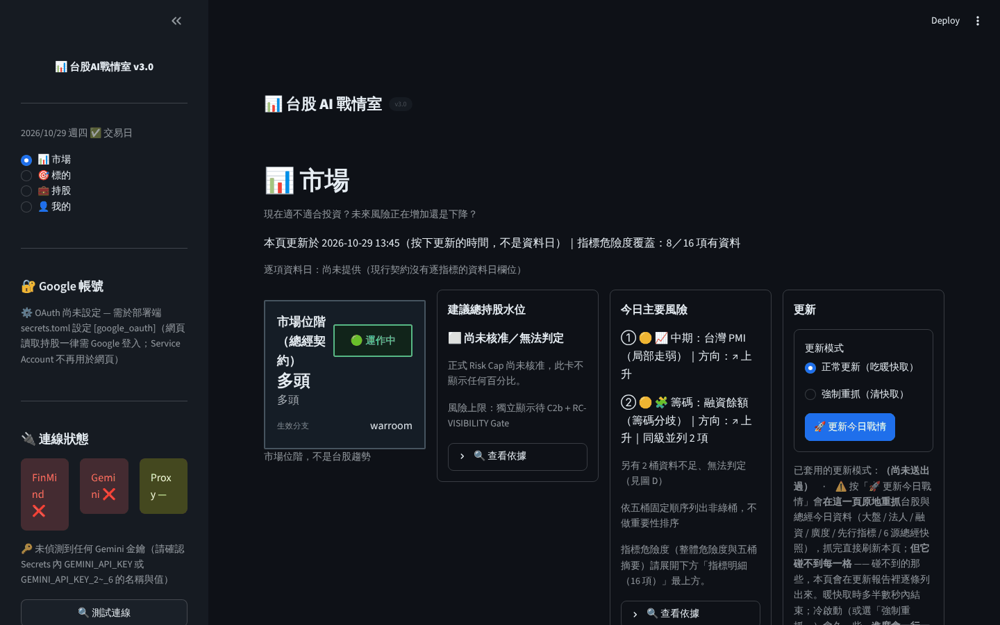
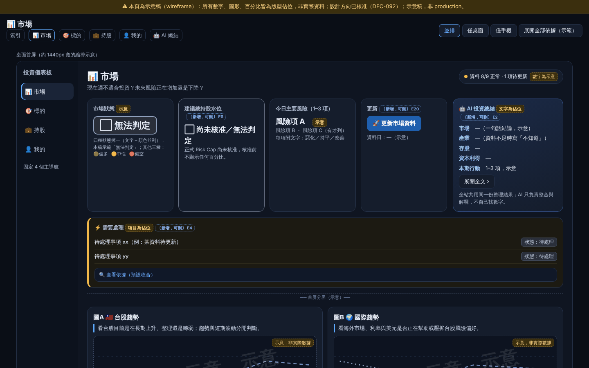
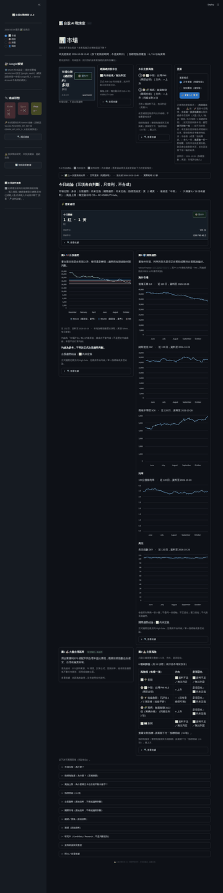
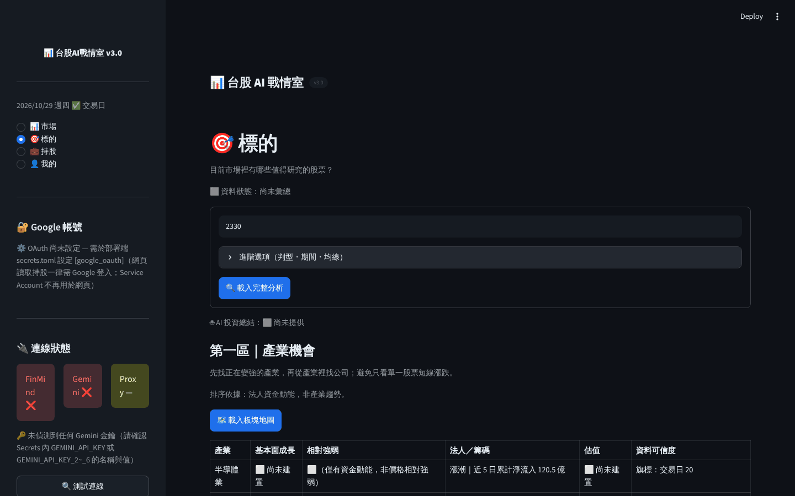
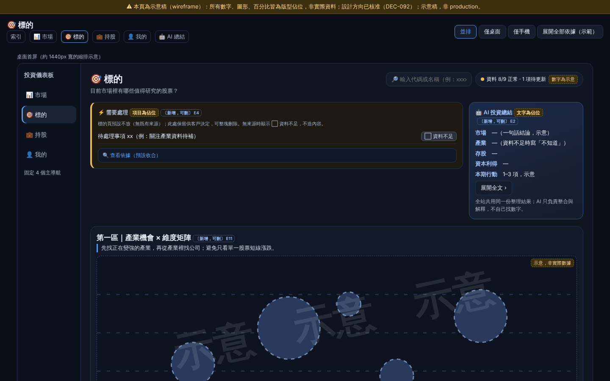
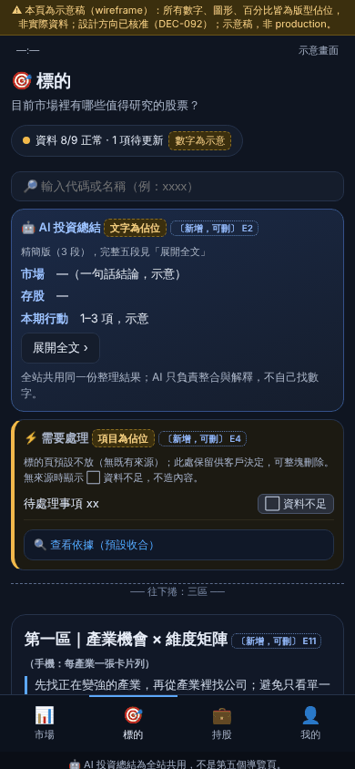
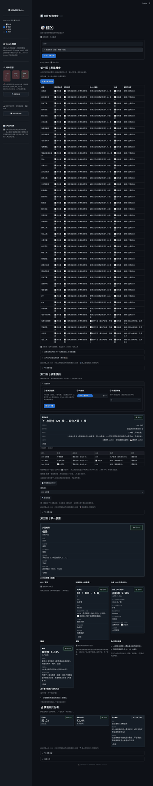
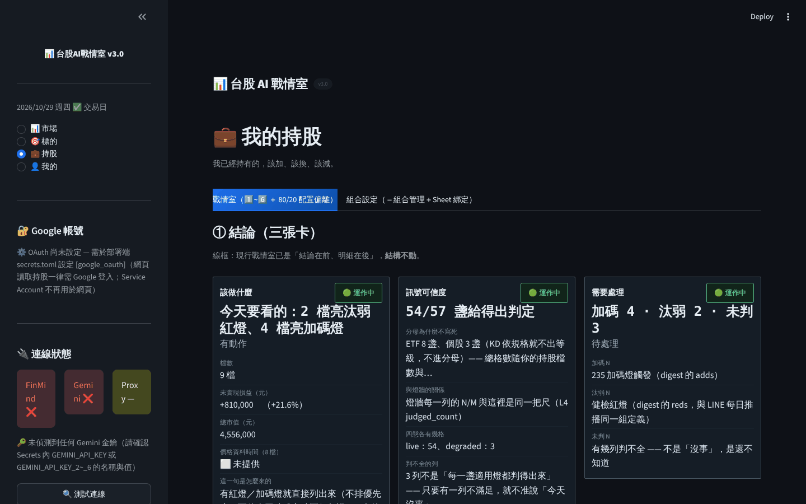
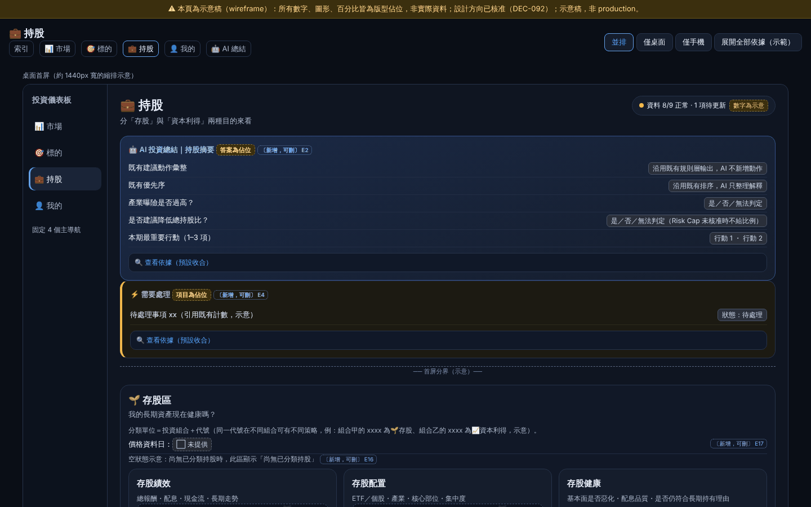
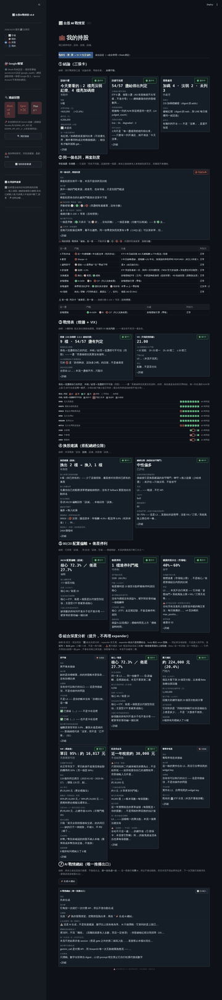

# Visual Gap Audit（Phase 1 baseline）— 三頁已載入狀態 vs 已核准 blueprint（📊 市場／🎯 標的／💼 持股）

- **狀態**：正式／現行（Phase 1 baseline 量測；Phase 4～6 Visual Fidelity Gate 的對照基準）
- **日期**：2026-10-29　**基準**：分支 `ccr-6eace3b6-0gglrs`（`src/` 與 main `978ecedc` 相同）
- **決策來源**：「visual gap audit」為客戶 DEC-109 三十 Phase 1 指定產出；量測方法、評分＝AI 總管內部（DEC-110）。
- **上位**：`CLAUDE.md` > `PROCESS.md` > `PROJECT_RULES.md`＋`docs/governance/UI_VISUAL_FIDELITY_GATE.md` > 最新有效 DEC > `docs/vnext/PRESENTATION_CONTRACT_vNext_2026-10-29.md`（契約）> 本檔。
- **來源**：Inv-3 visual gap audit（唯讀，repo 零改動）；量測工具已整理入庫 `tools/visual_fidelity/`（量測算法未改；前一輪撰寫組以入庫版重跑：blueprint 量測與墨水比例與 Inv-3 逐值相同，例 市場 contentH 1517、墨水 0.259／0.345、標的 0.475、持股 0.139；市場頁無更新報告變體手機全頁 8,054px，與 Inv-3 報告變體 8,125px 差在報告區塊，其餘未逐項比對）。
- **評分口徑**：下列 10 項評分是 Inv-3 依前一版（10 項）清單所打；Gate 現行為客戶 11 項＋補充 V1～V11（Gate §2）。新增的「A2 Primary Visual 是否突出」與 V 系列由 Phase 4～6 各頁 Gate 首次判定；本檔不補打分（避免無量測的評分）。
- **標記**：**FACT**＝量測／讀碼；**INFERENCE**＝推論（含全部評分）；**未驗**＝沙箱做不到。
- ⚠️ **揭露（`CLAUDE.md` §-2 規則 6）**：Inv-3 由單一調查組產出，**未經第二組獨立驗證**；評分為 INFERENCE；本檔轉錄亦為單組。高度數字依賴夾具；最可能**低估**真實狀況的是：真資料下標的候選表預設 50 列，該狀態**未渲染**。
- ⚠️ **R2 更正**：Inv-3 與前一版文件曾建議「L1 改 sparkline、大圖收進 expander」；依 DEC-109（每頁 1 Primary Visual 在第一屏、主圖外露 compact）改為「Primary 主圖外露但縮小、其餘合併／切換／下沉」。下文 Gaps 段已按此改寫。

---

## §0 方法與限制

- **Harness（FACT）**：`tools/visual_fidelity/harness_app.py` 跑**真 `app.py`**（含站殼、側欄、手機底部導覽；Streamlit 1.59.2，headless chromium），在 L3 層替換假資料，頁面 loader／builder 全走真程式：
  - 🎯 標的：`tests/uit_fakes.install`；playwright 依序點「🗺️ 載入板塊地圖 → 🎯 開始選股 → 🔍 查看此檔」。
  - 📊 市場：`get_allocation`／`get_macro_regime`／`get_twii_trend_view`（252 日）＋session 預置（`cl_data` 國際 5 系列各 120 日、`macro_info`、`mkt_info`、`macro_alerts`）。
  - 💼 持股：`get_holdings`（8 檔持有＋1 檔觀察）、`get_station_rows`（真 `build_station_rows`＋合成指標）、`fetch_vix`、換入候選、深度分析三支結果；gate 預置 `{"mode": SCOPE_WITH_BINDING}`。
- **座標**：app 的 y 為頁面絕對座標；mockup 的 y 相對於 mockup 框（`.desk .main`／`.phone .scr`）。可比較時另列「相對頁面 H2 的位移」（`+N`）。
- **墨水比例**（ink ratio）＝第一屏中文字字形＋圖表＋控制項覆蓋比例（6px 格點），**INFERENCE 級代理指標**；app 第一屏含 Streamlit 頂欄與站標帶，與 mockup 只能粗比。
- **未驗**：真外部資料；💼 按下 ⑦ AI（付費）後狀態；💼「組合設定」葉；收合中 expander 內容；候選表填滿預設 50 列（夾具 3～4 列）；mockup 換成真資料後的樣子；手機實機、Streamlit Cloud、`requirements.txt` floor 1.56。
- **夾具 bug 揭露**：持股頁第一次量測時 ④ 換股卡被夾具 bug（觀察清單 2454 沒給指標）弄成紅卡；已修正並重測，下列數字取自修正後。

### 跨頁 FACT：站殼吃掉第一屏上方約四分之一

頁面 H2 在 1440 與 390 寬度都起於 **y=223**（持股頁 207）；站標「📊 台股 AI 戰情室 v3.0」占 y 128–159。約占桌機第一屏（900px）25%、手機第一屏（844px）26%。→ 契約 §19 註、Migration Plan §7 Phase 3（站殼間距子項）。

---

## §1 📊 市場（已載入；更新報告為全成功版）

| 截圖 | App | Blueprint |
|---|---|---|
| desktop 1440 第一屏 |  |  |
| mobile 390 第一屏 |  |  |
| desktop 全頁（縮 25%） |  | — |

| 量測（FACT） | App 1440 | Mockup 1440 | App 390 | Mockup 390 |
|---|---|---|---|---|
| 全頁高度 | **5,719**（無報告：5,663） | 1,517 | **8,125** | 2,480 |
| Hero／KPI 卡 | y417（+194）。四卡不等高：位階 ≈213／水位 277／主要風險 504／更新 **641** | y91（+71），4 tile＋AI＝277 | 疊成一欄 **1,402px**（1.66 屏） | 2×2 tile，324 |
| 🚀 更新 CTA | 595 ✅ 首屏內 | 133 | **1,516**（首屏外） | 568 |
| 🤖 AI | 一行 caption，1,073 | hero 內卡片，91 | 1,883 | 121 |
| 今日結論句 | **1,221**（+998，首屏外） | 無獨立結論條 | 2,096 | — |
| ⚡ 需要處理 | 1,304 | 382 | 2,230 | 688 |
| 圖 A／B | 自 1,633 起；**6 張 `st.line_chart`，每張高 350**（桌寬 450／手機寬 326）；圖 B 卡單卡 **2,542**（桌）／**2,695**（手機），5 張分開的圖 | 2 個 svg，各 204（B 為一張合併圖） | 圖 A 在 2,560 | svg 128 |
| 圖 C／D | 4,191；D 為 6 列表格 386px（手機 668） | 1,043；D 為 6 列表格 | 6,099／6,362 | 1,646／2,005 |
| Expander | 18 個（底部 11＋卡內 7 個「🔍 查看依據」） | — | 同左 | — |
| 可見文字 | 58 元素／1,782 字；首屏 592 字 | 全頁 1,138 字 | 首屏 248 字 | — |
| 首屏墨水比例 | 0.218 | 0.259 | 0.312 | 0.345 |

部分失敗的報告變體會在結論句上方多一塊紅色 `st.alert`（桌 184px／手機 352px）——那是夾具刻意做的部分失敗步驟，不是 production 狀態。

**10 項評分（INFERENCE，Inv-3）**：1 第一屏結構 ❌（結論與 ⚡ 在首屏外、AI 不在 hero；手機只見位階卡與水位卡一部分）｜2 圖文比例 ❌（6 張大圖＋長文字卡）｜3 卡片密度 ❌（hero 卡 99／165／251 字 vs mockup 29–55；更新卡 188 字 caption）｜4 圖表尺寸 ❌（350 vs 204／128；圖 B 拆 5 張）｜5 空白比例 🟡（hero 213 vs 641 不等高）｜6 Top-N ✅（風險 1–3；圖 D 5 列）｜7 長文字下沉 🟡（更新卡 caption、風險卡指路句）｜8 Missing placeholder ✅（⬜ 尚未定義／⬜ 尚未核准；圖 C 零數值）｜9 CTA／結論首屏 ❌（桌 CTA 可見但結論不可見；手機兩者都不可見）｜10 Mobile ❌（hero 1,402px、圖 B 2,695px＝3.2 屏）

**Gaps → 契約 §12.1**：(a) Hero 4 張等高 tile 96–160px，更新卡 188 字 caption、水位卡與風險卡說明句移入摺疊；手機 2×2 ≤ 340px。(b) 結論句（1,221）與 AI（1,073）移進首屏。(c) 圖表：6×350 → **1 個 Primary 市場環境主圖**（compact ≤220／≤140，**外露**；台股／海外／利率／美元 switcher 或 small multiples 擇一）＋Secondary ≤3；大圖點開才出、一次一張（R2、契約 §2）。(d) 全頁：5,719 → ≤ 3,034（🟡 線）／理想 ≤ 1,972；手機 8,125 → ≤ 4,960／理想 ≤ 3,224。(e) 位階卡「生效分支 warroom」為工程字樣（C2b／Gate 為客戶自訂措辭，保留）。

---

## §2 🎯 標的（已載入：板塊地圖＋選股＋單一股票）

| 截圖 | App | Blueprint |
|---|---|---|
| desktop 1440 第一屏（夾具，4 產業） |  |  |
| mobile 390 第一屏 |  |  |
| desktop 全頁（真本地快取 41 產業，縮 25%） |  | — |

| 量測（FACT） | App 1440（夾具 4 產業） | App 1440（**真本地快取，41 產業**） | Mockup 1440 | App 390（4／41 產業） | Mockup 390 |
|---|---|---|---|---|---|
| 全頁高度 | 5,172 | **7,328** | 2,193 | 7,237／**14,139** | 3,185 |
| 搜尋＋🔍 載入完整分析 | 503 ✅ | 同左 | 頁首列 | 503 ✅ | 121 |
| AI | 一行 caption，575 | 同左 | hero 內卡片，91 | 575 | 卡片，162 |
| 第一區矩陣 | 799，高 269（5 列） | 高 **2,426**（**42 列，無 Top-N**） | 第一區共 776（svg 368） | 高 754／**7,657**（每產業卡約 190px） | 3 張產業卡 × 216 |
| 第二區 | 1,329 | 3,486 | 1,176 | 1,859／8,762 | 1,692 |
| 候選表 | `st.dataframe` 4 列／150px；預設 `DEFAULT_TOP_N=50`（FACT，讀碼） | 同左 | 3 列 | 同左 | 3 列 |
| 第三區 | 2,681；「判型結果」卡高 498 | 4,837 | 1,505；卡片 105–219px、11–60 字 | 3,696／10,599 | 2,059 |
| 圖表 | **0**（熱力圖／泡泡圖已移入 expander；EPS 圖「⬜ 尚未建置」） | 0 | 3 個 svg | 0 | 3 |
| 可見文字 | 1,814 字；> 80 字元素 7 個 | 3,885 字 | 993 字 | — | — |
| 首屏墨水比例 | 0.147 | 0.145 | 0.475 | 0.306 | 0.352 |

**10 項評分（INFERENCE，Inv-3）**：1 第一屏結構 🟡（搜尋、第一區標題與地圖鈕在首屏；AI 一行；⚡ 依 DEC-107 3A 不放，不算 gap）｜2 圖文比例 🟡（L1 無圖；熱力圖／泡泡圖下沉與 EPS 未建置已核准）｜3 卡片密度 ❌（「判型結果」卡 498px／88 字；健康度卡 8 欄以上）｜4 圖表尺寸 🟡（無過大圖，但 mockup 小圖也不在）｜5 空白比例 🟡（墨水 0.147 vs 0.475；大量 22px 單行 caption）｜6 Top-N ❌（矩陣列全部 41 產業；候選預設 50）｜7 長文字下沉 🟡（第二區卡面 4 句說明＋「此結果載入於…」）｜8 Missing placeholder 🟡（有 placeholder，但矩陣每列重複「⬜（僅有資金動能，非價格相對強弱）」）｜9 CTA 首屏 ✅｜10 Mobile ❌（真資料矩陣單一區塊 7,657px ≈ 9 屏）

> ⚠️ 依 DEC-109（契約 §2 B1：每頁 1 Primary 在第一屏）新讀法，第 2 項「L1 無圖」不再全數視為已核准：產業區需有 compact sector view（heatmap／Top-N bar，用既有矩陣資料）外露；DEC-107 降階的是**大圖**（熱力圖／泡泡圖全尺寸），compact view 在 Phase 5 落地（契約 §12.2）。此為撰寫組讀法。

**Gaps → 契約 §12.2**：(a) 矩陣 Top 5，其餘收進 expander；手機每產業卡 ~190px → ≤72px。(b) 每列重複的「僅有資金動能」說明改欄頭寫一次。(c) 候選：外露 Top 10 列（或 5 卡），完整表進 expander（L3 請求仍 50）。(d) 「判型結果」卡（498px）縮成 chip「🏢 個股 · 自動判型」，明細入摺疊。(e) 卡面工程字樣（FACT）：「本次條件 eps_high」「判型來源…（L2 判型」。(f) AI 一行 caption → 小卡。(g) 選股條件**維持 DEC-107 預設展開**；改為預設收合＋條件摘要 chip 與否＝Phase 5 線框待客戶拍板（契約 §22 W4）。

---

## §3 💼 持股（已載入：9 列，8 檔持有＋1 檔觀察）

| 截圖 | App | Blueprint |
|---|---|---|
| desktop 1440 第一屏 |  |  |
| mobile 390 第一屏 |  |  |
| desktop 全頁（縮 25%） |  | — |

| 量測（FACT） | App 1440 | Mockup 1440 | App 390 | Mockup 390 |
|---|---|---|---|---|
| 全頁高度 | **6,440** | 1,643 | **11,416**（13.5 屏） | 2,501 |
| 結構 | 兩個葉 tab（戰情室／組合設定）→ ①～⑦ 區段（「① 結論」在 393）；骨架與 mockup 不同 | AI 摘要卡（91）→ ⚡（348）→ 🌱 存股區（533）→ 📈 資本利得區（928）→ ⬜ 未分類（1,385） | ① 卡自 506 起 | AI 74 → ⚡ 342 → 存股區 487 |
| 卡片 | **18 張 v2 卡**，高 355–735px、每張 105–347 字；① 為 3 張（498／467／355） | 12 張，76–258px | 單欄，最高 705px | — |
| ⑦ AI | 按鈕在 **5,692** | 頁首，91 | 10,535 | 74 |
| 表格 | ② 兩套刻度 `st.dataframe` 9 列（325px）＋2 列（80px），常駐不可收合；③ 燈牆 HTML 9 列／263px（隨持股檔數增加） | 無 | 同左 | — |
| 圖表 | **0** | 5 張 mini svg（85–93px） | 0 | 5 |
| 未接線卡 | 再平衡 575px／197 字；葡萄串領息 393px／130 字 | — | — | — |
| 文字 | 4,464 字；> 80 字元素 **22** 個 | 912 字 | — | — |
| 可見文字中的工程字樣（瀏覽器計數） | 線框 ×6、L3 ×8、L0 ×6、SSOT ×5、digest ×3、expander ×3、widget ×2、L5 ×2、judged_count ×1 等 | 無 | — | — |
| 首屏墨水比例 | 0.216 | 0.139 | 0.290 | 0.368 |

**10 項評分（INFERENCE，Inv-3）**：1 第一屏結構 ❌（tab＋①～⑦，而非 AI → ⚡ → 三區）｜2 圖文比例 ❌（零圖表、4,464 字）｜3 卡片密度 ❌｜4 圖表尺寸 🟡（完全沒有圖；mockup mini 圖是否有資料源＝INFERENCE 未確認）｜5 空白比例 🟡（① 三卡 498／467／355 不等高）｜6 Top-N 🟡（燈牆列全部持股；刻度表固定 9 列）｜7 長文字下沉 ❌（①～⑦ 每區開頭「線框：…」caption；⑥ caption 199 字）｜8 Missing placeholder ❌（兩張未接線卡各一大段說明，含「實作住在 L5…widget key」）｜9 CTA／結論首屏 🟡（結論卡部分可見；AI 在 5,692）｜10 Mobile ❌（全頁 11,416px；單卡最高 705px）

**Gaps → 契約 §12.3**：(a) 骨架改為 AI 摘要 → ⚡（沿用既有 digest 加碼／汰弱／未判計數）→ 🌱／📈／⬜ 三區（blueprint 已核准方向；DEC-109 起不再待 PR #970 草稿核准，由 Phase 6 施工並過 Gate）。(b) 18 張卡（355–735px）→ ≤160px tile，說明移入摺疊。(c) 移除 L1／L2 所有「線框：」caption 與 L0／L3／SSOT／digest／expander 等字樣。(d) ③ 圖例收進 expander；② 兩套刻度常駐非摺疊**維持**（DEC-017 葉1 ②），改 L1 chip＋可展開與否＝Phase 6 線框待客戶拍板（契約 §22 W7）。(e) 未接線卡 575／393px → `⬜ 未接線` chip。(f) ⑦ AI 摘要出口移到頁首；付費 API gate 保留。

---

## §4 原始資料與重現

- 截圖（本檔引用）：`docs/vnext/`（PNG 256 色量化，單張 < 300KB；全頁長圖縮 25%；手機全頁長圖因體積未入庫，可用工具重產）。
- 冷啟動版本截圖（PR #970 草稿用）：已自本分支移除，稽核出處＝PR #970 commit `06a7a3e5`（`docs/vnext/ui_correction_assets/now_*`）。
- 重現：`tools/visual_fidelity/README.md`（harness 查詢參數 `?p=market&report=1`、`?p=target`（`&realflow=1`）、`?p=hold`）。原始 JSON 未入庫（夾具量測值，可重產）。
